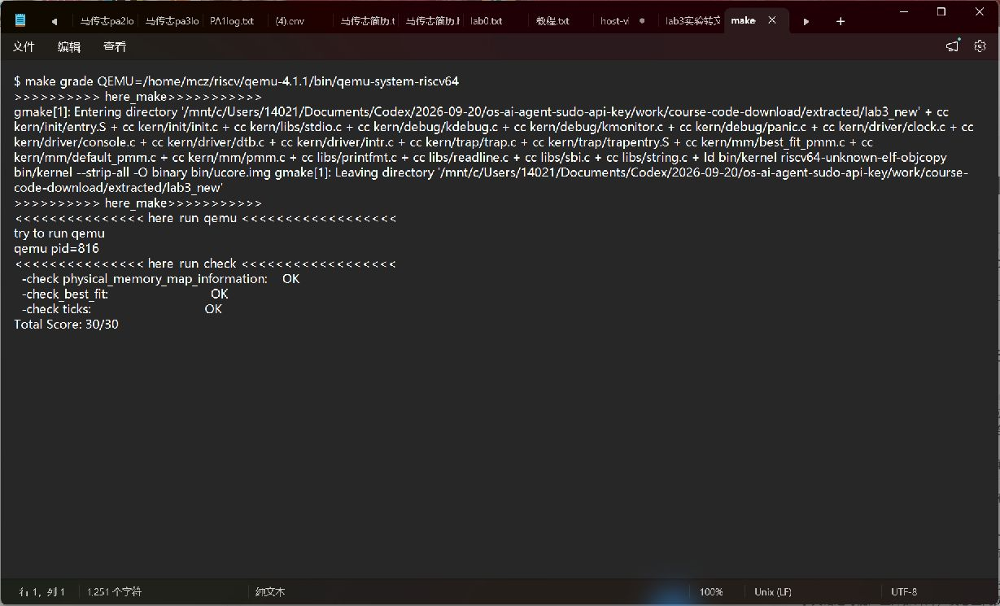
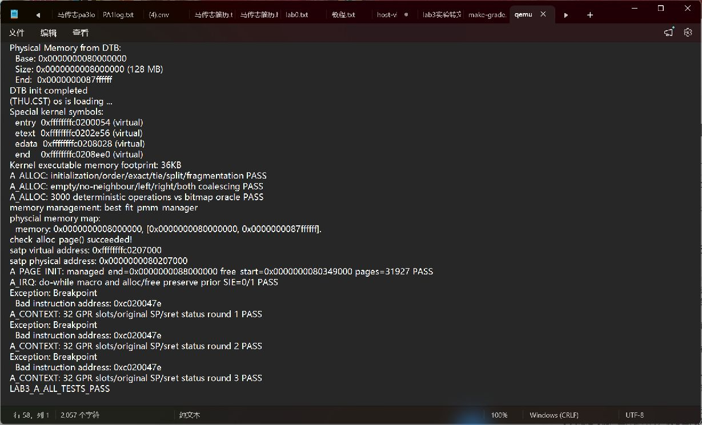
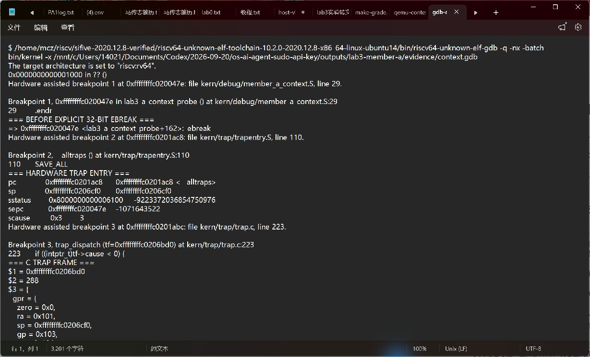
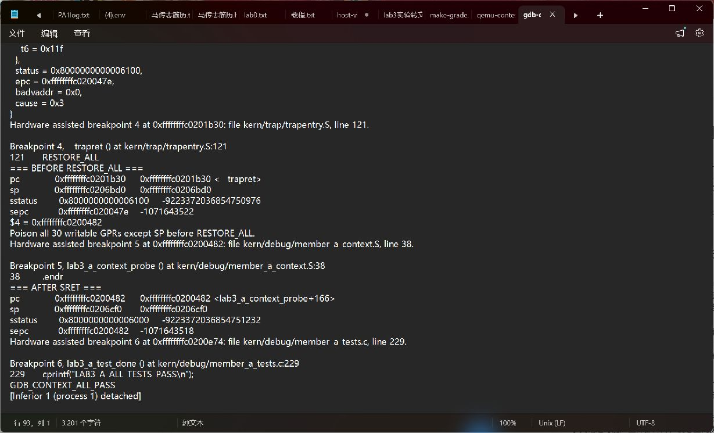

# Lab3：甲负责部分实验报告

成员：马传志，学号 2411788。当前实验角色：甲。验证日期：2026-10-28。

## 1. 任务范围与材料版本

本部分负责 Lab2 物理内存管理继承、Trap 汇编入口和上下文恢复的检查、实现与验证。中断分发、时钟统计和异常指令长度处理由其他成员负责。后文关于时钟和断点的运行结果，是为了验证甲的底层机制与现有处理函数可以衔接，不代表全部 Lab3 挑战已完成。

Lab3 基线来自本次提供的 `lab3_source_code_20261027.zip`。它的来源清单指向公开的 2025 年代码镜像，且包内 `RESTORE_ALL`、`__alltraps` 已有实现。因此，本次对汇编部分的工作是逐项核对、补充布局约束和进行实际验证，不将既有实现描述为本次从零编写的代码。原始输入已另行保留。

Lab2 继承来源已通过 `git fetch origin lab2` 核对，为小组仓库 `Skylar-Jiang/NKU-OS-2026` 的 `lab2` 分支，提交号 `8b06753cf99f2a1db3f7eda294ab56040d7c64c1`。此次查询时，它是该分支最新提交。其 Best-Fit、Page Init 算法作为本轮继承依据。

指导材料使用本次提供的离线指导书中“功能模块一：Trap 上下文恢复与 Trap 入口功能”，以及原子操作和报告要求章节。指导书包内记录的网页存档日期是 2026-10-13，不把压缩包文件名日期视为网页更新日期。

## 2. 完成内容与执行主线

| 文件 | 本次工作 |
| --- | --- |
| `kern/mm/best_fit_pmm.c` | 补齐描述符初始化、按地址插入、最小适配搜索、空闲页计数和相邻块合并；清理分配及合并后的过期长度字段；保留输入框架的两组自检代码 |
| `kern/mm/pmm.c` | 启用 Best-Fit；继承 Lab2 Page Init 的内存范围、描述符空间和保留区域检查；保留 Lab3 分配接口的中断保护 |
| `kern/mm/memlayout.h` | 补充与 Lab2 一致的物理内存上限及内核物理起点常量 |
| `kern/trap/trapentry.S` | 核对并保留恢复流程；说明 CSR 临时寄存器和 SP 的恢复顺序；明确 C 参数和调用关系；补充函数符号信息和本人成员标记 |
| `kern/trap/trap.h` | 增加编译期断言，检查保存区大小及关键字段偏移；结构体字段和接口不变 |
| `tools/grade.sh` | 仅将 CRLF 换行为 LF，解决 Linux shell 解析失败；判分内容不变 |

内核启动后先清零 BSS 并提取 DTB 内存信息，建立 Trap 入口，初始化物理内存管理，然后设置时钟事件并开启中断。Trap 发生时，硬件记录异常原因、返回位置和部分状态，并跳到 `stvec` 指定的 `__alltraps`。汇编保存寄存器，形成 Trap frame（中断现场结构），把其地址放入 `a0`，调用 C 函数 `trap(tf)`。C 层完成分发和处理后，汇编恢复现场，最后执行 `sret`。

```text
DTB 内存信息 → Page Init → Best-Fit 初始化和自检
                                      ↓
硬件 Trap → __alltraps → SAVE_ALL → trap(tf)
                                      ↓
原执行流 ← sret ← RESTORE_ALL ← __trapret
```

## 3. Lab2 继承与物理内存管理

### 3.1 Page Init 的边界

DTB 提供内存起点和长度，首先检查长度非零、地址加法不溢出，以及内核位于可管理区域内。本框架默认允许管理到物理地址 `0x88000000`，所以实际管理终点取 DTB 终点和该常量的较小者，再向下按页对齐。这是当前实验配置的管理上限，并不是 Sv39 的体系结构上限。

`npage` 是物理页号的排他上界；`nbase = DRAM_BASE / PGSIZE`，真正的描述符数量是 `npage - nbase`。描述符数组从内核映像结束之后按页对齐放置，必须先检查剩余内存是否容得下整个数组。初始化时先将全部页标为保留页，再将描述符数组之后的完整页交给分配器。因此 OpenSBI、内核映像、描述符数组及相关对齐空间不会进入空闲链表。

原输入代码把物理地址上界与虚拟地址常量 `KERNTOP` 比较，且后续仍可能使用未截断的 DTB 终点。继承小组 Lab2 的实现后，物理地址始终与物理上限比较，描述符数量和空闲页区间使用相同的终点。

### 3.2 Best-Fit 的规则

空闲链表按页描述符地址递增排列，只把空闲块头页挂入链表。头页的 `PG_property` 为 1，`property` 表示连续空闲页数。分配请求到来后，选择所有足够大的块中最小的一块；大小相同则选择地址较低的块。找到精确大小的块后可以立即结束搜索。若有剩余页，则把剩余块头插回原位置。

释放合法的已分配区间时，先重置页描述符，再按地址插入，先与前块合并，再用更新后的块头与后块合并。相邻判断使用 `前块头 + 前块页数 == 后块头`，这里指针加法的单位是一个 `struct Page`，对应一个物理页。链表相邻本身不代表物理连续。

当前接口依赖调用者传入合法、未重复释放的分配区间；`PG_property` 不是用于识别任意重复释放的完整分配位图。本次测试在合法接口约束内验证算法，不声称支持任意错误指针或任意区间释放。

### 3.3 Lab3 中的临界区

Lab3 的 `alloc_pages()`、`free_pages()`、`nr_free_pages()` 保留 `local_intr_save()` 和 `local_intr_restore()`，防止同一 hart 的中断处理在链表更新中途重入。不能把 Lab2 中直接调用分配器的包装函数整体覆盖过来。这种关中断保护不等价于多核互斥锁，不能据此声称分配器已具备多核并发安全性。

## 4. Trap frame 与汇编恢复

### 4.1 保存区布局

RV64 中一个寄存器槽是 8 字节，Trap frame 共 36 槽、288 字节。

| 槽位 | 字节偏移 | 内容 |
| --- | --- | --- |
| 0 | 0 | x0 的零值，占位以保持寄存器编号对应 |
| 1 | 8 | x1 / ra，原返回地址 |
| 2 | 16 | x2 / sp，Trap 发生前的栈指针 |
| 3～31 | 24～248 | 对应通用寄存器 |
| 32 | 256 | sstatus 快照 |
| 33 | 264 | sepc，C 层可修改的返回 PC |
| 34 | 272 | sbadaddr/stval，辅助诊断地址 |
| 35 | 280 | scause，Trap 原因 |

头文件中的编译期断言检查通用寄存器区大小、SP 位置、四个 CSR 字段位置以及整体大小。它不会修改 `struct trapframe`，而是在布局意外变化时使构建失败。

### 4.2 为什么最后恢复 SP

`SAVE_ALL` 先把原 SP 放入 `sscratch`，再在当前内核栈上分配保存区。通用寄存器保存后，借助已经保存过的 `s0`～`s4` 读取原 SP 及 CSR。原 SP 最终保存在槽 2，而不是用已经减去 288 的当前 SP 作为原值。

恢复期间所有 `LOAD` 都依赖当前 SP 指向 Trap frame，因此 x2 必须最后恢复。若提前恢复，就会从原栈位置错误地读取后续寄存器。对于 `s1`、`s2`，先用它们读回 `sstatus`、`sepc` 并写入 CSR，再恢复它们各自的原通用寄存器值，避免临时值覆盖现场。

`x0` 恒为零，不需要恢复；`scause` 和 `stval` 是诊断快照，不是本实验返回流程需要回写的 CSR。`sepc` 从 Trap frame 读取，使用 C 层处理后的值；底层返回代码不统一给它加 2 或加 4，因为时钟中断和不同长度的异常指令需要不同的返回位置处理。

### 4.3 C 调用约定与 sret

`mv a0, sp` 使第一个 C 参数指向当前 Trap frame。调用 C 之前，原 `a0`、`ra` 已被保存，调用过程可以使用这些寄存器。288 是 16 的整数倍，原内核栈对齐正确时，保存现场后仍满足 C 调用的栈对齐要求。C 函数返回后进入 `__trapret`，恢复完成后执行 `sret`。

`sret` 根据保存的 `SPP` 返回原特权级，并根据 `SPIE` 恢复 `SIE`，PC 取自 `sepc`。状态 CSR 的硬件管理位会在返回时变化，不能把“整个 sstatus 与进入 Trap 前逐位相同”当作验收标准。

本机 QEMU 4.1.1 的 `target/riscv/op_helper.c:74–101` 中，`helper_sret()` 在恢复 SIE 后明确把 SPIE 清为 0。该历史实现与较新实现中 SPIE 置 1 的行为有差别。本次按实际 QEMU 版本检查该位，并重点核对 SIE、SPP、返回 PC 和通用寄存器；测试没有通过改内核来掩盖这个版本差异。

本框架当前使用内核栈处理来自 S 态的 Trap。本次没有实现 U 态与内核栈切换，也没有将关中断下的顺序 Trap 测试等同于嵌套中断测试。

## 5. 模块 SPEC 与 Prompt

以下是本轮实现与核对所采用的模块约束，原始用户请求另保存在 `prompt.md`。这些约束是本轮整理的设计说明，不冒充此前不存在的聊天原文。

```text
[PROMPT]
完成甲负责的 Lab2 内存管理继承和 Lab3 Trap 汇编入口、上下文恢复验证。
检查输入包已有实现，保留正确部分，补齐缺失部分，并提供可重复的验证记录。

[RELY]
以用户提供的 Lab3 源码包为基线，Lab2 算法参考小组 origin/lab2@8b06753。
目标为 RV64、S 态内核、QEMU 4.1.1；SAVE_ALL 和 struct trapframe 已给定。
调用者保证 alloc/free 参数合法，Trap 进入前内核栈有效且按 ABI 对齐。

[GUARANTEE]
空闲块按地址有序；Best-Fit 返回最小足够块；拆分、合并和计数一致。
保留 Lab3 临界区保护。恢复后的 SP、通用寄存器和 PC 与 Trap frame 对应。
trap() 接收到当前 Trap frame；sret 恢复应有的特权状态和中断使能状态。

[SPECIFICATION]
Page Init 检查内存区间、内核映像和描述符数组边界，并按页对齐。
RESTORE_ALL 按现有槽位恢复 sstatus/sepc 和通用寄存器，SP 最后恢复。
__alltraps 保存现场后通过 a0 传递 SP，调用 trap，再走 __trapret/sret。
不修改 SAVE_ALL、结构体字段、函数签名及其他成员的处理中断/异常函数。
原分配器自检与评分规则保持原义；额外测试只在独立构建中注入。
用真实 QEMU、GDB、原评分脚本验证，保存完整结果和失败原因。
```

## 6. 验证方法与实际结果

环境为 Ubuntu 22.04 WSL、SiFive RISC-V GCC 10.2.0、RISC-V GDB 10.1 系列、QEMU 4.1.1。完整结果保存在 `../code/tools/member_a/evidence/results.json`。

| 验证项目 | 方法 | 结果与记录 |
| --- | --- | --- |
| 默认内核编译 | 原 Makefile，`-Wall -Werror -O2 -g` | 通过；`build-default.log` |
| 原评分脚本 | `make grade`，保留原判分逻辑 | 30/30；`make-grade.log` |
| 定时中断返回 | GDB 检查入口、C 参数、保存区、返回点及全部 GPR | 通过；`gdb-timer.log` |
| 持续中断 | 默认内核连续输出十行 `100 ticks` 后关机 | 通过；`qemu-timer.log` |
| Best-Fit 定向测试 | 空链表、乱序注册、精确匹配、相同大小、拆分、碎片不足 | 通过；`qemu-context.log` |
| 空闲块合并 | 无相邻、仅左、仅右、左右同时相邻、空表插入 | 通过；`qemu-context.log` |
| 分配算法对照 | 三个固定种子，合计 3000 次操作，对照独立位图模型 | 全部一致；同上 |
| 现场恢复 | 显式 32 位 ebreak，寄存器设不同值，连续执行三轮 | 通过；同上 |
| GDB 强制扰动 | 返回前故意改写除 x0/SP 外的 30 个 GPR，再检查恢复值 | 全部恢复；`gdb-context.log` |
| 中断保护 | 验证原 SIE=0/1 时 alloc/free 和 save/restore 保留原状态 | 通过；同上 |
| 内存配置 | 64 MiB / 128 MiB / 256 MiB；检查保留页与管理上限 | 全部通过；`memory-64M.log`、默认日志、`memory-256M.log` |
| 共享代码完整性 | 比对 SAVE_ALL、输入自检、trap.c、init.c、clock.c | 核对通过；评分脚本只规范换行 |

位图模型独立计算最小可用连续区间，并在每次操作后核对返回地址、空闲总页数、链表顺序、双向连接和块头标记。它可以识别“误写成 First-Fit 但总页数仍正确”、漏合并、重复挂链以及计数错误等问题。

GDB 断点使用 `hbreak *符号`，观察的是指令地址而非可能位于函数序言之后的源码行。定时中断入口原因码为 `0x8000000000000005`；断点异常为 `3`。默认内核一次观测中原 SP 为 `0xffffffffc0204ff0`，保存区地址为 `0xffffffffc0204ed0`，差为 `0x120`，即 288 字节。地址随构建可能变化，应以每次符号和寄存器为准。

隔离测试会增加代码体积，因此测试内核的启动页表位置与默认内核不同。默认内核仍通过附件评分脚本中对启动页表地址的检查；测试构建中的地址变化不能直接视为页表错误。

### 6.1 运行记录截图

下图均为真实运行日志在 Windows 记事本中的原生窗口截图，原始文本同时保留；它们不是现场手动键入命令的终端截图。现场手动复现步骤见 `gdb_manual.md`。



图1：原评分脚本的内存信息、Best-Fit 与时钟检查均通过。



图2：定向分配测试、3000 次位图对照以及三轮显式断点异常后的现场检查通过。



图3：GDB 观察断点异常进入统一入口，并将 288 字节保存区传入 C 层。



图4：在恢复前改写寄存器后，GDB 检查恢复完成并输出 `GDB_CONTEXT_ALL_PASS`。

## 7. 实际问题与修复记录

1. 输入源码中 Best-Fit 的多个位置为空，搜索部分仍按第一个可用块结束；内核又默认选择 First-Fit。补齐代码并切换管理器，避免运行成功却没有验证目标算法。
2. 输入 Page Init 混用物理终点和虚拟常量。继承远端已核实的 Lab2 边界处理，保留 Lab3 的关中断包装。64 MiB 和 256 MiB 配置分别检验向下缩减和上限截断。
3. 第一次运行评分脚本出现 shell 语法错误，原因是压缩包中的 CRLF 换行。只把脚本换行规范为 LF，随后原脚本取得 30/30。初始错误保存在 `initial-grade-crlf-error.log`。
4. 第一版 GDB 检查直接对 `$sp` 取模，GDB 将它视为指针，报算术参数类型错误。改为显式转成无符号整数后计算对齐；该问题在验证脚本，不在内核。记录见 `initial-gdb-expression-error.log`。
5. 初版验证假定返回后 SPIE 必为 1，与 QEMU 4.1.1 结果不符。检查其 `helper_sret()` 后确认模拟器会清零该位，改为按版本验证；现场恢复实现未因此改写。初始观测见 `qemu411-spie-observation.log`。

这些是本轮实际遇到和核实的问题，不把预设问题写成已经发生的 AI 代码缺陷。

## 8. 原理对应与思考题

**为什么 Trap 要保存调用者保存寄存器？** Trap 可以在任意指令之间发生，被打断代码并没有按照 C 调用约定主动保存临时值。因此 Trap 入口要保存整个整数执行现场，而不只保存 C 约定中的被调用者保存寄存器。

**硬件已经保存了什么？** 硬件写入 sepc、scause、stval 等状态，并更新 SPP、SPIE、SIE 后跳到入口；它没有自动把全部通用寄存器压入内核栈。后者由 SAVE_ALL 完成。

**为什么 `local_intr_save` 使用 `do { ... } while (0)`？** 它把多条宏语句组成一个语法上的单语句，并要求调用处正常写分号，因此可以安全地放在 `if (...) 宏; else ...` 中；条件 0 使宏体只执行一次。它不是循环等待中断的代码。单纯用花括号代替时，调用处的分号可能打断 if/else 的结合。

**为什么还要记录原先是否开中断？** 临界区结束后应恢复调用者原来的状态。若入口已经关中断，退出时无条件开中断会破坏外层临界区；若入口开着中断，退出后永久关闭则会阻断后续时钟处理。

**如何说明原子性和互斥？** 保存现场解决被打断代码的状态恢复，临界区保护解决共享数据结构的修改完整性。两者有关联，但不能互相替代。这里只在单 hart 中使用关中断保护；多 hart 还需要锁和相应内存顺序约束。

**本次没有覆盖哪些完整 OS 机制？** 用户态进程的独立内核栈切换、完整系统调用参数校验、抢占调度、完整嵌套中断策略、浮点/向量上下文管理，以及多核中断与锁。这些都是后续设计需要补充的内容。

## 9. 集成边界

甲负责部分已完成并验证。原 `trap.c` 中仍有输入包自带的历史成员编号、固定 `epc += 4`、部分未实现异常分支和 RV64 地址使用 `%x` 打印等问题，需乙、丙根据当前指导书完善。甲的额外异常测试显式使用 32 位 ebreak，因此不构成 `c.ebreak` 或完整 Challenge 3 的验收。

整组集成后应重新运行默认内核、评分脚本及额外验证。原评分脚本目前总分 30，仅核对其列出的三类输出；得到满分不意味着它覆盖所有异常长度、未知原因分支和挑战任务。


## 甲部分：现场手动调试与讲解步骤

以下使用本机已经安装的 Ubuntu、RISC-V 工具链和 QEMU 4.1.1。先做评分演示，再结束评分进程并做 GDB 演示。不要在一个内核正被调试时清理或重新构建该内核。

### 1. 打开代码和 Ubuntu

VS Code 打开下面文件夹：

```text
C:\Users\14021\Documents\Codex\2026-09-20\os-ai-agent-sudo-api-key\work\course-code-download\extracted\lab3_new
```

重点打开 `kern/trap/trapentry.S`、`kern/trap/trap.h`、`kern/mm/pmm.c`、`kern/mm/best_fit_pmm.c`，并对照本手册讲解。

打开两个 Windows Terminal 或 VS Code 终端，在每个 PowerShell 终端先输入：

```powershell
wsl -d Ubuntu-22.04
```

看到 `mcz@...$` 后，在两个 Ubuntu 终端都执行：

```bash
export PATH="/home/mcz/riscv/sifive-2020.12.8-verified/riscv64-unknown-elf-toolchain-10.2.0-2020.12.8-x86_64-linux-ubuntu14/bin:$PATH"
cd /mnt/c/Users/14021/Documents/Codex/2026-09-20/os-ai-agent-sudo-api-key/work/course-code-download/extracted/lab3_new
```

第二个终端用于调试 RISC-V 客体内核，因此要使用 `riscv64-unknown-elf-gdb`。本演示不调试 QEMU 自身的 x86_64 实现，不需要将宿主 GDB 连接到 QEMU 进程。

### 2. 先演示评分

终端一输入：

```bash
make grade QEMU=/home/mcz/riscv/qemu-4.1.1/bin/qemu-system-riscv64
```

本轮实际输出为 `Total Score: 30/30`。可以这样讲：

> 这里运行的是附件自带的评分脚本。它检查默认内核的内存信息、Best-Fit 自检和时钟输出。这份脚本共30分；我们另外增加了寄存器现场和分配器边界验证，因为仅凭这30分不能证明所有Trap行为都正确。

### 3. 终端一启动待调试内核

```bash
make -j4
/home/mcz/riscv/qemu-4.1.1/bin/qemu-system-riscv64 \
  -machine virt -m 128M -nographic -bios default \
  -device loader,file=bin/ucore.img,addr=0x80200000 \
  -S -gdb tcp:127.0.0.1:12345
```

窗口暂时没有正常启动输出是因为 `-S` 让 CPU 在开始执行之前暂停。`-gdb` 在12345端口提供客体调试接口。如果端口被已有进程占用，先结束自己之前启动的调试实例，或者在两个终端改用同一个空闲端口；不要直接结束来源不明的进程。

### 4. 终端二连接并停在 Trap 入口

```bash
riscv64-unknown-elf-gdb -q bin/kernel
```

随后在 `(gdb)` 中逐条输入：

```gdb
set pagination off
set architecture riscv:rv64
target remote :12345
hbreak *__alltraps
continue
```

继续后内核初始化并开启时钟；第一次时钟 Trap 会停在入口。输入：

```gdb
info registers pc sp sstatus sepc scause
set $old_sp = $sp
set $old_epc = $sepc
set $old_ra = $ra
set $old_a0 = $a0
```

讲解：

> scause 的最高位为1表示中断，剩余原因码5是S态时钟中断。sepc记录被打断的位置。当前还没有执行SAVE_ALL，SP仍是被打断时的值。硬件完成了CSR记录和入口跳转，但没有替我们把通用寄存器保存到栈上。

### 5. 查看传给 C 的保存区

```gdb
delete breakpoints
hbreak *trap
continue
set $tf_addr = $a0
p sizeof(struct trapframe)
p/x $tf_addr
p/x (unsigned long long)$old_sp - (unsigned long long)$sp
p/x *(struct trapframe *)$tf_addr
p/x ((struct trapframe *)$tf_addr)->gpr.sp
p/x ((struct trapframe *)$tf_addr)->gpr.ra
p/x ((struct trapframe *)$tf_addr)->gpr.a0
```

应看到结构体大小288、原SP与当前SP之差为 `0x120`，保存的 `gpr.sp` 等于 `$old_sp`，保存的 ra/a0 也与此前记录一致。GDB可能把 `trap` 的地址显示为内联的 `trap_dispatch`，以 `hbreak *trap` 的指令地址和当前 a0/SP 为准。

讲解：

> a0是C函数的第一个参数，值就是当前Trap frame地址。我们可以把它强制转换为struct trapframe指针查看。RV64中36个槽各8字节，因此保存区是288字节。原SP单独存放在槽2，恢复时不能把当前保存区SP误当成原SP。

### 6. 查看恢复顺序

```gdb
delete breakpoints
hbreak *__trapret
continue
p/x ((struct trapframe *)$tf_addr)->epc
info registers sp sstatus sepc
x/40i $pc
```

反汇编中应看到先加载保存的状态和返回PC并写入CSR，再恢复通用寄存器，最后恢复SP并执行 `sret`。

若老师要求单步，可输入：

```gdb
display/i $pc
si
si
si
si
info registers s1 s2 sstatus sepc
```

每次 `si` 执行一条机器指令，可与左侧汇编对应。继续单步时注意最后一次SP加载会使SP回到原栈位置。s1/s2用于临时装载CSR后，还会恢复为原通用寄存器值。

### 7. 检查 sret 后状态

无论上一步是否执行了少量单步，都可以继续：

```gdb
delete breakpoints
hbreak *$old_epc
continue
info registers pc sp ra a0 sstatus sepc
p $sp == $old_sp
p $ra == $old_ra
p $a0 == $old_a0
```

时钟中断不需要跳过指令，返回PC应等于原 `$old_epc`，SP、ra、a0的比较应为1；本轮额外测试还自动比较了全部通用寄存器。

讲解：

> 对时钟中断，C处理程序没有修改返回PC，所以sret回到原位置。SIE根据SPIE恢复，后续时钟中断才能继续触发。sstatus中的SPP等硬件管理位会变化，不要求整个CSR逐位不变。本机QEMU4.1.1还存在返回时清零SPIE的历史行为，报告里保留了源码核对记录。

最后输入：

```gdb
delete breakpoints
detach
quit
```

终端一继续运行，十行 `100 ticks` 后关机。

### 8. 展示更严格的异常现场测试

完整验证脚本在 `tests/run_validation.py`。它会在独立的 `validation/` 目录构建测试内核，默认源码中的 init.c、trap.c 不会被注入测试代码。复现命令：

```bash
python3 /mnt/c/Users/14021/Documents/Codex/2026-09-20/os-ai-agent-sudo-api-key/outputs/lab3-member-a/tests/run_validation.py
```

它先用纯汇编给30个可写通用寄存器设置不同值，保持有效SP，执行显式32位ebreak；GDB在恢复前故意将这些寄存器改成错误值，随后检查全部恢复结果。同时C测试连续执行三轮异常，检查最终快照和状态。该测试验证底层保存恢复，不包含16位c.ebreak挑战。

现场若要求手动展示该测试，先将两个终端的工作目录改为：

```bash
cd /mnt/c/Users/14021/Documents/Codex/2026-09-20/os-ai-agent-sudo-api-key/outputs/lab3-member-a/validation
```

用第3节的QEMU命令启动，再用GDB连接。第一次断点设在 `hbreak *lab3_a_probe_trap`，记录寄存器后删除该断点，再停在 `__alltraps`、`trap`、`__trapret`。处理后的EPC应为 `lab3_a_probe_after`。停在该标签后检查ra为0x101、gp为0x103、tp为0x104等原值，SP为记录的原值。测试用的ebreak是32位，因此本轮PC前进4字节。

可以讲：

> 这里没有只观察最终输出，而是同时验证“保存的值正确”和“恢复时确实使用了保存值”。恢复前主动破坏寄存器，能够发现遗漏恢复的情况。虽然测试含有断点异常处理，但16位指令长度判断和Challenge3仍由丙单独验收。


## 仓库内复现入口

在Ubuntu/WSL中，进入本仓库根目录，执行：

```bash
LAB3_TOOLBIN=/本机交叉工具链/bin LAB3_QEMU=/本机QEMU4.1.1路径 python3 code/tools/member_a/tests/run_validation.py
```

验证脚本自动定位code目录，把隔离构建和新日志写入仓库根目录旁的`.lab3-member-a-verification`目录；原验证记录在code/tools/member_a/evidence中。甲部分已完成，本报告尚不代表乙、丙或整组Lab3的最终验收。
