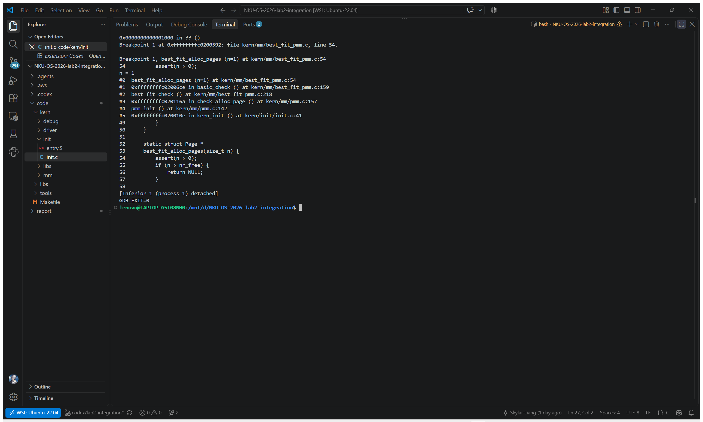
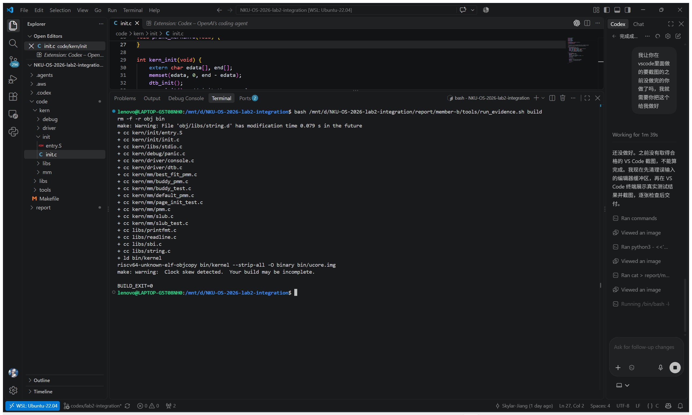
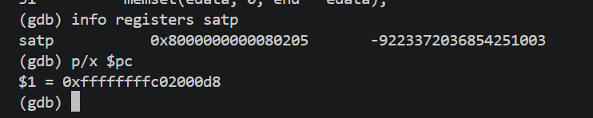
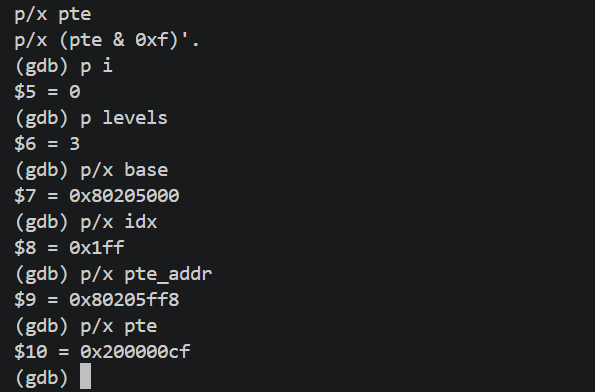
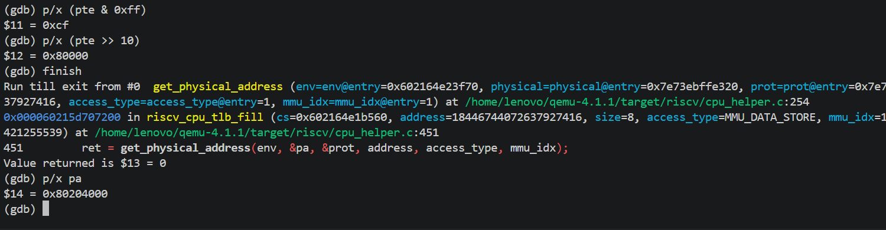
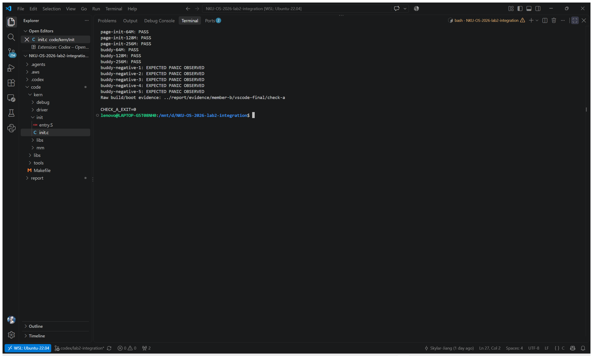

# Lab 2：物理内存和页表——乙负责部分

> 记录日期：2026-10-16。成员乙完成 Best-Fit、简化 SLUB、SLUB 测试、相关 QEMU/GDB 证据和本节报告。学号尚未提供，乙负责的源码注释保持为 `//lab2 function2-2 YOUR CODE`。

## 负责范围和协作边界

本节的代码范围为 `kern/mm/best_fit_pmm.c`、`kern/mm/slub.c`、`kern/mm/slub.h`、`kern/mm/slub_test.c`，以及 `kern/init/init.c` 中的两行初始化/测试接入。`pmm.c` 的标准配置已经由集成提交选择 `best_fit_pmm_manager`；Page Init、Buddy、First-Fit、评分脚本和 Makefile 未在本次检查中改动。启动顺序为：

```text
kern_init -> pmm_init -> slub_init -> slub_test
```

SLUB 测试位于 `pmm_init()` 完成后，此时物理页管理器已经注册空闲页。`slub_test()` 在最后检查 `nr_free_pages()` 恢复到进入测试前的值；本次实际 QEMU 串口日志已经到达 `slub_check() succeeded!`，因此不增加配置开关，也不修改 `init.c`。这种接入在当前启动阶段不会留下页分配状态；如果将来在有活动对象或多核并发的运行期调用，则应把自测改为独立调试配置，而不是依赖当前启动时机。

### 实际三人分工 Prompt

```text
[PROMPT]
任务：检查 Lab 2 实验源码及手册，确定全部基础、进阶及 QEMU 调试任务的三人分工。
操作要求：只分析源码，不修改文件。
输出要求：给出三人分工、涉及文件、工作量及执行顺序。
[RELY]
以实际工程源码、实验手册及 lab2、YOUR CODE 标记为依据。
[GUARANTEE]
必须覆盖 page_init、First-Fit、Best-Fit、Buddy、SLUB、QEMU+GDB 调试及实验报告。
[SPECIFICATION]
Pre-Condition：已获得 Lab 2 源码及实验手册。
Post-Condition：形成完整、合理的三人分工表。
Requirements：
工作量尽量均衡，明确每人任务、涉及文件及依赖关系，避免多人修改同一文件造成冲突，不遗漏任何必做、进阶及分支任务，本阶段不编写或修改代码，实验报告三人各自完成自己的部分
```

分工后的乙负责范围没有与甲的 `page_init`、Buddy 文件重叠；与丙的 First-Fit 分析和 TLB 调试证据也保持独立。

## Best-Fit 连续物理页分配

### SPEC 与实际 Prompt

Best-Fit 的接口由 `struct pmm_manager` 约束。管理器初始化空闲链表；`init_memmap` 把一段可用页登记为块头；`alloc_pages(n)` 在空闲块中选择 `property >= n` 且 `property` 最小的块；`free_pages(base,n)` 按地址插入、先前向后合并相邻块；`nr_free_pages()` 返回总空闲页数。`best_fit_pmm_manager` 把这些回调注册给 PMM 框架。

```text
[PROMPT]
完成 Lab 2 的 Best-Fit 连续物理页分配器，直接编写代码。
[RELY]
参考 default_pmm.c、best_fit_pmm.c、pmm.h、memlayout.h 和 libs/list.h，严格遵循现有 pmm_manager 接口及实验手册要求。
[GUARANTEE]
1. 只修改 kern/mm/best_fit_pmm.c。
2. 保留 //lab2 function2-2 YOUR CODE 标记。
3. 不修改原有 basic_check()、best_fit_check()。
4. 不修改甲负责的 pmm.c，也不修改其他组员文件。
5. 不修改评分脚本，不执行编译、测试、提交或推送。
[SPECIFICATION]
Pre-Condition：First-Fit 已实现，Best-Fit 只有原始框架和测试函数。
Post-Condition：完成可注册的 best_fit_pmm_manager。
Requirements：
1. 实现初始化、空闲块登记、页分配、页释放、空闲页统计和管理器注册。
2. 分配时选择满足请求且大小最小的空闲块。
3. 正确处理空闲块拆分、相邻块合并、链表维护及 Page.property、nr_free 更新。
4. 保证与原有测试接口兼容。
5. 使用简短中文注释，保持原有代码风格。
完成后列出修改文件和实现函数，等待我自行编译运行。
```

### 当前实现核对

`best_fit_init()` 初始化 `free_list` 和 `nr_free`。`best_fit_init_memmap()` 清除登记页的保留标志和属性，设置首个块头的 `property=n` 与 `PageProperty`，再按页描述符地址递增插入链表。`best_fit_alloc_pages()` 完整遍历空闲链表，保留满足条件的最小块；块大于请求时，把余下的 `page+n` 作为新块头插回原位置，最后减少 `nr_free`。`best_fit_free_pages()` 先逐页恢复页面状态，按地址插入块头，再分别检查前块和后块是否物理相邻并合并。`basic_check()`、`best_fit_check()` 的框架内容未改动。



图中断点命中 `best_fit_alloc_pages(n=1)`；调用栈来自 `best_fit_check()` 的 `basic_check()`。截图同时显示 `n > nr_free` 提前失败分支，GDB 退出码为 0；最小块比较和拆分由源码核查确认。


线性链表使一次查找的时间复杂度为 `O(k)`，其中 `k` 是空闲块数；地址有序插入同样需要线性查找。Best-Fit 会优先切分最小可容纳块，能够避免过早消耗很大的连续块，但容易产生许多小碎片；当前实现没有大小桶、平衡树或碎片整理，因此总空闲页数足够时仍可能因缺少连续块而分配失败。改进方向是在不改变 `pmm_manager` 接口的前提下，用按大小分类的空闲链表或平衡树减少候选块搜索，并增加碎片统计；这些不属于本次已实现代码。

## 简化 SLUB 两层分配器

### 实现 Prompt

```text
[PROMPT]
完成 Lab 2 Challenge：实现简化版 SLUB 内存对象分配器，直接编写代码。
[RELY]
参考 pmm.h、pmm.c、memlayout.h、best_fit_pmm.c、kern/init/init.c 和实验手册中的 SLUB 要求。
[GUARANTEE]
1. 仅新增 kern/mm/slub.c、kern/mm/slub.h，必要时修改 kern/init/init.c。
2. 不修改甲负责的 pmm.c、Buddy 模块和 Best-Fit 源码。
3. 不修改 Makefile、原有测试或评分脚本。
4. 不使用标准库 malloc/free。
5. 不执行编译、测试、提交或推送。
[SPECIFICATION]
Pre-Condition：工程已有物理页分配接口，尚无 SLUB 实现。
Post-Condition：完成可接入内核的简化 SLUB 两层分配器。
Requirements：
1. 底层通过 alloc_pages()、free_pages() 管理物理页。
2. 上层按对象大小管理页内空间，支持不同大小对象的分配与回收。
3. 实现 slub_init()、slub_alloc()、slub_free() 等接口。
4. 正确处理对象对齐、空闲槽位复用、页回收和内存不足。
5. 正确进行物理地址与内核虚拟地址转换。
6. 在 pmm_init() 后接入 SLUB 初始化，不破坏原有启动逻辑。
7. 保持实现简洁，添加必要的中文注释。
本阶段只完成分配器实现，不编写测试。
完成后列出新增文件、核心函数及支持的对象大小，等待后续测试。
```

`slub.c` 定义 16、32、64、128、256、512、1024 字节七个缓存。`slub_alloc(size)` 把申请向上归入最小可容纳缓存；请求为 0 或大于 1024 时返回 `NULL`。每个 slab 使用 `alloc_page()` 申请一页，页首存放 `slub_slab` 元数据，后面的对齐区域被串成空闲对象链表；对象地址按 16 字节对齐。`slub_page_kva()` 用 `page2pa(page)+va_pa_offset` 把物理页描述符转换为内核虚拟地址。

缓存有可用槽时，`slub_alloc()` 从 `free_list` 弹出一个对象，满 slab 从 `partial` 链表移除。`slub_free()` 使用对象所在页的页首元数据定位 slab，校验 magic、缓存指针、对象范围、对象对齐和当前空闲链表，随后把对象压回 `free_list`；slab 的 `inuse` 归零时调用 `free_page()` 回收物理页。

`slub_free()` 的实际局限来自当前源码：只支持这七种不超过 1024 字节的大小类，每个 slab 固定为一页，没有跨页 slab 或大小类动态创建；空闲链表扫描用于检测重复释放，单次释放为 `O(f)`，`f` 是当前空闲对象数；没有锁、CPU 本地缓存或并发保护；`NULL`、未初始化状态以及已映射 slab 页内能够识别的错误对象地址会返回，接口没有错误码。`slub_free()` 在 185–187 行先向下取整并读取 `slab->magic`，此前没有检查页地址是否可访问，因此任意未映射指针可能触发异常；已释放对象所在页若被重新分配，也不能依赖旧指针检测全部重复释放。它只适用于调用者持有的有效对象，不能视为通用非法指针验证器。上述结论对应 `slub_find_cache()`、`slub_new_slab()`、`slub_object_is_free()` 与 `slub_free()` 的可见分支，未把未实现的机制写成已验证特性。

## SLUB 测试、误判修复和覆盖范围

### 测试 Prompt

```text
[PROMPT]
为刚刚实现的 SLUB 分配器编写独立测试代码，按照实验手册要求完成 Challenge 测试。
[RELY]
以当前 slub.c、slub.h、pmm.h、kern/init/init.c 的实际接口为依据。
[GUARANTEE]
1. 新增 kern/mm/slub_test.c。
2. 必要时修改 slub.h 和 kern/init/init.c 接入测试。
3. 不修改 SLUB 算法实现、Best-Fit、Buddy、pmm.c、Makefile 或评分脚本。
4. 不删除断言，不伪造成功输出。
5. 不执行编译、QEMU、提交或推送。
[SPECIFICATION]
Pre-Condition：SLUB 分配器代码已完成。
Post-Condition：生成可在 QEMU 内核环境中执行的 SLUB 测试模块。
Requirements：
1. 测试不同大小对象分配，包括 8、32、64、128、512、1024 字节及非 2 的幂大小。
2. 检查指针有效性、地址对齐和对象不重叠。
3. 测试连续分配、交替释放及空间复用。
4. 测试零大小、超出支持范围和内存不足等边界情况。
5. 根据实际实现验证空闲页回收。
6. 使用断言验证结果，通过后再由 cprintf() 输出测试信息。
7. 在 SLUB 初始化完成后调用测试，不影响原有内核功能。
8. 测试发现算法 Bug 时只报告，不擅自修改实现。
完成后列出测试项目和修改文件。
```

`slub_test_sizes()` 覆盖 8、24、32、64、100、128、512、513、1024 字节；24、100、513 是非 2 的幂大小。它检查指针非空、16 字节对齐和同时存活对象的地址区间不重叠。`slub_test_reuse()` 连续申请四个 32 字节对象，交替释放第 2 和第 4 个对象，再按空闲链表顺序重新申请，断言先得到第 4 个、再得到第 2 个对象。`slub_test_page_reclaim()` 申请并释放 1024 字节对象，检查空闲页数先减一后恢复。入口还检查 0 与 1025 字节申请均为 `NULL`。


图中 GDB 命中 1025 字节申请，`finish` 显示返回 `0x0`；随后命中 8 字节申请并返回 `0xffffffffc0347ff0`。耗尽用例在清理完成后停于断言处，`pages_exhausted=1`、`objects_exhausted=1`、`pages_restored=1`；部分局部变量被优化，未把 `<optimized out>` 写成已直接观测。

### 静态检查 Prompt

```text
[PROMPT]
检查当前 SLUB 测试代码的逻辑正确性，重点检查物理页耗尽测试。
[RELY]
依据当前 slub.c、slub_test.c、slub.h、pmm.h 的实际实现。
[GUARANTEE]
只读检查，不修改文件，不运行测试，不提交代码。
[SPECIFICATION]
Pre-Condition：SLUB 测试代码已经编写完成，尚未运行。
Post-Condition：确认测试不会因错误假设导致误判、死循环或内存损坏。
Requirements：
检查物理页耗尽后，SLUB 是否仍可能利用已有空闲对象槽位。
检查内存不足测试是否有明确的循环边界。
检查测试过程中申请的物理页是否全部归还。
检查空闲页计数的断言是否合理。
检查测试是否可能破坏原有 PMM 状态。
仅报告发现的问题和对应位置，不修改代码。
```

### 真实误判与本次修复 Prompt

```text
[PROMPT]
修复 Lab 2 SLUB 测试中的内存耗尽误判和资源清理问题，采用最小改动原则，直接修改代码。
[RELY]
依据当前工程中的 kern/mm/slub_test.c、slub.c、slub.h、pmm.h 及此前静态检查发现的问题。
[GUARANTEE]
1. 仅修改 kern/mm/slub_test.c。
2. 不修改 SLUB 分配器、Best-Fit、Buddy、pmm.c、Makefile 或评分脚本。
3. 不删除内存不足测试，不降低测试标准。
4. 不伪造测试结果。
5. 不执行编译、QEMU、Git 提交或推送。
[SPECIFICATION]
Pre-Condition：
现有测试使用 assert(slub_alloc(16) == NULL) 判断内存耗尽，但 SLUB 可能仍存在可复用的对象槽位。断言失败还会阻止后续物理页回收。
Post-Condition：
内存耗尽测试不再依赖此前的 SLUB 缓存状态，能够正确验证分配失败并回收临时资源。
Requirements：
1. 区分物理页耗尽与 SLUB 对象槽位耗尽。
2. 允许复用已有空闲槽位，但必须最终验证空间不足时分配返回 NULL。
3. 使用有明确上限的测试逻辑，避免死循环。
4. 正确记录并释放测试期间申请的物理页及对象。
5. 先记录验证结果，再回收临时资源，最后执行断言，避免验证失败时遗漏清理。
6. 检查测试前后 nr_free_pages() 是否恢复。
7. 保留其他测试及 slub_check() succeeded! 成功输出。
8. 保持原有代码风格，添加简短中文注释。
完成后列出修改位置、修改原因及代码 Diff，等待我自行编译运行。
```

最早的错误判定把 `slub_alloc(16) == NULL` 当作物理页耗尽的直接证据。该条件不成立：即使 `alloc_page()` 已经失败，既有 slab 的空闲对象仍可能成功分配。旧版本的修订虽然用有上限的循环回收了临时页，却在耗尽物理页前没有保留一个 slab，因此没有实际验证空闲槽复用。

修复提交 `f5d1fdb` 修改 `kern/mm/slub_test.c` 的 `slub_test_reuse()` 和 `slub_test_memory_exhaustion()`：先申请一个 1024 字节对象以保留 slab，再记录剩余可用页数并有上限地占用这些页；物理页为零后继续从已有 slab 申请对象，至少一次成功会设置 `reused_slot`，超过一页对象数量上界后必须得到 `NULL`。最后先释放对象、再释放临时持有的物理页，计算 `pages_restored`，才执行三个断言。这样同时区分物理页耗尽、已有槽位复用和最终对象空间不足；循环上界是 `PGSIZE / 1024`，不会随总物理页数无界增长。完整差异在 [slub-test-memory-exhaustion-fix.diff](../evidence/member-b/slub-test-memory-exhaustion-fix.diff)。

## 真实构建和内核运行记录

当前验证使用 WSL 中已经存在的 `/home/lenovo/riscv-elf-toolchains/bin` 交叉工具链和 `/home/lenovo/qemu-4.1.1/riscv64-softmmu/qemu-system-riscv64`；没有安装或替换系统 QEMU。首次裸运行因 PATH 中缺少交叉编译器而失败，原始输出保存在 [make-clean-build.log](../evidence/member-b/make-clean-build.log)。把既有工具链目录仅加入本次进程 PATH 后重新构建成功。

| 命令 | 实测状态 | 原始记录 |
| --- | --- | --- |
| `make clean && make` | 退出码 0 | [最终构建日志](../evidence/member-b/final-review/build.log) |
| `make grade` | 退出码 0；Page Init、Best-Fit 均为 OK；总分 20/20 | [最终评分日志](../evidence/member-b/final-review/grade.log) |
| `timeout --signal=INT --kill-after=3s 30s make QEMU=... qemu` | 三个启动标记全部出现；超时后向 QEMU 发送 SIGINT，日志中的 124 是受控终止而不是断言失败 | [最终 QEMU 串口日志](../evidence/member-b/final-review/qemu.log) |
| `python3 tools/check_a.py --qemu ...` | 3 个 Page Init、3 个 Buddy 正常场景 PASS，5 个 Buddy 负例均观察到预期 panic；退出码 0 | [最终 A 回归汇总](../evidence/member-b/final-review/check-a.log) |

`make grade` 只对 Page Init 和 Best-Fit 评分，不把 20/20 误写为 SLUB 的独立评分。SLUB 的运行证据是 QEMU 串口中的 `slub_check() succeeded!`，它只会在上述断言全部通过且空闲页数恢复后打印。

2026-10-16 在 VS Code 集成终端重新执行完整构建、正式评分和 QEMU 启动。构建退出码为 0；WSL/Windows 文件时间存在小于 1 秒的偏差，日志原样保留 make 的 clock skew 提示，未隐藏警告。



正式评分显示 Page Init、Best-Fit 为 OK，20/20，退出码 0。


QEMU 显示 Best-Fit 管理器和两条自测成功标记。受控脚本读到三个标记后向本轮进程组发送 SIGINT，`MAKE_EXIT=-2` 表示受控结束，`QEMU_CHECK_EXIT=0` 表示标记检查通过。交互终端最初因作业控制暂停 QEMU，最终通过独立进程组和关闭标准输入解决；没有修改内核或系统 QEMU。


本轮截图由 Windows CopyFromScreen 从实际 VS Code 窗口截取，原始日志位于 `report/evidence/member-b/vscode-final/`。此前已有的 TLB 截图继续作为历史个人调试证据，不冒充本轮重新调试。

## QEMU 地址翻译调试证据

现有截图实际显示 `satp=0x8000000000080205`，根页表物理地址 `0x80205000`，目标虚拟地址 `0xffffffffc0204ff8`。MODE=8 对应 Sv39；本次读取的是根页表中第 511 项的 1 GiB 叶子 PTE，不是完整三级页表遍历。



在 QEMU 的 `get_physical_address()` 中，截图显示 `i=0`、`levels=3`、`base=0x80205000`、`idx=0x1ff`，计算得到 PTE 物理地址 `0x80205ff8`，读取 PTE `0x200000cf`。PTE 的 `PPN=0x80000`，根层叶子的物理大页基址为 `0x80000000`。加上 VA 的低 30 位 `0x204ff8` 得到 `0x80204ff8`。QEMU 将大页中的当前 4 KiB 子页基址计算为 `0x80204000`，再加低 12 位 `0xff8` 得到同一地址；不能把 `0x80204000` 当作 1 GiB 映射的起始地址。





`tlb_set_page()` 的参数截图给出虚拟页基址 `0xffffffffc0204000`、物理页基址 `0x80204000`、映射大小 4096；`riscv_cpu_tlb_fill()` 最终返回 true。


## 原理联系和未覆盖范围

PMM 把物理内存抽象为 `Page` 描述符，再把具体策略隐藏在 `pmm_manager` 回调后。Best-Fit 的连续块选择说明外部碎片：总空闲页足够不等于存在一个足够长的连续块。SLUB 在页级 PMM 之上复用同一页中的固定大小对象，减少小对象直接占用整页造成的内部碎片；其空闲对象链表是 slab 分配器的基本组织方式。

`SATP`、Sv39 根页表、PTE 和 TLB 属于虚拟地址到物理地址的翻译机制；Best-Fit 与 SLUB 解决的是物理页和内核对象的分配，它们不能替代页表查询。当前代码和验证没有覆盖需求分页、缺页异常、页替换/交换、用户地址空间隔离、动态 slab 大小类、NUMA、内存压缩或多核并发分配。

## 可复核文件

- 源码：`code/kern/mm/best_fit_pmm.c`、`code/kern/mm/slub.c`、`code/kern/mm/slub.h`、`code/kern/mm/slub_test.c`、`code/kern/init/init.c`。
- 实际 Prompt 全文：`report/member-b/prompt.md`；对应正文也按阶段完整保留。
- 实际运行日志：`report/evidence/member-b/`。
- 历史真实截图及来源说明：`report/images/member-b/` 与 [screenshot-sources.md](../images/member-b/screenshot-sources.md)。
- 乙负责的 Best-Fit 标记保持 `YOUR CODE`；其他成员标记保留。

## 本轮验收补记

已阅读教师压缩包内 lab2_2_1_exercise、lab2_4_qemu_mmu_debug、lab2_5_labs_requirement。整体顺序是先探测和登记物理页，再通过 PMM 策略分配连续页，最后在页内组织小对象；本节回答乙负责的 Best-Fit 改进和 SLUB 测试问题，甲、丙练习答案保留在各自报告中。

配置开关维持不增加：当前内核自测在单线程启动阶段运行，退出时恢复全部空闲页；最终标准评分和 A 模块回归未见干扰。耗尽测试会临时占满物理页，运行成本随空闲页数增加，因而该结论仅适用于本实验启动自测；运行期重入或接入业务后应单独配置。`init.c` 本轮无差异，无新增待甲复核修改。

SLUB 用非空断言发现分配失败，用大小类区间比较发现重叠，用释放后地址相等检验槽位复用，用页数变化检验整页归还，用预留 slab 后占满 PMM 的顺序区分两层空间不足。当前大小测试未单独申请 256 字节类，也没有跨多个 slab 的数据读写压力测试、并发测试和任意坏地址测试；这些属于覆盖局限，不列为通过。

原始错误断言由原始乙.docx 中的检查和修复 Prompt 记载，当前 Git 历史最早的集成版本已经使用修订后的耗尽测试；没有找到最初错误源码提交或运行 panic 日志。因此本节记录为静态发现的测试逻辑 Bug，不声称本轮复现过该原始断言失败。补强前后差异保留在 f5d1fdb 及配套 diff 中。

QEMU 4.1.1 的 `accel/tcg/cputlb.c` 中可以找到 `tlb_index()`、`tlb_hit()`、victim TLB 检查以及未命中后的 `tlb_fill()` 路径；架构回调进入 `riscv_cpu_tlb_fill()`、`get_physical_address()`，检查 PTE 有效位、叶子权限和大页对齐，最后调用 `tlb_set_page()`。QEMU 软件 TLB 还缓存到宿主地址的转换和访问类型信息；在裸地址模式仍可缓存客户物理地址到宿主内存的访问，不能把它等同于真实 CPU 仅用于虚拟地址翻译的硬件 TLB。本次历史截图验证的是页表翻译和填充，未显示一次完整的 TLB 命中快路径单步。

## VS Code 回归截图

`check_a.py` 的三种内存大小 Page Init、三种 Buddy 正常场景和五个预期 panic 场景记录如下，脚本未修改。


