# 操作系统实验报告

## 实验基本信息

| 项目 | 内容 |
|------|------|
| **实验名称** | Lab 2：物理内存和页表 |
| **小组成员** | 学号1-甲、学号2-乙、学号3-丙 |
| **完成日期** | YYYY-MM-DD |

### 小组分工

小组按源码文件划分职责，各成员在独立分支上开发，最后统一集成。这样每个文件只有一位负责人，避免多人同时修改同一文件。

| 成员 | 负责的练习/模块 |
|------|----------------|
| 学号1-甲 | 功能模块一：物理内存探测与页描述符初始化（`page_init`）；功能模块二任务三：Buddy System 及其测试；`pmm.c` 管理器接入；分支任务 QEMU/GDB 调试；三人代码集成与回归验收 |
| 学号2-乙 | 功能模块二任务二：Best-Fit 分配器；Challenge：SLUB 分配器及测试，以及 `init.c` 中的 SLUB 接入；分支任务 QEMU/GDB 调试 |
| 学号3-丙 | 功能模块二任务一：First-Fit 分析；Challenge：硬件可用物理内存范围的获取方法；分支任务 QEMU/GDB 主体调试及调试版 QEMU 构建 |

**实验报告分工：** 每位成员撰写自己负责的练习，内容包括实现、测试和调试记录。甲负责整体框架、实验逻辑分析、测试汇总和统稿。分支任务要求每人都实际调试，因此该节按成员分别记录各自的观察，最后汇总共同结论。

---

## 一、实验目的

1. 理解操作系统如何发现物理内存，并以页为单位组织物理内存。
2. 掌握 First-Fit、Best-Fit、Buddy System 等连续物理页分配算法，以及在页分配器之上实现对象分配（SLUB）的方法。
3. 理解 Sv39 页表和 TLB 的地址翻译过程：借助 QEMU 源码级调试，观察虚拟地址如何被翻译为物理地址。
4. 学习以规格驱动的方式（SPEC）与 AI 协作开发操作系统核心功能，并用测试和调试验证生成的代码。

---

## 二、实验环境

### AI 工具

| 成员 | AI 编程工具 | 底层模型 | 备注 |
|------|------------|---------|------|
| 学号1-甲 | Codex CLI（终端 Agent）；Claude Code（终端 Agent） | gpt-6.1-sol；Claude Opus 5.5 | Codex 用于 Page Init、Buddy 及其测试的生成；Claude Code 用于集成验收、QEMU 调试和报告整理 |
| 学号2-乙 | | | |
| 学号3-丙 | | | |

**说明：**
- **AI 编程工具**：具体使用的终端工具、编辑器插件、桌面应用或浏览器界面
- **底层模型**：该工具使用的大语言模型及版本

### 软件环境

| 组件 | 版本 |
|------|------|
| 运行平台 | Windows + WSL2（Ubuntu 22.04） |
| RISC-V 工具链 | riscv64-unknown-elf-gcc 15.1.0，riscv64-unknown-elf-gdb 16.3.90 |
| QEMU | 4.1.1（课程版本，用于构建、运行和评分） |
| 调试版 QEMU | 4.1.1，按指导书以 `--enable-debug` 在独立目录编译，未执行 `make install` |
| 宿主 GDB | GNU gdb 12.1（x86-64） |

---

## 三、实验整体逻辑分析

### 3.1 本章节的逻辑主线

本章的主题是物理内存管理，要解决的问题是：操作系统启动后，如何知道有哪些物理内存，如何把它们组织成可以分配的页，以及 CPU 发出的虚拟地址如何最终落到这些物理页上。按 128 MiB 标准内核的实际运行，执行链如下：

```text
OpenSBI            M 模式；地址不经过页表，直接作为物理地址
  -> kern_entry    0x80200000，S 模式，satp = 0（Bare），地址同样直接作为物理地址
       satp <- Sv39 | PPN(boot_page_table_sv39)   satp = 0x8000000000080205，根页表 PA 0x80205000
       sfence.vma                                  刷新 TLB
       跳转到高地址 kern_init
  -> kern_init     0xffffffffc02000d6，此后取指和访存都经过 Sv39 翻译
       dtb_init          解析设备树，得到内存 base/size
       pmm_init
         init_pmm_manager  选择分配策略（标准配置为 best_fit_pmm_manager）
         page_init         建立 Page 描述符数组，保留已占用页，注册空闲区
         check_alloc_page  执行当前分配器的自检
       slub_init / slub_test  在页分配器之上建立对象级分配
```

这条主线要解决两个先后相依的问题。第一，MMU 依赖内存中的页表，而页表需要由操作系统事先构造，因此上电后 CPU 先以物理地址运行，页表就绪并写入 `satp`、刷新 TLB 之后才进入 Sv39。第二，操作系统必须先知道“哪里有内存、哪些内存已被占用”，才能把剩余的页交给分配器。本实验的启动页表由 `entry.S` 静态给出（一个 1 GiB 超级页）：页表决定 CPU 如何访问内存，物理内存管理决定哪些物理页可以分配，两条线并行推进。

### 3.2 功能的逐步实现

1. **首先实现物理内存探测与页描述符初始化（`page_init`）。** 所有分配算法都只管理 `page_init()` 注册的空闲区，它们依赖正确的 `Page` 数组和 Reserved 标记；这一步出错，任何策略都可能把内核内存分配出去。
2. **接着理解 First-Fit。** `default_pmm.c` 是框架提供的完整实现，它展示了 `pmm_manager` 回调的状态约定：空闲链表按地址排序、块头记录 `property`、`nr_free` 统计空闲页数。后续算法都沿用这些约定。
3. **然后实现 Best-Fit 并设为标准分配器。** Best-Fit 与 First-Fit 的数据结构相同，只改变选块策略，是在既有约定上最小的扩展；官方评分要求标准配置使用 Best-Fit。
4. **再实现 Buddy System。** Buddy 改变了空闲块的组织方式（按 2 的幂分阶），需要新的元数据和独立的测试配置；它建立在已经验证的 Page Init 之上。
5. **之后实现 SLUB。** SLUB 只依赖稳定的单页分配接口，在页分配器之上管理小于一页的对象，因此放在页级分配器完成之后。
6. **最后进行 QEMU/GDB 地址翻译调试。** 前面的模块都在虚拟地址下运行；调试 QEMU 源码可以看到这些虚拟地址如何经 TLB 和 Sv39 页表变成物理地址，把物理内存管理与地址翻译两条线联系起来。

各模块之间的关系：

| 层次 | 模块 | 解决的问题 | 依赖 |
| --- | --- | --- | --- |
| 物理内存发现 | `dtb.c` | 物理内存在哪里、有多大 | OpenSBI 通过 `a1` 传入的 DTB |
| 页描述符布局 | `page_init()` | 把物理范围变成 `struct Page` 数组，排除 OpenSBI、内核镜像和描述符数组本身 | DTB 结果、链接符号 `end`、启动映射的固定偏移 |
| 分配机制 | `struct pmm_manager` | 机制与策略分离：内核只调用 `alloc_pages`/`free_pages`，具体策略可替换 | Page 数组 |
| 页级策略 | First-Fit / Best-Fit / Buddy | 连续物理页的分配、回收与合并 | `init_memmap` 注册的空闲区 |
| 对象级分配 | SLUB | 小于一页的任意大小对象 | 页分配器的单页接口 |
| 地址翻译 | Sv39 页表、TLB | 虚拟地址到物理地址 | `satp`、启动页表；由 QEMU 模拟的 MMU 完成 |

模块之间有三点关键联系：

- **物理页号与虚拟地址并存。** 分配器管理物理页（`pages[i]` 对应物理页号 `nbase + i`），内核访问描述符和页内容却使用虚拟地址（`page2pa(p) + va_pa_offset`）。Page Init、Buddy 的伙伴计算、SLUB 由页得到对象地址，都依赖这一换算。
- **策略只在注册的空闲区内生效。** 三种页分配策略都不知道 OpenSBI 和内核的位置，只管理 `page_init()` 交给它们的区间。
- **SLUB 建立在页分配器之上。** SLUB 每次只申请或释放一整页，因此与 Best-Fit、Buddy 都兼容；实测 SLUB 测试在 First-Fit、Best-Fit、Buddy 三种页管理器上均通过。

---

## 四、实验内容与实现

### 功能模块一：物理内存初始化

#### 任务一：物理内存探测与页描述符初始化

**负责人：** 学号1-甲

##### 模块功能描述

**需要实现/修改的函数：**

```c
static void page_init(void);   // kern/mm/pmm.c，由 pmm_init() 在 init_pmm_manager() 之后调用
```

**功能说明：**

`page_init()` 把设备树给出的物理内存范围转换为 `struct Page` 描述符数组，设置 `va_pa_offset`、`npage`、`pages`，并只把真正空闲的完整页交给当前 `pmm_manager`。它位于 `dtb_init()` 与分配器之间：输入是 DTB 解析出的 base/size 和链接符号 `end`，输出是一次 `init_memmap()` 调用；之后所有页分配策略都只在这段空闲区内工作。

##### 问题与物理布局

实现位于 [pmm.c](../code/kern/mm/pmm.c) 的 `//lab2 function1 YOUR CODE` 标记之后。

关键常量与关系如下：`DRAM_BASE = 0x80000000`，内核物理起点 `0x80200000`，`entry.S` 建立的固定虚实偏移 `PHYSICAL_MEMORY_OFFSET = 0xFFFFFFFF40000000`。DTB 给出的 DRAM 起点与内核装载起点不同，因此不能用 `KERNBASE - memory_base` 作为偏移。`nbase = DRAM_BASE / PGSIZE`，`npage` 是可管理物理内存上界的物理页号，描述符数量为 `npage - nbase`，`pages[i]` 对应物理地址 `(nbase + i) * PGSIZE`。

```text
物理地址：
0x80000000       0x80200000          kernel_end
    | OpenSBI 等 | 内核镜像、栈、页表 | 对齐 | Page 数组 | 对齐 | 完整空闲页 | 尾部残页
保留 ---------------------------------------------------->
                                                   free_start          managed_end
```

`pages` 位于页对齐的内核末端 `end` 之后；描述符数组的物理末端再次向上对齐，得到第一个空闲页；上界向下按页对齐，尾部不足一页的空间不注册。

以 128 MiB 标准内核的实测输出为例：

```text
PMM: DTB [0x0000000080000000, 0x0000000088000000), managed end 0x0000000088000000
PMM: descriptors [0x0000000080207000, 0x0000000080347000), free [0x0000000080347000, 0x0000000088000000)
```

这些数值可以逐项推出：管理范围共 `(0x88000000 - 0x80000000) / 4096 = 32768` 页；每个 `struct Page` 为 40 字节，数组占 `32768 × 40 = 0x140000` 字节，正好是 `[0x80207000, 0x80347000)`；第一个空闲页 `0x80347000` 之前的 `0x347 = 839` 页（OpenSBI、内核、描述符数组）保持 Reserved，其后 `(0x88000000 - 0x80347000) / 4096 = 31929` 页注册为空闲页，与 Best-Fit 自检开始时的空闲页数一致。

##### 功能规格

以下规格按 Lab 0.5 的 Pre/Post-Condition 与 Case 形式整理，与实现和测试逐条核对一致。

**Pre-Condition：**

- `entry.S` 已用 `boot_page_table_sv39` 建立 `VA = PA + 0xFFFFFFFF40000000` 的映射并开启 Sv39；
- `dtb_init()` 已运行，`get_memory_base()`、`get_memory_size()` 返回解析结果，但结果可能异常；
- `pmm_manager` 已选定并执行过 `init()`，尚未接管任何页。

**Post-Condition：**

- `va_pa_offset == PHYSICAL_MEMORY_OFFSET`；
- `managed_end = ROUNDDOWN(min(base + size, PHYSICAL_MEMORY_END), PGSIZE)`，`npage = PPN(managed_end)`，`npage` 是可管理物理页号的排他上界；
- `pages` 指向 `ROUNDUP(PADDR(end), PGSIZE)` 处的内核虚拟地址，共 `npage - nbase` 个描述符。描述符从 `DRAM_BASE` 开始编号，使框架的 `pa2page()`、`page2pa()` 可以直接使用；
- 每个描述符的 `flags` 只置 Reserved，`property = 0`，`ref = 0`，链表节点自环；
- `free_start = ROUNDUP(描述符数组物理末端, PGSIZE)`。若 `free_start < managed_end`，恰好调用一次 `init_memmap(pa2page(free_start), (managed_end - free_start) / PGSIZE)`；`[DRAM_BASE, free_start)` 中的页不会交给分配器。

  **Case 1（有效范围）：** DTB 范围覆盖内核且能放下描述符数组时，按上述规则建立布局，并打印 DTB 范围、描述符区间和空闲区间。

  **Case 2（DTB 数据无效）：** `size == 0`、`base < DRAM_BASE`、`base > KERNEL_BEGIN_PADDR` 或 `base + size` 溢出时，在修改任何描述符之前 panic，信息为 `page_init: invalid DTB memory range`。

  **Case 3（范围不包含内核）：** 内核物理末端不在 `[KERNEL_BEGIN_PADDR, managed_end)` 内时 panic，信息为 `memory does not contain the kernel`。

  **Case 4（放不下描述符数组）：** 数组起点超出 `managed_end`，或剩余空间按除法计算放不下 `npage - nbase` 个描述符时 panic，信息为 `no room for page descriptors`。使用除法判断，避免 `count * sizeof(struct Page)` 溢出后误判。

  **Case 5（超过框架上界）：** `base + size > PHYSICAL_MEMORY_END` 时截断到 `0x88000000`。

  **Case 6（尾部不完整页）：** 上界向下按页对齐，不足一页的尾部不注册。

  **Case 7（没有完整空闲页）：** 描述符数组之后不剩完整页时，只完成 Reserved 初始化，不调用 `init_memmap()`。

**Requirements：** 不硬编码空闲页数；严格区分虚拟地址、物理地址、物理页号和描述符地址；所有校验在写描述符之前完成。

##### 实现

1. 设置固定虚实偏移，读取并校验 DTB 范围。
2. 截断并向下对齐上界，校验内核末端位于范围内。
3. 设置 `npage`，计算 `count = npage - nbase` 和对齐后的 `pages_pa`，在写内存之前校验元数据容量。
4. 把所有描述符初始化为 Reserved、`ref = 0`、`property = 0`，并初始化链表节点。
5. 对描述符数组末端向上对齐，存在完整空闲页时调用当前管理器的 `init_memmap`。框架以 Reserved 表示“尚未交给页管理器”，管理器在接管空闲区时清除该标志。

##### 测试与验证

验证分为两类。第一类是正常启动：[page_init_test.c](../code/kern/mm/page_init_test.c) 在 Page Init 测试配置中逐个检查全部描述符的保留状态、`pa2page`/`page2pa` 往返和精确空闲页数，并调用官方未修改的 `test_page_init()`；`make grade` 的 check page init 在标准配置中再次检查。第二类是输入注入：在真实内核进入 `pmm_init` 时，用客户机 GDB 修改已解析的 DTB 全局变量，观察 `page_init()` 对异常输入的处理（实际内存保持 128 MiB）。

| SPEC 条目 | 验证方法 | 实测结果 |
| --- | --- | --- |
| Post-Condition 全部条目、Case 1 | 64/128 MiB 启动，`page_init_test()` 与官方 `test_page_init()`；`make grade` | 全部 PASS；官方评分 check page init OK |
| Case 2 | 注入 size=0、base=0、base+size 溢出、base=`0x80300000` | 均 panic，`page_init: invalid DTB memory range` |
| Case 3 | 注入不覆盖内核的 size | panic，`memory does not contain the kernel` |
| Case 4 | 注入只够容纳内核、放不下描述符的 size | panic，`no room for page descriptors` |
| Case 5 | 256 MiB 启动 | managed end 截断为 `0x88000000`，独立布局检查 PASS |
| Case 6 | 注入 64 MiB − 17 字节 | 尾部不完整页被排除，`npage` 与布局检查 PASS |
| Case 7 | 注入恰好只够放描述符的 size | 空闲链表为空、空闲页数为 0、全部描述符 Reserved |
| 描述符从 `nbase` 编号 | 注入 base=`0x80100000` | `pages[0..255]`（PA `0x80000000`–`0x800fffff`）全部 Reserved，官方与独立检查 PASS |

256 MiB 场景下，官方 `test_page_init()` 期望的是未截断的 DTB 末端页号，而本实现按指导书要求截断到框架上界，因此该场景使用独立的截断布局检查。日志见 [member-a-round2/](evidence/member-a-round2/README.md)（`check_a/page-init-*.log`、`debug_a/`、`page-init-extra/`）。

##### 实现迭代过程

本模块经过 1 次生成迭代即通过全部测试。

###### 第一次迭代

**最终结果：** 生成的 `page_init()` 一次编译通过：128 MiB 下官方 `test_page_init()` 通过，`make grade` 的 check page init 为 OK，“测试与验证”中的全部边界与注入用例均符合规格。

- ✅ 编译通过
- ✅ 所有相关测试通过
- ✅ 功能符合预期

**关键改进点总结：** 规格中有几处在生成前就写成了明确约束，对一次通过起了决定作用：

1. 明确 `npage` 是物理页号上界，而不是描述符个数；`pages[i]` 对应 `nbase + i`。
2. 要求所有校验在写描述符之前完成，并用除法判断描述符数组能否放下，避免乘法溢出。
3. 单独列出“没有完整空闲页时不调用 `init_memmap()`”这一 Case。

验证阶段的问题集中在测试脚本上：客户机 GDB 核对页表时，无类型的汇编符号 `boot_page_table_sv39` 需要显式转换为 `char *`，`$pc` 参与位运算前需要转换为整数，`$satp` 需要按无符号数解释。修正脚本后核对通过，内核代码未做改动。另外，QEMU 4.1.1 以 32 MiB 内存启动时，课程固件把 DTB 放在 `0x82200000`，已超出这块内存的范围，因此测试矩阵采用 64/128/256 MiB。

#### Challenge：硬件的可用物理内存范围的获取方法

**负责人：** 学号3-丙

操作系统一般不通过向未知物理地址盲目读写来“试出” RAM 容量。这种做法的问题在于：目标地址可能不存在，可能是别名地址，也可能落在 MMIO 设备寄存器上而产生读写副作用。实际系统由固件或引导程序先枚举可用 RAM 和保留区，再通过标准接口交给内核：

- **设备树（DTB）：** RISC-V 常用的方式。OpenSBI 或引导程序把 DTB 地址传给内核，`/memory` 节点的 `reg` 属性描述内存区间，`reserved-memory` 节点描述保留区。本实验的 `dtb_init()` 正是从 QEMU virt 平台的 DTB 取得 memory base/size。
- **固件内存表：** PC 平台通过 BIOS 的 E820 查询或 UEFI memory map 获得内存布局，ACPI 表补充 NUMA 等信息。
- **探测：** 只有在缺少上述信息时才考虑。可以在已知安全的候选区间内，按页写入特征值再读回，以检测是否为可读写内存。但必须事先排除 MMIO 区域，并恢复被覆盖的内容，风险较大。

无论信息来自何处，内核在解析之后都要扣除固件、内核镜像、页表、DTB 自身及设备保留区，并做边界和页对齐检查，这正是 `page_init()` 的职责。

### 功能模块二：物理内存分配

#### 任务一：理解 First-Fit 连续物理内存分配算法

**负责人：** 学号3-丙

First-Fit 位于 `kern/mm/default_pmm.c`。管理器只接收 `page_init()` 交给它的空闲描述符范围，用 `free_area_t` 中的循环双向链表 `free_list` 维护空闲块：块头 `Page` 的 `property` 保存块大小（页数），`PageProperty` 标记有效块头，`nr_free` 保存空闲页总数。链表按地址升序排列。

- **`default_init()`**：初始化空链表，`nr_free` 置零。
- **`default_init_memmap(base, n)`**：要求传入的页原本都是 Reserved；清理这些描述符的状态，把首页设为块头（`property = n`，置 `PageProperty`），按地址插入链表，`nr_free += n`。
- **`default_alloc_pages(n)`**：`n > nr_free` 时直接失败；否则从表头向后找第一个 `property >= n` 的块。找到后摘下该块，若有剩余，以 `base + n` 建立剩余块并插回原位置，最后 `nr_free -= n`、清除块头标记。即使总空闲页数足够，没有足够大的连续块时仍然失败。
- **`default_free_pages(base, n)`**：清理描述符、建立新的块头，按地址插入链表；若前驱块末端与新块相接，先与前驱合并；若新块末端与后继起点相接，再与后继合并。一次释放可以把左右两个空闲块连成一块。

实测中，客户机 GDB 在 `default_alloc_pages(n=5)` 处命中：调用来自 `default_check()`，分配前空闲页 31929，分配后 31924；返回的描述符对应物理页 `0x80347000`，正是唯一空闲块的首页，与 Page Init“问题与物理布局”中推算的第一个空闲页一致（[first-fit-gdb.log](evidence/member-c/first-fit-gdb.log)）。

**First-Fit 是否有进一步的改进空间？** 有。设空闲块数为 k，分配时的扫描和释放时寻找插入点最坏都是 O(k)；空闲块较多时线性扫描慢，不同大小请求交错还会产生外部碎片。可以从以下几个方向改进：

- **Next-Fit：** 记住上次命中的位置，从该处继续扫描，减少反复从表头开始；最坏仍为 O(k)，碎片分布会随之变化。
- **按大小分级的空闲链表或位图：** 先定位合适的大小类，缩短搜索；代价是拆分、合并时需要在类间迁移。
- **地址索引与大小索引并存（如平衡树）：** 按地址快速找到释放块的前后邻居，按大小快速找到满足请求的块，查询可降到 O(log k)，但元数据和实现更复杂。
- **Buddy System：** 按 2 的幂分阶，伙伴可以由页号异或得到，拆分与合并都很快；代价是向上取整造成的内部碎片（见任务三）。

#### 任务二：Best-Fit 连续物理内存分配算法

**负责人：** 学号2-乙

##### 模块功能描述

**需要实现/修改的函数：**

```c
// kern/mm/best_fit_pmm.c
static void best_fit_init(void);
static void best_fit_init_memmap(struct Page *base, size_t n);
static struct Page *best_fit_alloc_pages(size_t n);
static void best_fit_free_pages(struct Page *base, size_t n);
static size_t best_fit_nr_free_pages(void);
const struct pmm_manager best_fit_pmm_manager;
```

**功能说明：** Best-Fit 沿用 First-Fit 的数据结构与状态约定（`free_area`、按地址排序的空闲链表、块头 `property` 与 `PageProperty`、`nr_free`），只改变选块策略：在全部空闲块中选择满足请求且最小的块。原有的 `basic_check()` 与 `best_fit_check()` 保持不变；`pmm.c` 在标准配置中把 `best_fit_pmm_manager` 设为当前管理器，因此内核启动和官方评分运行的都是 Best-Fit。

##### 设计与实现

- **初始化与登记：** `best_fit_init()` 初始化 `free_list` 和 `nr_free`。`best_fit_init_memmap()` 清除登记页的保留标志和属性，设置首页 `property = n` 与 `PageProperty`，再按页描述符地址递增插入链表。
- **分配：** `best_fit_alloc_pages()` 完整遍历空闲链表，只在 `property >= n` 且比当前候选更小时才替换候选；大小相同时保留先遇到的、地址较低的块。块大于请求时，把 `page + n` 作为新块头插回原位置，以保持地址有序，最后减少 `nr_free`。
- **释放：** `best_fit_free_pages()` 逐页恢复页面状态，按地址插入块头，再分别检查前块和后块是否物理相邻并合并。

官方 `best_fit_check()` 中有一个能区分 First-Fit 与 Best-Fit 的用例：先释放 `p0+1` 起的 2 页和 `p0+4` 的 1 页，再申请 1 页。First-Fit 会返回地址更低的 2 页块的首页，Best-Fit 必须返回大小恰好为 1 的 `p0+4`。`make grade` 的 check best fit 为 OK，说明选块策略正确。

在内核侧调试中，于 `best_fit_alloc_pages` 设置断点，命中时 `n = 1`。调用栈依次为 `basic_check()` → `best_fit_check()` → `check_alloc_page()` → `pmm_init()` → `kern_init()`，说明官方自检确实调用到了 Best-Fit 管理器（图 1）。

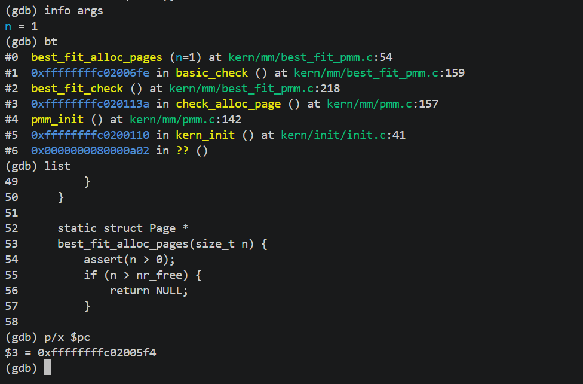

*图 1 best_fit_alloc_pages 断点处的参数、调用栈与源码*

**Best-Fit 是否有进一步的改进空间？** 有。线性链表使每次分配的查找都是 O(k)（k 为空闲块数），释放时按地址插入也需要线性查找。Best-Fit 优先切分最小的可容纳块，可以保留大块，但容易留下许多难以利用的小碎片，总空闲页足够时也可能因缺少连续块而分配失败。在不改变 `pmm_manager` 接口的前提下，可以按大小分类组织空闲链表，或用平衡树同时维护大小索引与地址索引，把查找降到 O(log k)；此外还可以统计碎片情况，为是否合并或整理提供依据。

##### 实现迭代过程

本模块经过 1 次生成迭代即通过全部测试。生成的代码单独编译（`make obj/kern/mm/best_fit_pmm.o`）通过，集成后完整构建成功，`make grade` 的 check best fit 为 OK。

- ✅ 编译通过
- ✅ 所有相关测试通过
- ✅ 功能符合预期

#### 任务三：Buddy System（伙伴系统）分配算法

**负责人：** 学号1-甲

##### 模块功能描述

**需要实现/修改的函数：**

```c
// kern/mm/buddy_pmm.c / buddy_pmm.h
const struct pmm_manager buddy_pmm_manager;
static void buddy_init(void);
static void buddy_init_memmap(struct Page *base, size_t n);
static struct Page *buddy_alloc_pages(size_t n);
static void buddy_free_pages(struct Page *base, size_t n);
static size_t buddy_nr_free_pages(void);
static void buddy_check(void);
void buddy_validate(void);   // 只读不变量检查，供测试使用
// kern/mm/buddy_test.c
void buddy_test(void);
```

**功能说明：** Buddy 以 `pmm_manager` 接口实现，可以替代 First-Fit/Best-Fit 管理 `page_init()` 注册的空闲区。它把空闲区组织为 2 的幂大小的块，分配时逐级拆分，释放时与伙伴逐级合并。Buddy 只支持整块释放，而官方 First-Fit 自检会释放一个块的一部分，因此 Buddy 在独立的测试配置中运行，标准配置使用 Best-Fit。

##### 数据组织与释放契约

实现为 [buddy_pmm.c](../code/kern/mm/buddy_pmm.c)、[buddy_pmm.h](../code/kern/mm/buddy_pmm.h)，注册为 `buddy_pmm_manager`，公共 `Page` 布局和 `pmm_manager` 接口保持不变。

- 维护 0 到 15 阶的空闲链表，阶 k 对应 `2^k` 页，另外维护真实空闲页总数。最大阶与 128 MiB / 4 KiB 的框架上界一致，由编译期断言保证。
- 伙伴按物理页号计算：`buddy_ppn = ppn XOR (1 << order)`。只有同阶、同容量且空闲的伙伴才能合并，物理上相邻但不互为伙伴的块不会合并。
- 请求 n 页时实际占用 `2^ceil(log2 n)` 页。例如请求 3 页占用 4 页，空闲统计减少 4；释放时 `free_pages(p, 3)` 与 `free_pages(p, 4)` 都归还整个 4 页块。
- 只支持整块释放：`n` 必须等于原请求或实际容量。内部指针、部分释放、错误尺寸和重复释放都在修改空闲状态之前检测并 panic。
- 管理器运行在单核启动阶段，不涉及并发。SLUB 只按单页调用页分配器，满足整块释放契约，实测在 Buddy 配置下 SLUB 测试通过。

##### 关键机制

**描述符状态编码。** Buddy 复用 `struct Page` 的已有字段：

| 字段 | 空闲块头 | 已分配块头 | 块内其他页 |
| --- | --- | --- | --- |
| `flags` bit 0 `PG_reserved` | 0 | 0 | 0 |
| `flags` bit 1 `PG_property` | 1 | 0 | 0 |
| `flags` bit 2 `BUDDY_MANAGED` | 1 | 1 | 1 |
| `flags` bit 3 `BUDDY_ALLOCATED` | 0 | 1 | 0 |
| `flags` bit 32..63 | 0 | 原请求页数 n | 0 |
| `property` | 块容量 2^k | 块容量 2^k | 0 |
| `page_link` | 挂在 `free_lists[k]` | 不在链表 | 不在链表 |

只看块头就能区分空闲块、已分配块和块内页，因此释放时传入块内页、重复释放或保留页，都能在修改状态之前识别出来。`Page.ref` 保持引用计数语义，原请求页数单独存放在 flags 高位。

**XOR 伙伴查找。** 阶为 k 的块大小为 2^k 页，起点物理页号按 2^k 对齐。把一个 2^(k+1) 的块对半拆开，左半起点的第 k 位为 0、右半为 1，其余位相同，所以伙伴起点为 `ppn ^ (1 << k)`，合并后的新块起点为 `ppn & ~(1 << k)`。实现使用绝对物理页号：`nbase = 0x80000 = 2^19` 是 2^15 的倍数，按绝对页号对齐等价于按相对 `DRAM_BASE` 的页号对齐。合并需要同时满足：伙伴在描述符范围内、属于 Buddy、是空闲块头、容量同为 2^k。例如 4 页区间中下标 1 和 2 的两页物理相邻，但 `1 ^ 1 = 0`、`2 ^ 1 = 3`，二者不是伙伴，都释放后仍不能分配 2 页（`non_buddies` 用例）。

**拆分。** 从满足 `2^k >= n` 的最小非空阶取块；若取到的块更大，则反复对半拆分，右半挂回低一阶链表，左半继续拆分，直到容量为 2^k。64 页区间先分配 1 页再分配 32 页，二者分别位于区间起点和起点 + 32（`split_and_merge` 用例），与“保留左半”的拆分顺序一致。

**为什么只支持整块释放。** 伙伴关系依赖“块大小为 2 的幂、起点按大小对齐”。若只归还块中的一部分，剩余部分既不是 2 的幂也不满足对齐，必须再拆分成若干合法块，块头记录的请求和容量也随之失效。这与 First-Fit 自检中“释放一段的一部分”的用法不兼容，因此 Buddy 在独立配置中测试，标准配置使用 Best-Fit。

##### 功能规格

以下按 Lab 0.5 的 Pre/Post-Condition、Case 与 Requirements 整理，以实际实现为准。

###### buddy_init

- **Pre-Condition：** 没有活动分配（启动时首次调用，或测试重建现场时调用）。
- **Post-Condition：** 0–15 阶空闲链表都为空，空闲页数为 0。
- **Requirements：** `(PHYSICAL_MEMORY_END - DRAM_BASE) / PGSIZE == 2^15`，由编译期断言保证。

###### buddy_init_memmap(base, n)

- **Pre-Condition：** `base` 是 `pages` 数组内按描述符对齐的指针；`n > 0` 且不越过数组末端；区间内各页都是 Reserved，且没有被 Buddy 接管。
- **Post-Condition：** 区间内各页都属于 Buddy、引用计数为 0；区间被切成若干个起点按 2^k 对齐的 2^k 块；空闲页数增加 n。

  **Case 1（起点对齐且足够长）：** 取满足“不超过剩余长度、起点对齐”的最大阶组成高阶块。

  **Case 2（起点不满足高阶对齐）：** 先用较小阶的块补齐到对齐边界，再使用高阶块，不丢页。

  **Case 3（长度不是 2 的幂）：** 尾部余下的页继续切成更小的块，全部纳入管理。

  **Case 4（与已注册区间互为伙伴）：** 每插入一块都尝试与已有的同阶空闲伙伴合并，分段注册后补上中间空洞即可合并成大块。

  **Case 5（非法输入）：** 指针不在描述符数组内或未对齐时 panic（`buddy: invalid page descriptor`）；区间含有非 Reserved 或已被接管的页时断言失败。所有检查在修改状态之前完成。

###### buddy_alloc_pages(n)

- **Pre-Condition：** 已初始化，`n > 0`。
- **Post-Condition：** 成功时返回块头 p，容量 `c = 2^ceil(log2 n)`，起点按 c 对齐；块头标记为已分配并记录 n，`property = c`；空闲页数减少 c；拆分产生的右半块挂入对应阶。失败时返回 NULL，状态不变。

  **Case 1（对应阶有空闲块）：** 直接取出。

  **Case 2（需要拆分）：** 从更高的最小非空阶取块，逐级对半拆分。

  **Case 3（n 不是 2 的幂）：** n = 3 时占用 4 页，块头记录请求 3、容量 4。

  **Case 4（无法满足）：** `n > 2^15`、`n` 超过空闲页总数，或总数足够但没有足够大的连续块时，返回 NULL。

- **Requirements：** 复杂度 O(K)，K 为最大阶。

###### buddy_free_pages(base, n)

- **Pre-Condition：** `base` 是某次分配返回、尚未释放的块头；`n` 等于当时的请求或实际容量。
- **Post-Condition：** 整块归还，空闲页数增加实际容量；块与伙伴逐阶合并，直到伙伴不空闲、不同阶、越界或已到最大阶；合并后的块头是地址较低的一方。

  **Case 1（伙伴仍被占用）：** 不合并，按原阶挂入链表。

  **Case 2（伙伴空闲且同阶）：** 合并成高一阶的块，继续向上检查。

  **Case 3（连续多阶都可合并）：** 迭代向上合并，例如 8 页 + 8 页恢复为 16 页。

  **Case 4（原请求不是 2 的幂）：** `free_pages(p, 3)` 与 `free_pages(p, 4)` 都归还整个 4 页块。

  **Case 5（非法释放）：** 在修改任何状态之前 panic：描述符地址非法或未对齐时为 `invalid page descriptor`；传入块内页、重复释放、保留页时为 `free requires an allocated block head`；`n` 既不是请求也不是容量时为 `free size must match request or capacity`。

- **Requirements：** 只支持整块释放（原因见“关键机制”）。

###### buddy_nr_free_pages

- **Post-Condition：** 返回所有空闲块容量之和，按实际容量而不是原请求计算。

###### buddy_check

- **Post-Condition：** 调用 `buddy_validate()` 检查全部不变量并打印结果，不修改状态。行为测试由独立配置中的 `buddy_test()` 完成（见下文“独立测试”）。

##### 复杂度与权衡

记最大阶数为 K（K = 15）。分配时扫描阶并拆分、释放时逐阶寻找伙伴，复杂度均为 O(K)，单次伙伴定位为 O(1)。初始化需处理全部描述符，约为 O(N + K × 初始块数)。额外空间仅为 K+1 个链表头，每页复用已有描述符。代价是幂次取整造成的内部碎片：请求 513 页实际占用 1024 页。此外，即使总空闲页充足，也可能因为不存在足够大的对齐块而分配失败。

##### 独立测试

测试代码为 [buddy_test.c](../code/kern/mm/buddy_test.c)，与实现分开设计。

###### 测试环境的隔离

`buddy_test()` 在启动初始化完成、管理区全部空闲且没有活动分配时运行。它先确认初始空闲区是单一连续区间，再以该真实物理区间的子区间构造各个测试场景；每个场景要求所有分配都已归还，之后才重建描述符。全部场景结束后，重新注册完整的初始空闲区并验证空闲页数恢复。测试不使用模拟分配器或伪造的 Page 数组：分配到的物理页在首尾写入并读回不同标记，用来检查跨页容量、互不覆盖和数据完整性。测试区不包含 OpenSBI、内核或描述符占用的页。

###### 用例设计

| 用例 | 检查内容 |
| --- | --- |
| 真实大内存区高阶分配 | 513 页及更高阶请求的取整、物理对齐、互不重叠、容量扣数和完整回收 |
| 1/2/4/8、3/5/6 页 | 连续容量、两两不重叠、ref 与标志、实际页数统计、首尾数据标记；按原请求释放与按实际容量释放均验证 |
| 64 页块拆分 | 1 页与 32 页请求从正确的阶获取，释放后可重新分配完整 64 页 |
| 占用伙伴与递归合并 | 伙伴仍在使用时 16 页申请失败；两块 8 页归还后恢复 16 页块 |
| 相邻非伙伴 | 4 页区间内下标 1、2 的页释放后不能分配 2 页；真实伙伴归还后才能合并 |
| 耗尽与巨大请求 | 分配全部单页，确认不重复、不越界，耗尽时返回 NULL 且计数不变；反序释放后恢复 |
| 不规则区间与最后一页 | 高阶未对齐起点 + 13 页、物理上界的最后 1 页；不丢尾页、不越界 |
| 分段注册与空洞 | 被空洞隔开的两段不能合并；补注册中间区间后按伙伴关系合并 |
| 2000 次确定性混合操作 | 固定种子、32 个槽、1–12 页请求，持续检查计数、重叠和数据，定期检查全部不变量，最终恢复整块 |
| 6 个预期 panic 启动 | 重复释放、内部指针、错误页数、释放保留页、未对齐描述符地址、重复注册已接管的页；按确切错误信息判定 |

预期 panic 的用例各自单独编译启动（`LAB2_BUDDY_NEGATIVE=1..6`），不会影响正常用例的回归。

###### 测试结果

[check_a.py](../code/tools/check_a.py) 构建并启动真实的 QEMU 内核：正常用例以串口中的 PASS 标记判定；预期 panic 用例同时检查 BEGIN 标记、panic 发生位置和确切错误信息。

| 测试 | 结果 | 日志 |
| --- | --- | --- |
| Buddy 正常用例，64/128/256 MiB | 全部 PASS，最终恢复完整初始空闲区 | [64M](evidence/member-a-round2/check_a/buddy-64M.log)、[128M](evidence/member-a-round2/check_a/buddy-128M.log)、[256M](evidence/member-a-round2/check_a/buddy-256M.log) |
| 预期 panic 用例 1–5 | 重复释放、内部指针、释放保留页报 `free requires an allocated block head`；错误页数报 `free size must match request or capacity`；未对齐描述符报 `invalid page descriptor` | [1](evidence/member-a-round2/check_a/buddy-negative-1.log)、[2](evidence/member-a-round2/check_a/buddy-negative-2.log)、[3](evidence/member-a-round2/check_a/buddy-negative-3.log)、[4](evidence/member-a-round2/check_a/buddy-negative-4.log)、[5](evidence/member-a-round2/check_a/buddy-negative-5.log) |
| 预期 panic 用例 6 | 重复注册被拒绝，`assertion failed: PageReserved(base + i)` | [6](evidence/member-a-round2/check_a/buddy-negative-6.log) |
| Buddy 配置下完整启动 | Buddy 测试之后 SLUB 测试也通过 | [profile-buddy-full-boot-128M.log](evidence/integration/pre-merge-isolated/profile-buddy-full-boot-128M.log) |

128 MiB 正常用例的串口输出：

```text
buddy_check: free-list invariants PASS (31927 pages)
[Buddy] real-arena high-order allocation and recovery: PASS
[Buddy] basic, 3/5/6 rounding, payload, full recovery: PASS
[Buddy] high-order split, occupied buddy, recursive merge: PASS
[Buddy] adjacent non-buddies never merge: PASS
[Buddy] exhaustion, irregular range, last page, holes: PASS
[Buddy] 2000 deterministic mixed operations, payload integrity: PASS
[Buddy] original boot-time free interval restored: PASS (31927 pages)
[Buddy] ALL NORMAL TESTS PASS
```

Buddy 测试内核比标准内核略大，因此初始空闲页为 31927，比标准内核少 2 页；这也说明空闲页数必须由 Page Init 实际计算，不能硬编码。

##### 实现迭代过程

本模块经过 1 次生成迭代，实现与测试分两个阶段生成。

###### 第一次迭代

**最终结果：** 生成的 Buddy 实现与测试一次编译通过，“独立测试”中的全部正常用例、5 个预期 panic 用例及 2000 次混合操作均通过，没有出现泄漏、重复分配、错误合并或计数错误。

- ✅ 编译通过
- ✅ 所有相关测试通过
- ✅ 功能符合预期

**关键改进点总结：**

1. 规格中要求“明确 `free_pages(base, n)` 的调用契约”，促使实现把原请求页数记录在块头，并在修改状态之前拒绝非法释放。
2. 测试规格要求“不重写算法来适配测试预期”，并把预期 panic 的用例与正常回归隔离开。

集成验收时，对照 SPEC 与测试逐条核对，补充了第 6 个预期 panic 用例：在已被 Buddy 接管的页上重复调用 `init_memmap()`。该用例被 `assertion failed: PageReserved(base + i)` 正确拒绝，实现无需修改。

#### Challenge：任意大小的内存单元 SLUB 分配算法

**负责人：** 学号2-乙

##### 模块功能描述

**需要实现/修改的函数：**

```c
// kern/mm/slub.h / slub.c
void slub_init(void);
void *slub_alloc(size_t size);
void slub_free(void *obj);
// kern/mm/slub_test.c
void slub_test(void);
// kern/init/init.c：在 pmm_init() 之后调用 slub_init() 与 slub_test()
```

**功能说明：** SLUB 在页分配器之上实现两层分配。第一层通过 `alloc_page()`/`free_page()` 获取和归还整页；第二层把一页切成固定大小的对象，按需分配任意不超过 1024 字节的内存。它只依赖单页分配接口，因此与 Best-Fit、Buddy 都兼容。

##### 设计与实现

- **大小类：** 定义 16、32、64、128、256、512、1024 字节七个缓存（`slub_cache`）。`slub_alloc(size)` 把请求归入能容纳它的最小大小类；`size` 为 0 或大于 1024 时返回 `NULL`。
- **slab 布局：** 每个 slab 占一页。页首存放 `slub_slab` 元数据（所属缓存、页描述符、空闲链表、容量、已用数、magic），其后按 16 字节对齐切分对象，空闲对象通过首字存放的指针串成链表。`slub_page_kva()` 用 `page2pa(page) + va_pa_offset` 把物理页换算为内核虚拟地址。
- **分配：** 缓存的 `partial` 链表中有可用 slab 时，从其空闲链表弹出一个对象；slab 用满后移出 `partial` 链表；没有可用 slab 时调用 `alloc_page()` 新建。
- **释放：** `slub_free()` 把对象地址向下取整到页首得到 slab，校验 magic、所属缓存、地址范围、对象对齐，并扫描空闲链表以拒绝重复释放，然后把对象压回空闲链表；slab 的 `inuse` 归零时调用 `free_page()` 归还整页。

这是一个保留 SLUB 主体思想的简化实现：大小类固定、每个 slab 固定一页，不涉及每 CPU 缓存和多核并发，符合实验“可简化实现，能够体现其主体思想”的要求。

##### 测试设计

`slub_test()` 在 `slub_init()` 之后运行，开始时记录 `nr_free_pages()`，结束时要求它恢复原值，最后输出 `slub_check() succeeded!`。

| 测试 | 检查内容 | 为什么能检验实现 |
| --- | --- | --- |
| 边界请求 | `slub_alloc(0)` 与 `slub_alloc(1025)` 返回 `NULL` | 覆盖大小类查找的两个失败分支 |
| 不同大小（`slub_test_sizes`） | 8、24、32、64、100、128、512、513、1024 字节，其中 24、100、513 不是 2 的幂；检查非空、16 字节对齐、同时存活的对象两两不重叠 | 检验大小类映射、对齐与 slab 切分是否正确 |
| 交替释放与复用（`slub_test_reuse`） | 申请 4 个 32 字节对象，释放第 2、4 个，再申请两次，必须依次得到第 4 个、第 2 个 | 检验空闲链表按后进先出复用槽位 |
| 整页回收（`slub_test_page_reclaim`） | 申请 1024 字节对象后空闲页数减一，释放后恢复 | 检验 `inuse` 归零时归还物理页 |
| 两层耗尽（`slub_test_memory_exhaustion`） | 先保留一个 1024 字节 slab，再占满剩余全部物理页；此时仍能从已有 slab 分配（`reused_slot`），超过一页的对象数后必须返回 `NULL`；先释放对象和临时占用的页，再检查三个结果 | 区分“物理页耗尽”与“对象槽位耗尽”两层空间不足，并验证测试结束后页分配器状态完全恢复 |

内核侧调试的观察如图 2 所示：`slub_alloc(1025)` 用 `finish` 返回 `0x0`；`slub_alloc(8)` 返回 `0xffffffffc0347ff0`；耗尽测试结束时 `pages_exhausted = 1`、`objects_exhausted = 1`、`pages_restored = 1`。8 字节请求落在 16 字节类，返回地址可以由布局推出：该类每页容量为 `(4096 − 64) / 16 = 252`，空闲链表按后进先出组织，第一次分配得到最后一个槽位，其页内偏移为 `64 + 251 × 16 = 0xff0`；所在页 `0xffffffffc0347000` 对应物理页 `0x80347000`，正是 `page_init()` 注册的第一个空闲页。

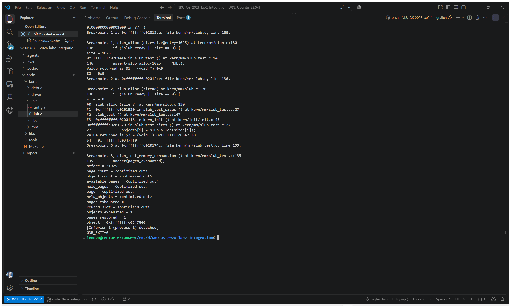

*图 2 SLUB 边界请求、正常请求与耗尽测试的 GDB 记录*

##### 实现迭代过程

本模块经过 3 次迭代：实现一次通过，测试代码经过两次修正。

###### 第一次迭代：分配器与测试生成

分配器（`slub.c`）与测试（`slub_test.c`）分两个阶段生成，均单独编译通过（`make obj/kern/mm/slub.o`、`make obj/kern/mm/slub_test.o`）。

###### 第二次迭代：内存耗尽判定错误

**遇到的问题：** 对测试代码做静态检查时发现，最初生成的耗尽测试在占满物理页后，用 `assert(slub_alloc(16) == NULL)` 判断“内存耗尽”。这一断言的前提不成立：即使 `alloc_page()` 已经失败，已有 slab 中的空闲对象仍可分配，断言可能误判；而且断言失败会中断测试，临时占用的物理页无法归还。

**问题解决策略：** 修改测试规格，要求区分物理页耗尽与对象槽位耗尽，使用有明确上限的循环，并且“先记录结果、再回收资源、最后断言”。修正后的测试在三种页管理器下均通过。

###### 第三次迭代：加强复用与耗尽验证

**遇到的问题：** 集成复核发现，第二版在占满物理页之前没有保留任何 slab，因此实际上没有验证“物理页耗尽后已有槽位仍可复用”这一行为；复用测试也只覆盖了单个对象。

**问题解决策略：** 耗尽测试先申请一个 1024 字节对象以保留 slab，再占满剩余物理页，要求至少一次从已有 slab 成功分配（`reused_slot`），并以一页可容纳的对象数作为循环上界，超过后必须返回 `NULL`；复用测试改为交替释放两个对象，检查复用顺序。修改只涉及 `slub_test.c`，差异见 [slub-test-memory-exhaustion-fix.diff](evidence/member-b/slub-test-memory-exhaustion-fix.diff)。

**最终结果：**

- ✅ 编译通过
- ✅ 所有相关测试通过：标准内核在 64/128/256 MiB 下以及 First-Fit、Buddy 配置下均输出 `slub_check() succeeded!`
- ✅ 功能符合预期

---

### 分支任务：gdb 调试页表查询过程

**负责人：** 学号3-丙（主导）；学号1-甲、学号2-乙各自独立调试。（一）至（八）为甲的调试记录，（九）、（十）为乙、丙的补充观察，（十一）、（十二）为全组的共同结论。

#### （一）实验目的与方法

uCore 运行在 QEMU 模拟的 RISC-V 处理器上，地址翻译由 QEMU 的 C 代码完成。本实验的目的，是在 QEMU 源码层面观察一次访存从“查 TLB”到“得到物理地址”的完整过程，具体包括四个问题：

1. TLB Miss 时，QEMU 经过哪条调用路径进入 RISC-V 的地址翻译；
2. Sv39 页表如何被逐级遍历，超级页如何得到物理地址；
3. TLB 命中时，哪些代码被跳过；
4. 模拟 TLB 与真实硬件 TLB 在逻辑上有哪些区别。

**两个 GDB 的分工。** 宿主 GDB（x86-64 的 gdb 12.1）附加到 QEMU 进程，在模拟器的 C 源码中设置断点、查看变量；客户机 GDB（`riscv64-unknown-elf-gdb`）通过 QEMU 的 gdbstub 调试 uCore，查看 RISC-V 指令和寄存器。宿主断点暂停的是整个模拟器线程，客户机断点暂停的是被模拟的 CPU。

**调试版 QEMU。** 按指导书在独立目录中重新编译 QEMU 4.1.1，不执行 `make install`，课程 QEMU 保持不变：

```bash
../configure --target-list=riscv32-softmmu,riscv64-softmmu --enable-debug   # build-debug/
../configure --target-list=riscv32-softmmu,riscv64-softmmu --enable-debug \
             --enable-tcg-interpreter                                        # build-debug-tci/
```

`--enable-debug` 构建不做优化（`CFLAGS -g`），可以逐行单步。第二个构建另外启用了 TCG 解释器（TCI），原因在于数据访问的 TLB 查询方式：默认的 TCG 后端会把“查 TLB、比较、命中后直接访问”编译成宿主机器码，内联在翻译结果中（`tcg/i386/tcg-target.inc.c` 的 `tcg_out_tlb_load`），只有 Miss 才调用 C 函数 `load_helper`/`store_helper`；TCI 后端则在每次客户机 load/store 时都调用这两个 C 函数。因此，取指路径在 `build-debug` 上观察，数据访问的 Miss 与命中在 `build-debug-tci` 上观察。两个构建都能完整启动本仓库的标准内核。

**调试环境。** 终端 1 用 `make debug QEMU=<调试版 QEMU>` 以 `-s -S` 启动 QEMU，使其在复位向量处等待；终端 2 运行客户机 GDB（`make gdb`）；终端 3 中宿主 GDB 附加到 QEMU 进程。图 3 显示调试版 QEMU 已按 `-s -S` 启动，客户机 GDB 停在复位向量 `0x1000`。

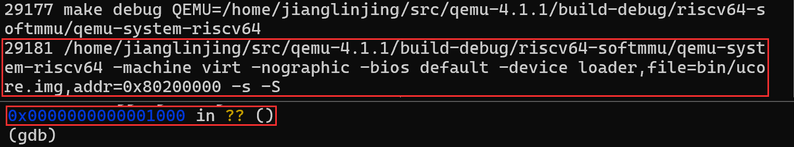

*图 3 调试环境：调试版 QEMU 进程（上）与停在复位向量的客户机 GDB（下）*

**观察对象。** 观察的地址来自内核符号表和反汇编：

| 场景 | 虚拟地址 | 访问类型 | 对应的客户机指令或数据 |
| --- | --- | --- | --- |
| M 模式复位 | `0x1000` | 取指 | QEMU virt 复位向量（MROM） |
| Sv39 取指 | `0xffffffffc02000d6` | 取指 | `kern_init` 第一条指令 |
| Sv39 store | `0xffffffffc0206018`、`0xffffffffc0206019` | store | `memset` 清零 bss 的前两个字节（`sb a1,-1(a5)`） |
| Sv39 load | `0xffffffffc0201f08` | load | `dtb_init` 中 `cprintf` 读取格式串 `"DTB Init\n"` |

#### （二）QEMU 地址翻译的源码路径

阅读 `accel/tcg/cputlb.c` 与 `target/riscv/cpu_helper.c`，一次访存的处理路径如下：

```text
取指:   get_page_addr_code   cputlb.c:1030  tlb_hit() 判断
                             cputlb.c:1031  VICTIM_TLB_HIT() 查 8 项 victim TLB
                             cputlb.c:1032  tlb_fill()            （两者都未命中时）
数据:   load_helper          cputlb.c:1271  tlb_hit() 判断 → 未命中则 victim TLB → tlb_fill()
        store_helper         cputlb.c:1519  同上，cputlb.c:1522 调用 tlb_fill()
填充:   tlb_fill             cputlb.c:878   → cc->tlb_fill，即 riscv_cpu_tlb_fill
        riscv_cpu_tlb_fill   cpu_helper.c:451  get_physical_address()  完成翻译
                             cpu_helper.c:472  tlb_set_page()          写入 TLB 表项
命中后: 宿主地址 = 客户机虚拟地址 + entry->addend
```

`get_physical_address()` 中决定翻译方式的关键分支：

| 位置 | 代码 | 作用 |
| --- | --- | --- |
| 171 行 | `if (mode == PRV_M \|\| !riscv_feature(env, RISCV_FEATURE_MMU))` | M 模式直接返回 `*physical = addr` |
| 187–197 行 | `switch (vm)` | `VM_1_10_SV39` 设定 `levels = 3, ptidxbits = 9, ptesize = 8`；`VM_1_10_MBARE` 直接返回 `*physical = addr` |
| 237 行 | `for (i = 0; i < levels; i++, ptshift -= ptidxbits)` | 逐级遍历页表 |
| 238–252 行 | `idx = (addr >> (PGSHIFT + ptshift)) & 0x1ff`；`pte_addr = base + idx * ptesize`；`pte = ldq_phys(...)` | 计算本级索引与 PTE 地址，从物理内存读出 PTE |
| 256、259 行 | `!(pte & PTE_V)`；`!(pte & (PTE_R \| PTE_W \| PTE_X))` | PTE 无效则失败；R/W/X 全为 0 表示非叶 PTE，令 `base = ppn << 12` 进入下一级 |
| 276 行 | `ppn & ((1ULL << ptshift) - 1)` | 超级页的 PPN 对齐检查 |
| 279–286 行 | 按访问类型检查 R/W/X | 权限检查 |
| 291–317 行 | 计算 `updated_pte`，必要时用 cmpxchg 写回 | 由软件更新 A/D 位 |
| 334 行 | `*physical = (ppn \| (vpn & ((1L << ptshift) - 1))) << PGSHIFT` | 合成物理页基址 |

#### （三）未开启分页时的取指：M 模式不经过页表

**目的。** 观察 CPU 上电后、页表尚未建立时，QEMU 如何处理取指。

**方法。** 在 `riscv_cpu_tlb_fill` 和 `get_physical_address` 上设置断点，客户机 GDB 执行 `continue`。

**观察。** 第一次命中发生在复位向量 `0x1000`（图 4）：`access_type = MMU_INST_FETCH`，`mmu_idx = 3`；调用栈为 `get_page_addr_code`（cputlb.c:1032）→ `tlb_fill` → `riscv_cpu_tlb_fill`。进入 `get_physical_address` 时，`addr = 0x1000`、`mmu_idx = 3`。

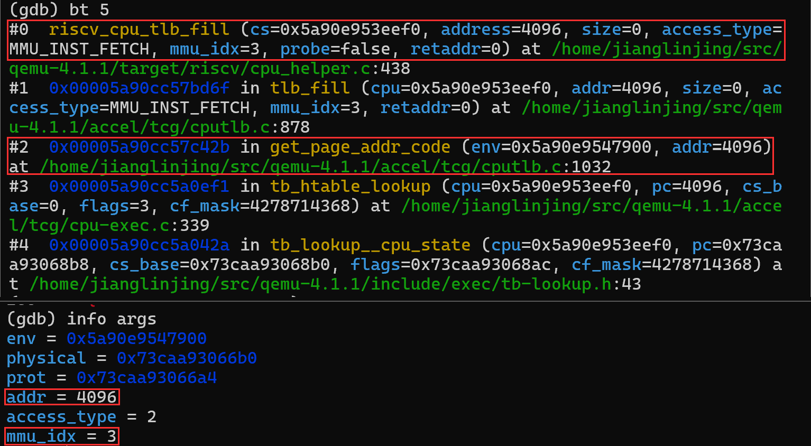

*图 4 复位向量 0x1000 取指时的调用栈（上）与 get_physical_address 的参数（下）*

**分析。** RISC-V 的 `mmu_idx` 就是当前特权级（`riscv_cpu_mmu_index()` 返回 `env->priv`），3 表示 M 模式。`get_physical_address` 第 171 行判断 `mode == PRV_M` 成立，直接令 `*physical = addr`，不读取 `satp`，也不访问页表。用条件断点全程记录同一次启动时，可以看到 OpenSBI 入口和 `kern_entry` 也遵循同样的规律：前者在 M 模式下直接返回，后者处于 S 模式但 `satp.MODE = 0`（Bare），由第 196 行的 `VM_1_10_MBARE` 分支直接返回：

```text
[HOST get_physical_address] M-mode VA=0x80000000 mmu_idx=3 -> 'mode == PRV_M' branch, physical = addr (no page table)
[HOST get_physical_address] satp.MODE=BARE (satp=0x0) VA=0x80200000 access_type=2 -> case VM_1_10_MBARE, physical = addr
[HOST get_physical_address] satp.MODE=BARE (satp=0x0) VA=0x80206000 access_type=1 -> case VM_1_10_MBARE, physical = addr
```

**结论。** 页表就绪之前，虚拟地址与物理地址相同；QEMU 仍然经由 `tlb_fill` 为这些地址建立 TLB 表项，但翻译本身不涉及页表。这正对应“实验整体逻辑分析”中所述“先以物理地址运行、再开启分页”的启动顺序。

#### （四）kern_init 取指：TLB Miss 进入 RISC-V 地址翻译

**目的。** 观察开启 Sv39 后的第一次高地址取指如何触发 TLB Miss。

**方法。** 为排除 OpenSBI 阶段的大量访问，给两个断点加上条件，只关注内核高地址：

```text
condition 1 mmu_idx == 1 && address >= 0xffffffffc0200000 && address < 0xffffffffc0300000
condition 2 mmu_idx == 1 && addr >= 0xffffffffc0200000 && addr < 0xffffffffc0300000
```

**观察。** 断点在 `riscv_cpu_tlb_fill` 命中（图 5）：`address = 0xffffffffc02000d6`，即 `kern_init` 的入口；`access_type = MMU_INST_FETCH`，`mmu_idx = 1`（S 模式）。调用栈与复位取指相同，同样由 `get_page_addr_code` 第 1032 行调用 `tlb_fill`。

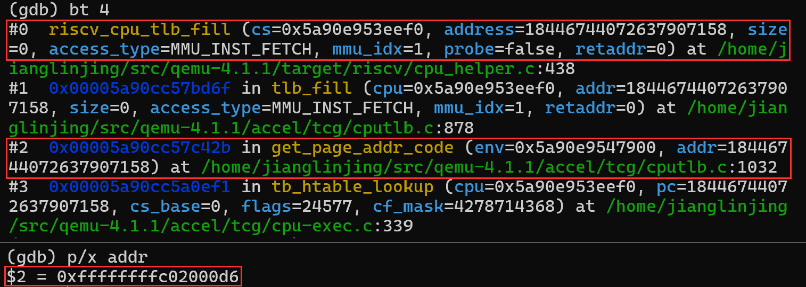

*图 5 kern_init 取指触发 TLB 填充的调用栈*

**分析。** 发生 Miss 有两个原因。其一，`entry.S` 写入 `satp` 后执行了 `sfence.vma`；宿主 GDB 观察到它进入 `helper_tlb_flush`，软件 TLB 被整体清空。值得注意的是，QEMU 4.1.1 的 `write_satp()` 只在 ASID 变化时调用 `tlb_flush`，从 Bare 切换到 Sv39 时并不刷新，真正的刷新来自随后的 `sfence.vma`：

```text
[HOST write_satp] old satp=0x0 new=0x8000000000080205 priv=1
[HOST helper_tlb_flush] sfence.vma executed, priv=1 satp=0x8000000000080205
```

其二，高地址页 `0xffffffffc0200000` 此前从未被访问过。因此第 1030 行的 `tlb_hit()` 为假，victim TLB 中也没有该页，只能调用 `tlb_fill` 进行页表遍历。逐行单步的记录显示，此时该页对应的表项（`index = 0`）中 `addr_code = 0xffffffffffffffff`，即无效表项。

**结论。** 开启分页后的第一次取指确实经由“TLB 查询失败 → `tlb_fill` → `riscv_cpu_tlb_fill` → `get_physical_address`”进入 RISC-V 的地址翻译。

#### （五）Sv39 页表遍历与超级页物理地址

**目的。** 观察 `get_physical_address` 如何从 `satp` 出发找到 PTE，并计算物理地址。

**方法。** 在第 254 行（PTE 刚由 `ldq_phys` 读出）设置临时断点，打印遍历变量；再在第 337 行（物理地址已计算）设置临时断点，打印 `*physical`。

**观察。** 第一次停在 254 行时（图 6），`satp = 0x8000000000080205`，`base = 0x80205000`，`levels = 3`，`i = 0`，`ptshift = 18`，`idx = 0x1ff`，`pte_addr = 0x80205ff8`，`pte = 0x200000cf`。停在 337 行时（图 7），`*physical = 0x80200000`。

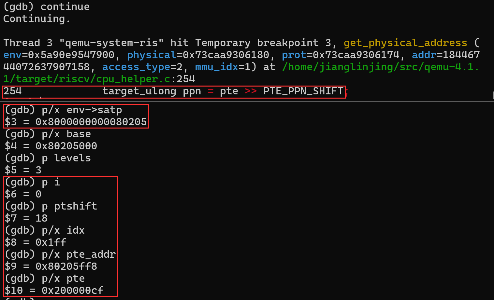

*图 6 第 254 行处的遍历变量*

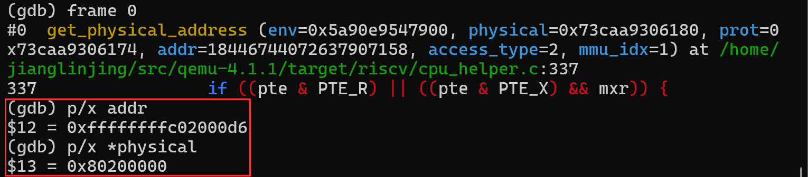

*图 7 第 337 行处得到的物理页基址*

**分析。** 由这些变量可以完整重建地址计算过程：

| 步骤 | 计算 | 结果 |
| --- | --- | --- |
| 解析 `satp` | MODE = `satp >> 60`；根页表 PPN = 低 44 位 | MODE = 8（Sv39），`base = 0x80205 << 12 = 0x80205000`，即 `boot_page_table_sv39` |
| 第一级索引 | `ptshift = (levels - 1) × 9 = 18`；`idx = (VA >> (12 + 18)) & 0x1ff` | `(0xffffffffc02000d6 >> 30) & 0x1ff = 0x1ff` |
| PTE 地址 | `base + idx × 8` | `0x80205000 + 0xff8 = 0x80205ff8` |
| 解析 PTE | 低 8 位为标志，`ppn = pte >> 10` | `0xcf` = D、A、X、W、R、V（无 U），`ppn = 0x80000` |
| 判断叶子 | R/W/X 不全为 0 | 第一级就是叶子，即 1 GiB 超级页，循环只执行 `i = 0` 一次 |
| 对齐检查 | `ppn & ((1 << 18) - 1)` | `0x80000 & 0x3ffff = 0`，通过 |
| 物理页基址 | `(ppn \| (vpn & 0x3ffff)) << 12`，`vpn = VA >> 12` | `vpn & 0x3ffff = 0x200`，`(0x80000 \| 0x200) << 12 = 0x80200000` |
| 物理地址 | 物理页基址 + 页内偏移 `0xd6` | `0x802000d6 = VA − 0xFFFFFFFF40000000` |

超级页之所以能提前结束遍历，是因为 Sv39 规定：任一级 PTE 只要 R/W/X 不全为 0，就是叶子。第一级叶子覆盖 2^30 字节，VA 的低 30 位直接成为物理地址的低 30 位；QEMU 在第 334 行把这低 30 位中的页号部分（`vpn` 的低 18 位）并入 `ppn`，合成一个“虚拟的 4 KiB 叶子”，供 TLB 使用。权限方面，取指要求 X 位（第 286 行），PTE 满足；由于 D 位已置位，第 345–347 行同时授予写权限，最终 `prot = 7`（读、写、执行）。

逐行单步的完整记录（[fetch-host-gdb.log](evidence/member-a-qemu-step/fetch-host-gdb.log)）显示，这次遍历依次经过 171 行（非 M 模式）、187 行（`vm = 8`）、191 行（Sv39 参数）、237–252 行（计算 `idx`、`pte_addr` 并读出 PTE）、256/259 行（有效且为叶子）、276 行（对齐检查）、286 行（执行权限）、334 行（物理地址），最后在 349 行返回 `TRANSLATE_SUCCESS`。客户机 GDB 在页表层面的独立核对也得到同样的结果：根页表第 511 项为 `0x200000cf`，按其计算的物理地址与“虚拟地址减固定偏移”一致（[gdb-guest-translation.log](evidence/member-a-round2/debug_a/gdb-guest-translation.log)）。

**结论。** `0xffffffffc02000d6` 经一级 Sv39 遍历翻译为物理地址 `0x802000d6`，翻译结果与启动页表的线性映射一致。

#### （六）TLB 填入与取指命中

**目的。** 观察翻译结果如何写入 TLB，以及之后再次访问同一页时 QEMU 跳过哪些代码。

**观察一：TLB 填入。** `riscv_cpu_tlb_fill` 第 472 行调用 `tlb_set_page`，进入 `tlb_set_page_with_attrs`。逐行单步记录了表项的建立过程（节选）：

```text
[075]         tlb_set_page_with_attrs cputlb.c:700  {
                vaddr = 0xffffffffc0200000
                paddr = 0x80200000
                prot = 0x7
                size = 0x1000
[093]         tlb_set_page_with_attrs cputlb.c:756  te = tlb_entry(env, mmu_idx, vaddr_page);
                index = 0x0
[101]         tlb_set_page_with_attrs cputlb.c:805  if (prot & PAGE_READ) {
                tn.addend = 0x80001fe00000
[103]         tlb_set_page_with_attrs cputlb.c:811  if (prot & PAGE_EXEC) {
                tn.addr_read = 0xffffffffc0200000
[105]         tlb_set_page_with_attrs cputlb.c:817  tn.addr_write = -1;
                tn.addr_code = 0xffffffffc0200000
[113]         tlb_set_page_with_attrs cputlb.c:830  if (prot & PAGE_WRITE_INV) {
                tn.addr_write = 0xffffffffc0200400
```

表项按 4 KiB（`size = 0x1000`）建立，虽然页表中是 1 GiB 超级页。一次填入同时写好 `addr_read`、`addr_code`、`addr_write` 三个字段，以及 `addend`。`addr_write` 带有 `TLB_NOTDIRTY` 标志（`0x...0400`），因为这一页包含已翻译的代码，写这一页需要走慢路径，以便让翻译结果失效。

**观察二：取指命中。** 在 `get_page_addr_code` 第 1030 行设置断点，继续执行后再次在 `addr = 0xffffffffc02000d6` 处停下（图 8）。执行 `next` 后，程序从 1030 行直接到达 1039 行。

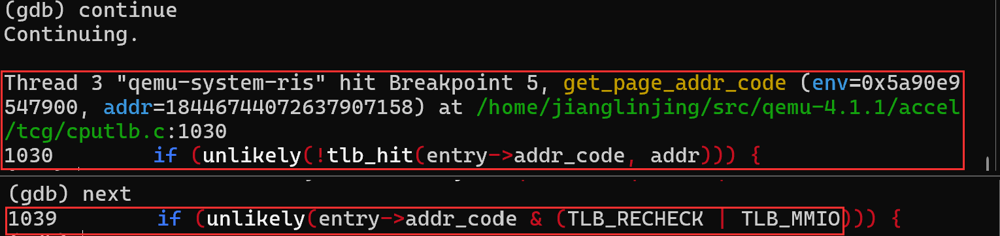

*图 8 再次查找 kern_init 所在页时跳过 TLB Miss 处理分支*

**分析。** `tlb_hit(tlb_addr, addr)` 的定义是 `addr & TARGET_PAGE_MASK == tlb_addr & (TARGET_PAGE_MASK | TLB_INVALID_MASK)`，即比较页号，并要求表项没有无效标志。此时表项的 `addr_code = 0xffffffffc0200000`，正是 `addr` 的页号，因此 `tlb_hit` 为真，第 1031–1037 行的 Miss 处理分支（victim TLB 查询和 `tlb_fill`）被整体跳过。随后第 1051 行用 `addr + entry->addend = 0x7fffe00000d6` 得到 QEMU 进程中模拟内存的宿主指针；在该宿主地址读到的 4 个字节 `17 65 00 00`，与客户机 GDB 在 `kern_init` 处执行 `x/4bx $pc` 的结果相同（[fetch-host-gdb.log](evidence/member-a-qemu-step/fetch-host-gdb.log)、[fetch-guest-gdb.log](evidence/member-a-qemu-step/fetch-guest-gdb.log)）。

**结论。** 一次 Miss 建立的 TLB 表项被后续取指复用；命中时 QEMU 既不遍历页表，也不经过物理地址，而是直接用 `addend` 由虚拟地址得到宿主指针。

#### （七）数据 Store：Miss 与命中

**目的。** 观察数据写操作的 TLB 查询，并与取指路径对比。

**方法。** 使用 TCI 构建，在 `store_helper` 第 1519 行设置条件断点（地址位于内核高地址范围），配合 `riscv_cpu_tlb_fill` 上的条件断点 `address == 0xffffffffc0206018`。

**观察一：Store Miss。** `memset` 清零 bss 时，第一次写入 `0xffffffffc0206018`（`size = 1`，`val = 0`）。此时 `tlb_addr = 0xffffffffffffffff`；`next` 依次到达 1520 行（victim TLB）和 1522 行（`tlb_fill`）；随后 `riscv_cpu_tlb_fill` 命中，`address = 0xffffffffc0206018`，`access_type = MMU_DATA_STORE`（图 9）。调用栈为：

```text
#0  riscv_cpu_tlb_fill (..., address=18446744072637931544, size=1, access_type=MMU_DATA_STORE, mmu_idx=1, ...) at target/riscv/cpu_helper.c:438
#1  tlb_fill (..., access_type=MMU_DATA_STORE, mmu_idx=1, ...) at accel/tcg/cputlb.c:878
#2  store_helper (big_endian=false, size=1, ..., val=0, addr=18446744072637931544, ...) at accel/tcg/cputlb.c:1522
#3  helper_ret_stb_mmu (..., val=0 '\000', oi=1, ...) at accel/tcg/cputlb.c:1642
#4  tcg_qemu_tb_exec (...) at tcg/tci.c:1224
#5  cpu_tb_exec (...) at accel/tcg/cpu-exec.c:173
```

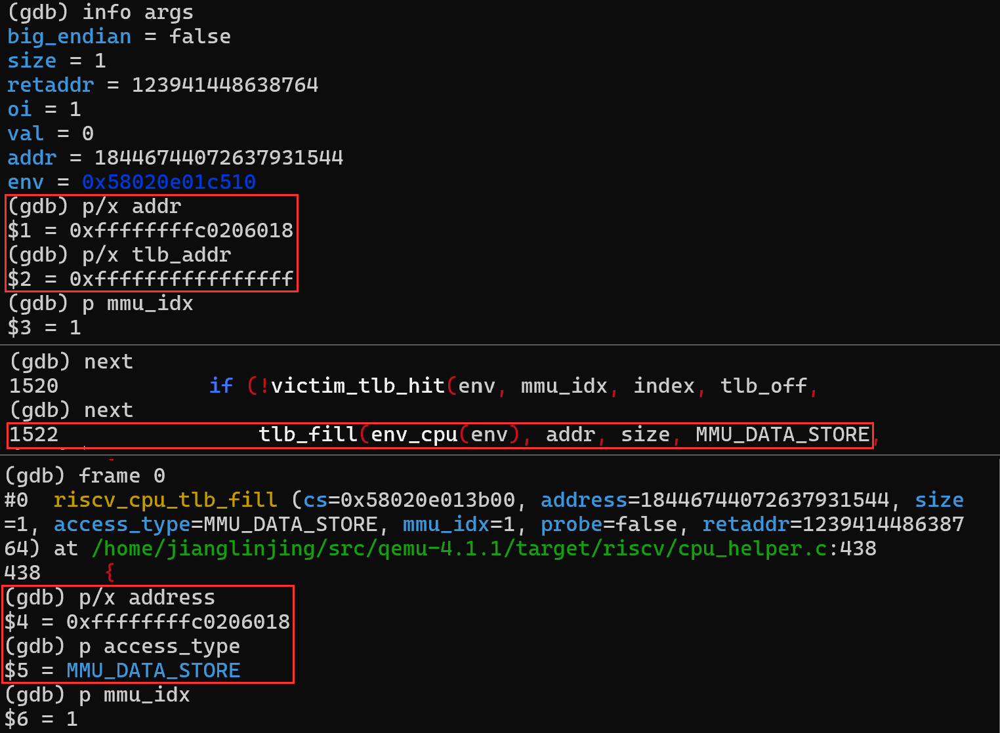

*图 9 store_helper 的 Miss 路径（上、中）与随后进入的 riscv_cpu_tlb_fill（下）*

**观察二：Store 命中。** 紧接着写入下一个字节 `0xffffffffc0206019` 时，`tlb_addr = 0xffffffffc0206000`；`next` 从 1519 行直接到达 1531 行（图 10）。

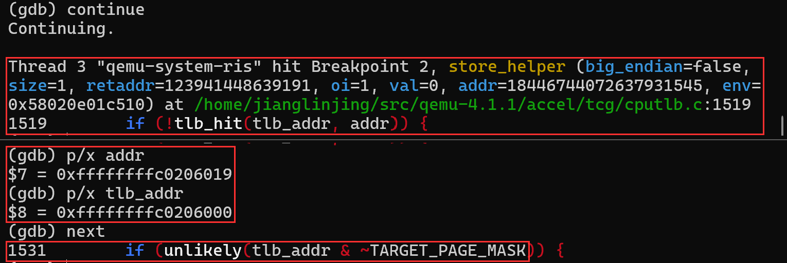

*图 10 同一页上的下一次 store 跳过 Miss 处理分支*

**分析。** 调用栈表明，在 TCI 构建中，RISC-V 的 `sb` 指令由解释器 `tcg_qemu_tb_exec` 执行，经 `helper_ret_stb_mmu` 进入 `store_helper`。数据访问使用的是表项中的 `addr_write` 字段，判断方式与取指相同。第一次写入时，该页对应的表项无效，因此走 1520–1527 行的 Miss 分支，由 `tlb_fill` 以 `MMU_DATA_STORE` 类型完成翻译；`get_physical_address` 在 291–295 行同时检查并更新 A/D 位。填入后，同一页的下一次写入在 1519 行判断命中，直接跳到 1531 行的 IO 检查，随后在 1607 行用 `addend` 计算宿主地址并写入。两次写入只相差 1 字节，命中正是因为二者位于同一个 4 KiB 页 `0xffffffffc0206000`。

**结论。** 数据写操作与取指遵循同一套“页号比较 → victim TLB → `tlb_fill`”逻辑，区别只在于比较的是 `addr_write` 字段，以及调用 `tlb_fill` 时传入的访问类型。

#### （八）数据 Load 命中：由 addend 得到宿主地址并读出数据

**目的。** 观察一次数据读的 TLB 命中，并验证 `entry->addend` 的作用。

**方法。** 在 `load_helper` 第 1271 行设置断点。TCI 中，翻译代码时读取指令同样经过 `load_helper`（此时 `code_read = true`，`access_type = MMU_INST_FETCH`），因此先确认 `access_type = MMU_DATA_LOAD`、`code_read = false`，再单步观察。

**观察。** 停下时 `addr = 0xffffffffc0201f08`，`tlb_addr = 0xffffffffc0201000`；单步经 1314 行到达 1337 行 `do_aligned_access`；此时 `entry->addend = 0x70b98fe00000`，`haddr = 0x70b950001f08`；执行 1341 行 `ldub_p(haddr)` 后 `res = 0x44`；在宿主 GDB 中用 `x/1xb haddr` 检查该地址，结果同样为 `0x44`（图 11）。

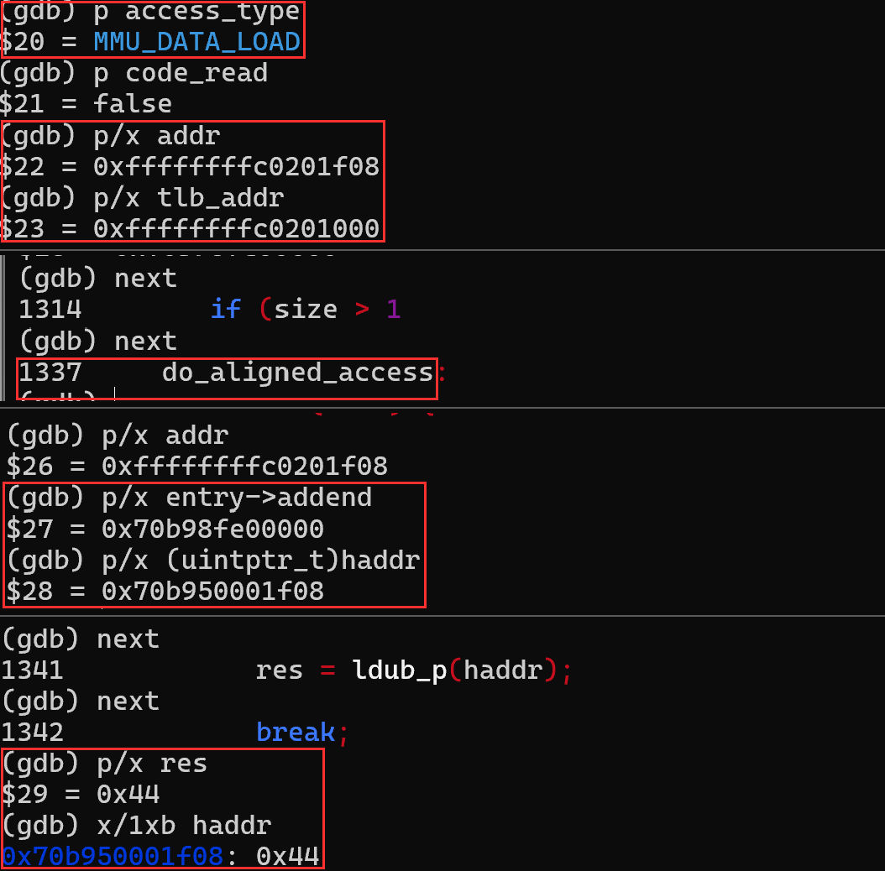

*图 11 load_helper 的命中路径、宿主地址计算与读取结果*

**分析。**

- **命中判断。** `tlb_addr = 0xffffffffc0201000` 是 `addr` 的页号，因此第 1271 行判断命中，不调用 `tlb_fill`，程序经 1283 行（非 IO）、1314 行（访问不跨页）到达 1337 行的对齐访问。
- **数据含义。** `0xffffffffc0201f08` 是 `dtb_init` 中 `cprintf("DTB Init\n")` 的格式串地址（反汇编 `addi a0,a0,-810 # ffffffffc0201f08`），内核镜像在该地址的内容为 `44 54 42 20 49 6e 69 74 0a`，第一个字节 `0x44` 即字符 `'D'`。`cprintf` 逐字节读取格式串，因此这是一次 1 字节的 load（`ldub_p`）。
- **宿主地址计算。** `haddr = addr + addend = 0xffffffffc0201f08 + 0x70b98fe00000 = 0x70b950001f08`（按 64 位取模）。`addend` 的含义可以由线性映射推出：QEMU 把客户机物理内存 `0x80000000` 起的区域映射到宿主地址 `ram_base`；内核虚拟地址 `VA = PA + 0xFFFFFFFF40000000`；因此 `haddr = ram_base + (PA − 0x80000000) = VA + (ram_base + 0x40000000)`，即 `addend = ram_base + 0x40000000`。代入 `addend = 0x70b98fe00000` 得 `ram_base = 0x70b94fe00000`，物理地址 `0x80201f08` 对应的宿主地址为 `0x70b94fe00000 + 0x201f08 = 0x70b950001f08`，与 `haddr` 一致。由于所有内核页都使用同一线性映射，各个内核页表项的 `addend` 相同；取指实验中的 `0x80001fe00000` 是另一次 QEMU 运行时 `ram_base` 不同所致。
- **为何能命中。** 该页此前没有被 load 过，命中所用的表项来自同一页上 `memset`（`0xffffffffc0201dfc`）的取指：`tlb_set_page_with_attrs` 一次写好读、写、取指三个字段，所以后续的数据读可以直接复用。
- **数据一致性。** `ldub_p` 读出的 `res = 0x44`，与宿主 GDB 直接检查 `haddr` 的结果相同，也与内核镜像中格式串的首字节一致。这说明 QEMU 对客户机内存的读写，最终就是对宿主进程内存的直接读写。

**结论。** 数据 load 命中时，QEMU 只做一次页号比较和一次加法：由 `entry->addend` 把客户机虚拟地址直接换算成宿主指针，而不再经过页表和物理地址。

#### （九）乙的调试观察：数据 store 的 TLB 填充

乙用宿主 GDB 附加课程环境中的 QEMU 4.1.1，在 `riscv_cpu_tlb_fill()` 与 `get_physical_address()` 上设置断点，观察 `kern_init` 中 `sd ra,8(sp)` 对栈地址 `0xffffffffc0204ff8` 的写入，结果与（四）至（六）部分相互印证：

- 客户机 GDB 显示 `satp = 0x8000000000080205`，`pc = 0xffffffffc02000d8`（位于 `kern_init` 入口之后）。
- `riscv_cpu_tlb_fill()` 命中时 `access_type = MMU_DATA_STORE`、`size = 8`、`mmu_idx = 1`，即一次 S 模式的 8 字节 store。
- `get_physical_address()` 中 `i = 0`、`levels = 3`、`base = 0x80205000`、`idx = 0x1ff`、`pte_addr = 0x80205ff8`、`pte = 0x200000cf`，与取指时完全相同：整个内核高地址区都由同一个根级 1 GiB 叶子 PTE 映射。
- `tlb_set_page()` 的参数为 `vaddr = 0xffffffffc0204000`、`paddr = 0x80204000`、`prot = 7`、`size = 4096`（图 12）。1 GiB 映射的物理基址是 `0x80000000`；QEMU 只为当前访问所在的 4 KiB 子页建立表项，子页基址为 `0x80000000 + (0xffffffffc0204000 & 0x3fffffff) = 0x80204000`，加上页内偏移 `0xff8`，物理地址为 `0x80204ff8`。
- `finish` 退出 `riscv_cpu_tlb_fill()` 时返回值为 `true`（图 13），`tlb_fill()` 中的 `assert(ok)` 随即通过，说明翻译成功、表项已建立。

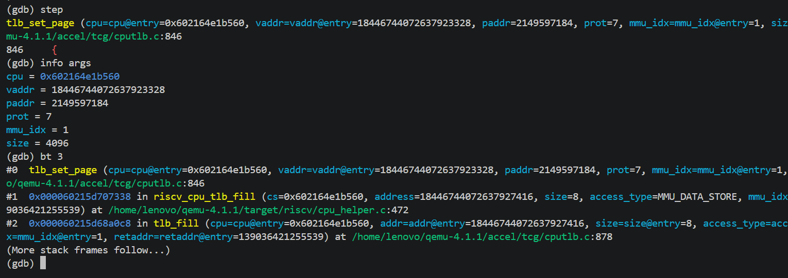

*图 12 数据 store 翻译后写入 TLB 的参数与调用栈*

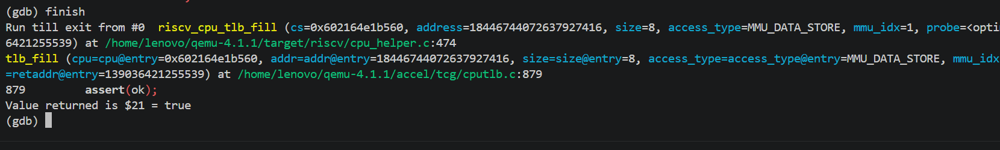

*图 13 riscv_cpu_tlb_fill 的返回值*

#### （十）丙的调试观察：Bare 模式访存、Sv39 load 与 victim TLB

丙在独立目录中以 `--enable-debug` 构建 QEMU 4.1.1（目标 `riscv64-softmmu`，未执行 `make install`），用 `file`、`info source`、`info line` 确认调试符号可用，并用该二进制完整启动了集成内核（[构建记录](evidence/member-c/qemu-debug-outof-tree-configure.log)）。在此基础上补充了三组观察：

- **Bare 模式与 M 模式的 load/store**（[host-load-store-bare.log](evidence/member-c/host-load-store-bare.log)）：OpenSBI 在 M 模式下的 load（`0x80009610`）和 store（`0x8001be00`）均有 `mmu_idx = 3`；uCore 开启分页前的 store `0x80206000` 有 `mmu_idx = 1`。`get_physical_address()` 返回后实测 VA = PA = `0x80009610`，与第（三）部分的结论一致。
- **Sv39 数据 load**（[host-sv39-load-translation.log](evidence/member-c/host-sv39-load-translation.log)）：VA `0xffffffffc0202998`，`access_type = 0`（load），同样经根级 PTE `0x200000cf` 翻译，物理页 `0x80202000`，页内偏移 `0x998`，最终 PA 为 `0x80202998`。
- **victim TLB 命中**：在 `victim_tlb_hit()` 中捕获到一次真实的命中，`page = cmp = 0x80000000`、`vidx = 0`、`index = 0`、`mmu_idx = 3`，调用者为 `get_page_addr_code()` 第 1031 行（图 14）。主 TLB 是直接映射的，同一索引上的旧表项被挤出后，会先进入 8 项的 victim TLB；再次访问时，若在 victim TLB 中命中，QEMU 交换 victim 项与主表项及对应的 IOTLB 项，从而避免重新执行 `tlb_fill()`。这补全了第（二）部分中“主 TLB 未命中 → victim TLB → `tlb_fill`”这条路径的中间一环。

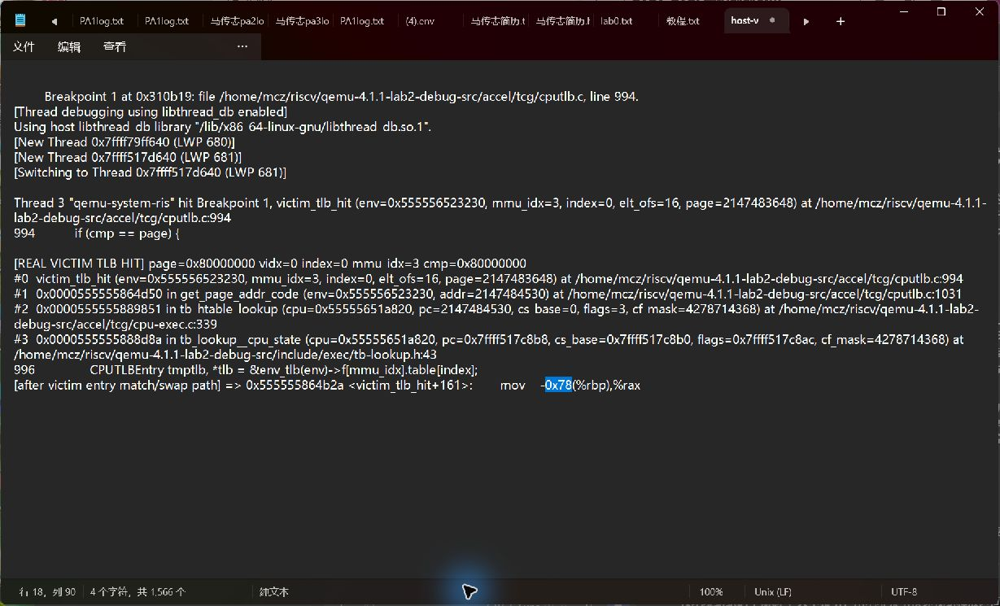

*图 14 宿主 GDB 记录的 victim TLB 命中*

#### （十一）模拟 TLB 与真实 TLB 的逻辑区别

| 方面 | QEMU 4.1.1 的软件 TLB（本实验观察） | 真实硬件 TLB |
| --- | --- | --- |
| 未开启分页时 | 仍先查 TLB，Miss 时经 `tlb_fill` 填入 VA = PA 的恒等表项（第（三）部分） | M 模式和 Bare 模式下地址不经过翻译，TLB 不参与 |
| 表的组织 | 每个特权级（`mmu_idx`）一张独立的表，复位时 `mmu_idx = 3`，内核运行时为 1 | 通常是一个 TLB，以 ASID、全局位等区分表项 |
| 表项内容 | 页号与 `addend`，命中后直接得到宿主指针（10.6、第（八）部分） | 物理页号与权限位 |
| 粒度 | 固定 4 KiB：1 GiB 超级页也按 4 KiB 建立表项，访问超级页中的每个新 4 KiB 页都要再填入一次（第（六）部分） | 通常可以用一个表项缓存整个大页 |
| 结构 | 直接映射，按 `VPN & (表项数 − 1)` 定位，辅以 8 项 victim TLB（丙观察到一次实际命中，见第（十）部分）；内核运行时 S 模式表为 64 项 | 组相联或全相联 |
| 刷新 | `write_satp` 仅在 ASID 变化时刷新，开启分页时依靠 `sfence.vma`（第（四）部分） | 由软件执行 `sfence.vma`，硬件可按 ASID 和地址选择性失效 |
| 命中检查 | 软件比较页号：取指在 `get_page_addr_code`，数据在 `load_helper`/`store_helper`，默认 TCG 后端把数据访问的比较内联到生成代码中 | 硬件在流水线中并行比较 |
| 写保护代码页 | 含已翻译代码的页，其 `addr_write` 带 `TLB_NOTDIRTY`，写操作必须走慢路径（第（六）部分） | 无此机制 |
| A/D 位 | `get_physical_address` 中由软件计算，并用 cmpxchg 写回 PTE | 由硬件更新，或交给软件处理 |

#### （十二）调试中的其他发现

- **代码页会被描述符数组挤出 TLB。** 运行中 `kern_init` 所在的代码页被重新填入了 5 次。在 `tlb_set_page_with_attrs` 写入表项前（cputlb.c:777）检查 0 号槽位原有的内容，第 2–4 次为 `0xffffffffc0340000`，第 5 次为 `0xffffffffc0240000`，二者都位于 `page_init()` 建立的描述符数组中（物理地址 `[0x80207000, 0x80347000)`）。S 模式表此时为 64 项直接映射，`0x...c0340 & 63 = 0x...c0240 & 63 = 0x...c0200 & 63 = 0`，因此初始化和检查描述符时访问的页与代码页争用同一个槽位；被挤出的表项先进入 8 项 victim TLB，随后又被冲掉，于是需要重新遍历页表（[refill-host-gdb.log](evidence/member-a-qemu-step/refill-host-gdb.log)）。
- **调试器读内存同样会遍历页表。** 客户机 GDB 执行 `x/4i`、`x/4bx` 或插入断点时，QEMU 通过 `riscv_cpu_get_phys_page_debug` 调用同一个 `get_physical_address`，但不会把结果写入 TLB。统计翻译次数时，需要用调用者区分这两类遍历（[host-gdb.log](evidence/member-a-qemu-host-gdb/host-gdb.log)）。
- **TCI 中翻译代码也经过 `load_helper`。** 在 `load_helper` 第 1271 行设置断点后，断点也会在 `code_read = true`、`access_type = MMU_INST_FETCH` 的 4 字节读上命中，例如地址 `0xffffffffc02000f2`：这是 TCI 在翻译基本块时读取客户机指令，使用的是表项的 `addr_code` 字段。数据读与取指读在 C 层面共用同一个函数，通过 `code_read` 选择比较的字段。

---

## 五、测试与验证

所有测试均使用课程 QEMU 4.1.1，在三人代码合并后的 `lab2` 上执行。

**`make qemu`：** 内核依次输出 DTB 内存范围、`memory management: best_fit_pmm_manager`、Page Init 布局、`check_alloc_page() succeeded!` 和 `slub_check() succeeded!`（图 15）。

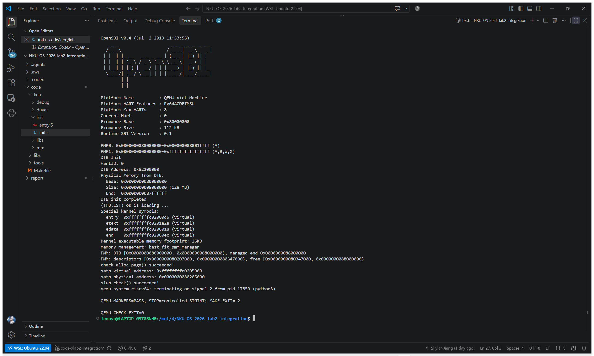

*图 15 make qemu 的运行结果*

**`make grade`：** Page Init 与 Best-Fit 两项检查均为 OK，总分 20/20（图 16）。

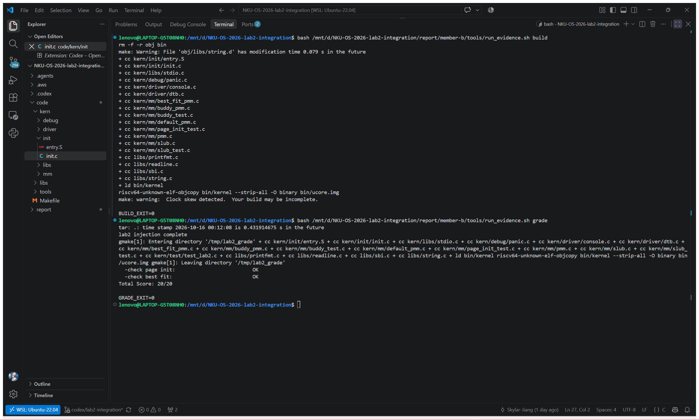

*图 16 make grade 的评分结果*

**完整回归：**

| 测试 | 配置 | 结果 | 日志 |
| --- | --- | --- | --- |
| 完整构建 `make` | 标准 | BUILD_EXIT=0 | [make.log](evidence/integration/post-merge-round3/make.log) |
| `make qemu` | 标准（Best-Fit + SLUB） | Best-Fit 自检、SLUB 测试通过 | [make-qemu.log](evidence/integration/post-merge-round3/make-qemu.log) |
| `make grade` | 官方评分 | check page init OK，check best fit OK，20/20 | [make-grade.log](evidence/integration/post-merge-round3/make-grade.log) |
| Page Init 独立测试 | 64/128/256 MiB | 全部 PASS | [check_a.log](evidence/integration/post-merge-round3/check_a.log) |
| Buddy 正常用例 | 64/128/256 MiB | 全部 PASS | 同上 |
| Buddy 预期 panic 用例 1–6 | 各自单独启动 | 均观察到预期错误 | 同上 |
| Page Init 输入注入、客户机 GDB 翻译核对 | Page Init 配置 | 全部符合规格 | [debug_a.log](evidence/member-a-round2/debug_a.log) |
| SLUB 测试 | First-Fit、Best-Fit、Buddy 三种页管理器 | 均输出 `slub_check() succeeded!` | [profile-buddy-full-boot-128M.log](evidence/integration/pre-merge-isolated/profile-buddy-full-boot-128M.log) |

`make grade` 只对 Page Init 与 Best-Fit 评分；Buddy 与 SLUB 的正确性由各自的测试证明（见第四节对应部分）。

---

## 六、实验总结与收获

### 对操作系统的理解

#### 1. 重要知识点与 OS 原理的对应

| 实验中的知识点 | 对应的 OS 原理 | 含义、关系与差异 |
| --- | --- | --- |
| 设备树提供内存范围，`dtb_init` 解析 | 物理内存探测（如 x86 BIOS 的内存布局查询） | 都在启动早期确定“哪里有内存”。实验中 OpenSBI 把 DTB 传给内核；实际系统还有固件探测、多段内存和保留区等情况 |
| 链接符号 `end`、Page Init 保留内核与描述符 | 内核映像常驻内存，不参与分配 | 链接器决定内核占用的范围，Page Init 将其排除在空闲区之外。实验中内核整体常驻；原理中内核也可以部分按需加载 |
| `struct Page` 数组、Reserved/Property 标志 | 页框表与页框状态 | 每个物理页对应一个描述符；不同分配器复用描述符字段，例如 Buddy 使用私有 flags 位 |
| `pmm_manager` 函数指针 | 机制与策略分离 | 内核提供统一的分配接口（机制），First-Fit、Best-Fit、Buddy 是可替换的策略，作用类似 C++ 的纯虚函数 |
| First-Fit / Best-Fit | 连续内存分配、外部碎片 | 都维护按地址排序的空闲链表并合并相邻块，区别在于选择哪一块。Best-Fit 选择最小的满足块，容易留下难以利用的小碎片 |
| Buddy System | 伙伴系统、内部碎片 | 块大小为 2 的幂，用 XOR 快速定位伙伴并合并，代价是向上取整造成的内部碎片 |
| SLUB | slab / 对象缓存 | 在页分配器之上按对象大小分类缓存，用于小对象分配 |
| `boot_page_table_sv39`、`satp` | 多级页表、页表基址寄存器 | Sv39 使用三级页表，`satp` 保存根页表的物理页号和模式 |
| 第一级叶子 PTE | 大页 / 超级页 | 遍历在第一级结束，减少遍历次数和页表占用；QEMU 的软件 TLB 仍按 4 KiB 缓存（见分支任务第（六）部分） |
| `tlb_fill`、`sfence.vma` | TLB、TLB 刷新 | Miss 后遍历页表并填入 TLB，修改页表或 `satp` 后需要刷新 |
| 先 Bare 运行，再写 `satp` 进入 Sv39 | 开启分页的引导问题（类比 x86 从实模式进入保护模式） | MMU 依赖内存中的页表，上电后必须先以物理地址运行，建好页表再开启翻译 |
| `va_pa_offset`、`KADDR`/`PADDR` | 内核的虚实地址映射 | 内核以固定偏移线性映射物理内存，分配器管理物理页，两者需要相互换算；QEMU 表项中的 `addend` 正是这一线性关系在宿主侧的体现 |

#### 2. OS 原理中重要但本实验未对应的知识点

- 每个进程独立的页表与地址空间切换（本实验只有内核启动页表）；
- 缺页异常处理、按需分页、写时复制；
- 页面置换算法与交换区；
- 用户态内存保护（PTE 的 U 位、`SUM` 位）以及内核与用户地址空间的隔离；
- 多核下的 TLB 一致性（TLB shootdown）与分配器加锁；
- 内核虚拟内存分配（如 vmalloc）与内存映射文件；
- 内存回收与内存压力下的 OOM 处理；
- NUMA、多段物理内存、固件保留区和 DMA 区域的管理。

### AI 协作开发的经验

1. **规格写得越具体，生成代码越可靠。** Page Init 的规格明确写出了 `npage` 的含义、校验顺序和“没有完整空闲页”的情况，生成代码一次就通过了全部边界测试；Buddy 的规格要求写明释放契约，实现因此在块头记录了原请求页数，并在修改状态之前拒绝非法释放。缺少这些约束时，AI 往往只处理正常路径。
2. **测试本身也需要审查。** SLUB 测试中的耗尽判定 `assert(slub_alloc(16) == NULL)` 看似合理，却忽略了已有 slab 中的空闲槽位；这个错误是对测试代码做静态检查时发现的。AI 生成的测试与实现一样需要对照原理复核，否则可能出现“测试通过但没有测到要测的东西”。
3. **实现与测试分开生成，并相互制约。** Buddy 与 SLUB 都采用“先实现、后单独生成测试”的方式，并在测试规格中禁止为通过测试而修改算法或删除断言，使测试能够独立检验实现。
4. **调试中让 AI 做导航，由断点输出做裁判。** QEMU 源码规模很大，AI 能快速定位 `get_page_addr_code`、`riscv_cpu_tlb_fill`、`get_physical_address` 等关键函数，也能解释“数据访问的 TLB 命中为何在 C 层面不可见”，并给出编译 TCI 版本的思路。但每个结论都以宿主 GDB 的实际输出为准，并与客户机 GDB 的读数、内核镜像内容相互核对。
5. **集成阶段的回归必不可少。** 三人分支合并时，每次合并前后都重新执行构建、`make qemu`、`make grade` 和独立回归，及时发现配置之间的耦合（例如 SLUB 测试在所有配置下都会运行），避免把问题带入最终提交。
