# 操作系统实验报告

Lab5：用户进程管理

## 实验基本信息

| 项目 | 内容 |
| --- | --- |
| 实验名称 | Lab5：用户进程管理 |
| 小组成员 | 2411788-马传志、2413507-蒋林瀞、2412096-王麒萱 |
| 完成日期 | 2026.11.25 |

表1 实验基本信息

### 小组分工

| 成员 | 负责的练习/模块 |
| --- | --- |
| A 2412096-王麒萱 | 前置代码迁移；功能模块一：系统调用与 Trap；COW 写缺页接入；时钟调度及用户态读缺页处理 |
| B 2413507-蒋林瀞 | 功能模块二：用户程序加载及进程初始化；功能模块四：进程退出、等待、让出 CPU 和终止 |
| C 2411788-马传志 | 功能模块三：进程复制；COW、页表输出；Dirty COW 分析 |

表2 小组分工

## 一、实验目的

1. 掌握用户态和内核态之间的切换方法，理解系统调用的参数传递及返回过程。
2. 理解 ELF 用户程序的加载方式，掌握用户地址空间、用户栈和初始运行现场的设置方法。
3. 掌握用户进程的创建、复制、调度、退出及等待回收方法。
4. 理解写时复制机制，分析页表权限、缺页异常和物理页引用计数之间的关系。

## 二、实验环境

| 项目 | 配置 |
| --- | --- |
| 操作系统 | Windows、WSL Ubuntu 22.04 |
| 目标架构 | RISC-V 64 位，Sv39 分页 |
| 交叉编译器 | riscv64-unknown-elf-gcc 15.1.0；SiFive GCC 10.2.0 |
| Binutils | GNU Binutils 2.45 |
| 调试器 | RISC-V GDB 16.3.90.20250610-git；宿主 GDB 12.1 |
| 运行环境 | QEMU 4.1.1 Virt Machine，OpenSBI v0.4 |
| 模拟物理内存 | 128 MiB |
| 编辑器 | VSCode |

表3 软件环境

## 三、实验整体逻辑与原理

### 3.1 内核启动流程

Lab5 沿用 Lab4 的内核线程创建和调度机制。先初始化内存、Trap 入口和进程管理模块，再创建 idle、init 两个内核线程。init 创建 user_main，通过 kernel_execve 加载用户程序，最后沿 Trap 返回路径进入 U 态。

```text
kern_init -> pmm_init -> idt_init -> vmm_init -> proc_init -> clock_init -> cpu_idle
                                                    |
                                              idleproc / initproc
                                                         |
                                              kernel_thread(user_main)
                                                         |
                                              kernel_execve -> ebreak
                                                         |
                                              syscall -> do_execve -> load_icode
                                                         |
                                              __trapret -> sret -> 用户程序
```

用户程序通过 ecall 请求内核服务。内核保存异常现场，执行对应的系统调用，再根据进程状态继续运行或切换进程。父进程通过 wait 回收已退出的子进程，init 回收移交给它的孤儿进程。

### 3.2 实验步骤

1. 迁移 Lab2 至 Lab4 的内存管理、Trap、内核线程及调度代码，适配 Lab5 的结构体和接口。
2. 编写 U/S 态 Trap 保存和恢复代码，完成系统调用分发及九个封装函数。
3. 编写 ELF 装载、用户栈设置和进程管理代码，构造用户程序的初始 trapframe。
4. 编写普通 Fork 和 COW 复制代码，通过写保护和缺页异常延迟复制物理页。
5. 运行用户程序，使用 GDB 观察特权级和寄存器变化，再执行官方评分。

### 3.3 特权级切换

RISC-V 进入 S 态 Trap 时，将原特权级记录在 SPP，将原 SIE 保存到 SPIE，清除 SIE，并将异常指令地址写入 sepc。软件保存通用寄存器和原栈指针。执行 sret 时，处理器依据 SPP 选择返回特权级，将 SPIE 复制给 SIE，再跳转至 sepc。

| 字段 | 用途 |
| --- | --- |
| `sscratch` | U 态运行期间保存内核栈地址，S 态运行期间设为 0 |
| `sstatus` | 保存 SPP、SPIE、SIE、SUM 等状态位 |
| `sepc` | 保存异常返回地址 |
| `scause` | 记录中断或异常原因 |
| `stval` | 记录异常相关地址 |

表4 Trap 相关 CSR

RV64 的 trapframe 由 32 个通用寄存器槽和 4 个 CSR 槽组成，占 288 字节。系统调用将返回地址增加 4 字节，COW 写缺页修复后保留原地址，使写指令重新执行。时钟中断也保留原地址。

### 3.4 用户地址空间

使用 Sv39 三级页表管理用户虚拟地址。ELF 的 PT_LOAD 段描述文件内容、内存长度、虚拟地址和读写执行权限。先把文件数据复制到相应物理页，再清零 BSS，建立用户栈，最后把 ELF 入口和用户栈顶写入 trapframe。

进程之间共享内核映射。普通 Fork 为子进程创建独立的 mm 和页表，CLONE_VM 共享同一个 mm。mm_count 记录地址空间的使用者数量，Page 引用计数记录物理页的映射引用。

## 四、实验过程

### 4.1 迁移 Lab2、Lab3、Lab4 代码

负责人：A 2412096-王麒萱。

将物理页分配、页表映射、kmalloc、Trap 入口、内核线程和调度代码迁入 Lab5，适配 DTB 内存初始化、页引用及 TLB 刷新。Trap 帧中的异常地址字段使用 tval，线程切换继续通过 context 保存 ra、sp 和 s0～s11。

### 4.2 功能模块一：系统调用

负责人：A 2412096-王麒萱。

#### 4.2.1 保存 Trap 现场

在 `kern/trap/trapentry.S` 中，使用 SAVE_ALL、RESTORE_ALL、__alltraps 和 __trapret 保存、恢复异常现场。将栈帧大小统一为 `36 * REGBYTES`，使用汇编条件判断约束 16 字节对齐。

```asm
csrrw sp, sscratch, sp
bnez sp, _save_context
_restore_kernel_sp:
    csrr sp, sscratch
_save_context:
    addi sp, sp, -TRAPFRAME_SIZE
```

U 态发生 Trap，交换 sp 和 sscratch，使用 sscratch 中的内核栈地址建立 trapframe；S 态发生 Trap，交换得到的 sp 为 0，从 sscratch 取回原内核栈指针。保存通用寄存器以后，使用 `csrrw s0, sscratch, x0` 读出原栈指针，同时清零 sscratch。将 s0 写入下标为 2 的寄存器槽，再保存 status、epc、tval 和 cause。

| 字段 | 字节偏移 |
| --- | ---: |
| `gpr.sp` | 16 |
| `status` | 256 |
| `epc` | 264 |
| `tval` | 272 |
| `cause` | 280 |

表5 Trap 栈帧字段偏移

#### 4.2.2 恢复 Trap 现场

先关闭 SIE，读取栈帧中的 status 和 epc，并清除待写回 status 的 SIE 位。保留 SPIE，由 sret 恢复中断状态。

```asm
csrci sstatus, SSTATUS_SIE
LOAD s1, 32*REGBYTES(sp)
LOAD s2, 33*REGBYTES(sp)
andi s1, s1, ~SSTATUS_SIE
csrw sscratch, zero
andi s0, s1, SSTATUS_SPP
bnez s0, _restore_context
addi s0, sp, TRAPFRAME_SIZE
csrw sscratch, s0
_restore_context:
    csrw sstatus, s1
    csrw sepc, s2
```

根据 SPP 区分返回目标。返回 U 态时将释放 trapframe 后的内核栈地址写入 sscratch，返回 S 态则保持 sscratch 为 0。恢复其余通用寄存器，最后读取下标为 2 的槽恢复 sp。status 和 epc 用于异常返回，tval 和 cause 用于记录异常信息。

在 __alltraps 中将 sp 写入 a0，调用 trap。普通异常返回沿 __trapret 恢复现场；新进程通过 forkrets 将预先构造的 trapframe 地址写入 sp，再跳转到 __trapret，两条路径都以 sret 结束。

#### 4.2.3 系统调用分发

用户态通过 a0 传递系统调用号，a1～a5 传递参数，执行 ecall。内核将 epc 增加 4，再调用 syscall。使用 uint64_t 保存调用号和参数，保留 RV64 指针宽度。

```c
uint64_t number = tf->gpr.a0;
int result = -E_INVAL;
if (number < NUM_SYSCALLS && syscalls[number] != NULL)
{
    uint64_t arg[5] = {
        tf->gpr.a1, tf->gpr.a2, tf->gpr.a3, tf->gpr.a4, tf->gpr.a5,
    };
    result = syscalls[number](arg);
}
tf->gpr.a0 = (uintptr_t)(intptr_t)result;
```

将系统调用号作为分发表下标，先判断范围和函数指针，再传入参数数组。将 int 类型的执行结果符号扩展到 RV64 寄存器宽度，写回 a0。无效调用号返回 -E_INVAL。

| 系统调用 | 内核接口或操作 |
| --- | --- |
| `sys_exit` | `do_exit((int)arg[0])` |
| `sys_fork` | `do_fork(0, tf->gpr.sp, tf)` |
| `sys_wait` | `do_wait`，传入 PID 和退出状态地址 |
| `sys_exec` | `do_execve`，传入程序名称、名称长度、映像地址及大小 |
| `sys_yield` | `do_yield()` |
| `sys_kill` | `do_kill`，传入 PID |
| `sys_getpid` | 返回 `current->pid` |
| `sys_putc` | `cputchar`，返回 0 |
| `sys_pgdir` | `print_pgdir()`，返回 0 |

表6 系统调用分发接口

在 trap 中临时将 current->tf 指向当前异常帧，执行分发，再恢复原指针。用户态返回前读取 PF_EXITING 和 need_resched，分别执行进程退出和重新调度。

#### 4.2.4 内核态系统调用入口

内核通过 ebreak 启动用户程序：a7 为 T_SYSCALL，a0 为 SYS_exec，a1～a4 分别传递名称、长度、映像地址和映像大小。先通过 SPP 和寄存器标记判断是否为内核 exec 请求，再检查指令编码，区分 2 字节的 c.ebreak 和 4 字节的 ebreak。普通断点沿原异常分支执行。

成功加载程序会修改当前 trapframe 中的 epc、status 和 sp，因此在调用 syscall 前先推进断点地址。若加载成功，则通过新的 epc 进入用户程序；若加载失败，则返回原内核调用位置。

### 4.3 功能模块二：用户程序加载

负责人：B 2413507-蒋林瀞。

#### 模块功能

进程初始化和装载涉及以下函数：

```c
static struct proc_struct *alloc_proc(void);
int kernel_thread(int (*fn)(void *), void *arg, uint32_t clone_flags);
static int init_main(void *arg);
static int user_main(void *arg);
static int kernel_execve(const char *name, unsigned char *binary, size_t size);
int do_execve(const char *name, size_t len, unsigned char *binary, size_t size);
static int load_icode(unsigned char *binary, size_t size);
void proc_run(struct proc_struct *proc);
```

启动时先创建 user_main 内核线程，再装载用户程序并进入 U 态。执行路径如下：

```text
proc_init -> initproc(init_main) -> kernel_thread(user_main)
user_main -> kernel_execve -> ebreak -> trap -> syscall -> sys_exec -> do_execve -> load_icode
__trapret -> sret -> 用户程序入口 0x800020
init_main: do_wait 回收全部子进程 -> 检查进程表与空闲页
```

init_main 通过 do_wait 等待并回收子进程，退出与回收流程见 4.5。

#### 4.3.1 适配 Lab4 进程管理代码

PCB 初始化与页表切换沿用 Lab4 的流程，按 Lab5 的新增字段和用户地址空间进行设置：

1. `alloc_proc` 在清零 PCB 后显式初始化 Lab5 新增字段：

```c
proc->exit_code = 0;
proc->wait_state = 0;
proc->cptr = proc->yptr = proc->optr = NULL;
```

`set_links` 和 `remove_links` 依赖这三个指针的初值为 `NULL`。

2. `proc_run` 通过框架提供的 `lsatp()` 写入 satp，再调用 `flush_tlb()`。`lsatp` 写入 `0x8000000000000000 | (pgdir >> 12)`，即 Sv39 模式。各进程使用 ASID=0，切换页表后刷新全部 TLB。

`kernel_thread` 沿用 Lab4 实现：内核线程以 `SPP=1` 返回 S 态，用户进程由 `load_icode` 重写 trapframe。

#### 4.3.2 解析 ELF 并建立地址空间

`load_icode` 采用先建后换的顺序：在旧地址空间仍然有效时建立完整的新地址空间，全部成功后再切换。用户进程通过 `exec` 传入的程序映像位于旧用户空间，提交前一直可以读取；装载失败时当前进程保持原状，`exec` 返回错误码。

装载分为七步：

```text
(1) 复制并检查 ELF 头           失败: -E_INVAL_ELF，未分配资源
(2) mm_create + setup_pgdir      失败: -E_NO_MEM
(3) 逐个装载 PT_LOAD 段          失败: 销毁新 mm，返回错误码
(4) 检查入口位于可执行段
(5) 建立用户栈
(6) 提交: 安装新 mm，切换 satp，释放旧 mm
(7) 重写 trapframe
```

**ELF 检查。** `--format=binary` 嵌入的程序映像不保证 8 字节对齐，因此先用 `memcpy` 把 ELF 头和程序头复制到局部变量再读取。检查项如下：

| 检查项 | 条件 |
| --- | --- |
| 魔数 | `e_magic == ELF_MAGIC` |
| 程序头 | `e_phnum > 0`，`e_phentsize == sizeof(struct proghdr)` |
| 程序头范围 | `e_phoff <= size`，且 `(size - e_phoff) / sizeof(proghdr) >= e_phnum` |
| 段大小 | `p_filesz <= p_memsz` |
| 文件范围 | `p_offset <= size`，且 `p_filesz <= size - p_offset` |
| 虚拟地址 | `p_va + p_memsz` 不回绕，且位于 `[USERBASE, USERTOP)` |
| 段重叠 | 与已建立的 VMA 不相交，包括共用同一页的情况 |
| 入口 | `e_entry` 位于带 `VM_EXEC` 的 VMA 内 |
| 段数量 | 至少有一个 `PT_LOAD` 段 |

表7 ELF 合法性检查

范围检查都写成减法形式，避免 `p_offset + p_filesz` 等加法溢出后绕过检查。

**权限设置。** 按段标志设置 VMA 和 PTE 权限：

```c
if (p_flags & ELF_PF_X) { *vm_flags |= VM_EXEC;  *perm |= PTE_X; }
if (p_flags & ELF_PF_W) { *vm_flags |= VM_WRITE; *perm |= PTE_W | PTE_R; }
if (p_flags & ELF_PF_R) { *vm_flags |= VM_READ;  *perm |= PTE_R; }
```

RISC-V 规定 W=1、R=0 的组合保留不用，因此可写页同时设置 R。代码段为 R-X，数据段和 BSS 为 RW-。

**段装载。** 用户程序的代码段从 `0x800020` 开始，没有按页对齐。对段覆盖的每一页，先分配新页并整页清零，再复制该页与文件数据区间 `[p_va, p_va + p_filesz)` 的交集：

```c
for (la = ROUNDDOWN(va, PGSIZE); la < end; la += PGSIZE) {
    page = pgdir_alloc_page(mm->pgdir, la, perm);
    memset(page2kva(page), 0, PGSIZE);
    from = max(la, va);
    to = min(la + PGSIZE, va + filesz);
    if (from < to)
        memcpy(kva + (from - la), src + (from - va), to - from);
}
```

整页清零同时处理三种情况：首页中 `p_va` 之前的部分，BSS，以及末页中文件数据之后的部分。testbss 的 BSS 段 `p_filesz=0`、`p_memsz=0x400000`，共 1024 页。

**段重叠检查。** `mm_map` 只用 `find_vma(start)` 判断新区间的起点是否落在已有 VMA 内。若新区间的起点低于已有 VMA 并覆盖它，就会进入 `insert_vma_struct` 的重叠断言，使内核 panic。`load_icode` 在调用 `mm_map` 前遍历全部 VMA，判断区间相交：

```c
if (start < vma->vm_end && vma->vm_start < end)
    return -E_INVAL_ELF;
```

**用户栈。** 映射 `[USTACKTOP - USTACKSIZE, USTACKTOP)` 为 `VM_READ | VM_WRITE | VM_STACK`，并为栈顶 4 页分配物理页。Lab5 没有缺页时按需分配页面的机制，VMA 中其余部分不建立映射，用户栈越界访问会触发缺页异常。

**提交。** 在关中断的临界区内安装新 mm：

```c
mm_count_inc(mm);
current->mm = mm;
current->pgdir = PADDR(mm->pgdir);
lsatp(current->pgdir);
flush_tlb();
```

随后执行 `fence.i`。代码段是内核通过直接映射区写入的，`fence.i` 保证之后从用户地址取到的是新写入的指令。最后调用 `release_mm(old_mm)` 释放旧地址空间的引用。

`release_mm` 将 `mm_count` 减一，减到 0 时依次调用 `exit_mmap`、`put_pgdir`、`mm_destroy`。`mm_count` 记录共享同一地址空间的进程数（`CLONE_VM`），物理页的 `Page::ref` 记录映射该页的页表项数（COW）。`exit_mmap` 撤销映射时按 `Page::ref` 决定是否释放物理页，因此 COW 共享页只在最后一个映射撤销时释放。

**trapframe。** 提交后重写 `current->tf`：

```c
uintptr_t sstatus = read_csr(sstatus);
memset(tf, 0, sizeof(struct trapframe));
tf->gpr.sp = USTACKTOP;
tf->epc = elf.e_entry;
tf->status = (sstatus & ~(SSTATUS_SPP | SSTATUS_SIE)) | SSTATUS_SPIE;
```

- `SPP=0`：`sret` 返回 U 态。
- `SPIE=1`：`sret` 将 SIE 置 1，用户程序运行时开中断。
- `SIE=0`：返回用户态前的内核路径保持关中断。
- `SUM` 等其他位沿用当前值。

**失败回收。** 第 (3)～(5) 步失败时，新 mm 尚未安装，`mm_count` 为 0，依次调用 `exit_mmap`、`put_pgdir`、`mm_destroy`，回收已分配的页面、页表和 VMA。

#### 4.3.3 替换程序映像

`do_execve` 校验参数并复制进程名，再调用 `load_icode`：

```c
if (name == NULL || binary == NULL || size == 0)
    return -E_INVAL;
if (len > PROC_NAME_LEN)
    len = PROC_NAME_LEN;
if (mm != NULL) {
    lock_mm(mm);
    if ((len != 0 && !copy_from_user(mm, local_name, name, len, 0)) ||
        !user_mem_check(mm, (uintptr_t)binary, size, 0)) {
        unlock_mm(mm);
        return -E_INVAL;
    }
    unlock_mm(mm);
} else {
    memcpy(local_name, name, len);
}
if ((ret = load_icode(binary, size)) != 0)
    return ret;
set_proc_name(current, local_name);
```

- 用户进程（`mm != NULL`）传入的指针必须位于自身可读的 VMA 中。
- 内核线程（`mm == NULL`）只能通过 `kernel_execve` 调用，参数是内核镜像中的数据，直接复制。
- 进程名截断为 `PROC_NAME_LEN`（15）个字符，复制到以零结尾的局部缓冲区。`load_icode` 提交后会释放旧地址空间，之后不再读取用户内存中的名称。
- `load_icode` 失败时直接返回错误码，PID、进程关系和原映像都不变。

#### 4.3.4 进入用户态

内核启动用户程序时，通过 ebreak 进入已有的 Trap 返回路径。trap.c 使用以下调用约定：`a7 = T_SYSCALL`、`a0 = SYS_exec` 时，异常处理将 `epc` 跳过 `ebreak` 指令，再调用 `syscall()`。`kernel_execve` 按此契约发起 `exec`：

```c
size_t len = strlen(name);
register uintptr_t a0 asm("a0") = SYS_exec;
register uintptr_t a1 asm("a1") = (uintptr_t)name;
register uintptr_t a2 asm("a2") = (uintptr_t)len;
register uintptr_t a3 asm("a3") = (uintptr_t)binary;
register uintptr_t a4 asm("a4") = (uintptr_t)size;
register uintptr_t a7 asm("a7") = T_SYSCALL;
asm volatile("ebreak"
             : "+r"(a0)
             : "r"(a1), "r"(a2), "r"(a3), "r"(a4), "r"(a7)
             : "memory");
return (int)a0;
```

执行过程如下：

1. `ebreak` 进入 `__alltraps`，`SAVE_ALL` 在当前内核栈上保存 trapframe，`trap()` 将 `current->tf` 指向它。
2. `syscall()` 调用 `do_execve`，`load_icode` 把这个 trapframe 改写为用户态现场。
3. 返回 `__trapret` 后，`RESTORE_ALL` 发现 `SPP=0`，将内核栈地址写入 `sscratch`，恢复寄存器，执行 `sret` 进入用户程序。

`exec` 成功后不会回到 `kernel_execve`。返回 `kernel_execve` 说明 `exec` 失败，`a0` 中是错误码。进入 Trap 时硬件清除 SIE，`RESTORE_ALL` 再次清除 SIE，切换过程中不会被中断打断。

`user_main` 根据编译参数选择程序：

```c
#ifdef TEST
    ret = KERNEL_EXECVE2(TEST, TESTSTART, TESTSIZE);
#else
    ret = KERNEL_EXECVE(exit);
#endif
    cprintf("user_main: kernel_execve failed, error %d.\n", ret);
    return ret;
```

`make build-hello` 传入 `-DTEST=hello -DTESTSTART=_binary_obj___user_hello_out_start -DTESTSIZE=...`，评分脚本依次以各测试程序构建内核。`exec` 失败时 `user_main` 返回错误码，经 `kernel_thread_entry` 调用 `do_exit`，由 `initproc` 回收。

`init_main` 创建 `user_main`，循环调用 `do_wait(0, NULL)` 回收全部子进程，包括移交给它的孤儿进程。回收完毕后检查进程表：

```c
assert(initproc->cptr == NULL && initproc->yptr == NULL && initproc->optr == NULL);
assert(nr_process == 2);
assert(list_next(&proc_list) == &(initproc->list_link));
assert(list_prev(&proc_list) == &(initproc->list_link));
```

回收结束后记录空闲页数，并检查 kmalloc 的已分配字节数是否恢复。SLOB 保留的 arena 页面继续供后续小块分配使用。

### 4.4 功能模块三：进程复制

负责人：C 2411788-马传志。

#### 4.4.1 创建子进程

先判断进程数是否达到 MAX_PROCESS，再分配 PCB、内核栈和地址空间，复制父进程的 trapframe。关中断期间分配 PID、登记哈希表、调用 set_links 建立父子及兄弟关系，最后唤醒子进程。set_links 内部已增加 nr_process，因此不重复计数。

```c
proc->tf = (struct trapframe *)(proc->kstack + KSTACKSIZE) - 1;
*proc->tf = *tf;
proc->tf->gpr.a0 = 0;
proc->tf->gpr.sp = stack ? stack :
    ((tf->status & SSTATUS_SPP) ? (uintptr_t)proc->tf : tf->gpr.sp);
proc->context.ra = (uintptr_t)forkret;
proc->context.sp = (uintptr_t)proc->tf;
```

子进程的 a0 设为 0，父进程通过 syscall 得到子进程 PID。用户栈采用传入地址或父进程原用户 sp；内核线程的零 stack 则使用新 trapframe 地址。子进程首次调度从 forkret 开始执行。

#### 4.4.2 复制地址空间

在 copy_mm 中区分三种情况：内核线程的 mm 为空；CLONE_VM 共享原 mm；普通 Fork 创建新 mm 和根页表，再通过 dup_mmap 复制 VMA 和用户映射。

普通复制模式下，在 copy_range 中逐页查找有效用户叶项，分配新物理页并复制 PGSIZE 字节，再按原权限建立子进程映射。若原页为 COW，复制的新页恢复 W 并清除 COW 标志。`LAB5_COW=0` 对应立即复制，默认使用 COW。

若复制中途失败，撤销子地址空间已建立的映射、释放根页表、VMA 和 mm，再回收内核栈及 PCB。只有资源和现场全部建立成功，才登记子进程。

#### 4.4.3 输出页表

使用 pmm.c 中的 print_pgdir 输出当前页表。读取当前 satp，从低位 PPN 计算根页表物理地址。检查 Sv39 模式和根页表所在物理内存范围，递归遍历三级页表。根据叶项所在层级区分 4 KiB、2 MiB 和 1 GiB 映射，输出规范虚拟地址、物理地址及 RWX/U/G/A/D、COW 权限。遍历过程逐层读取已有页表项，输出映射范围和权限。

### 4.5 功能模块四：进程生命周期

负责人：B 2413507-蒋林瀞。

#### 模块功能

进程退出、等待和调度使用以下接口：

```c
int do_exit(int error_code);
int do_wait(int pid, int *code_store);
int do_yield(void);
int do_kill(int pid);
```

退出、等待回收、让出 CPU 和终止分别通过以下调用进入：

| 函数 | 调用来源 |
| --- | --- |
| `do_exit` | `sys_exit`；`trap()` 发现 `PF_EXITING`；内核线程函数返回后的 `kernel_thread_entry` |
| `do_wait` | `sys_wait`；`init_main` |
| `do_yield` | `sys_yield` |
| `do_kill` | `sys_kill` |

表8 调用来源

#### 4.5.1 进程退出

`do_exit` 的处理顺序如下：

1. `idleproc` 或 `initproc` 调用时 panic，与官方框架一致。
2. 若 `current->mm` 非空，先写入 `boot_pgdir_pa` 切换到内核页表，再调用 `release_mm`。正在使用的页表不能在切换之前释放。
3. 关中断，将状态设为 `PROC_ZOMBIE`，记录 `exit_code`。
4. 父进程的 `wait_state` 为 `WT_CHILD` 时唤醒父进程。
5. 将全部子进程移交给 `initproc`。
6. 恢复先前的中断状态，调用 schedule 切换进程。

移交子进程时，从 `current->cptr` 逐个取下，插入 `initproc` 子进程链表的头部，与 `set_links` 的插入方式相同：

```c
while (current->cptr != NULL) {
    proc = current->cptr;
    current->cptr = proc->optr;
    proc->yptr = NULL;
    if ((proc->optr = initproc->cptr) != NULL)
        initproc->cptr->yptr = proc;
    proc->parent = initproc;
    initproc->cptr = proc;
    if (proc->state == PROC_ZOMBIE && initproc->wait_state == WT_CHILD)
        wakeup_proc(initproc);
}
```

移交的子进程中若有僵尸进程，并且 `initproc` 正在等待，就唤醒 `initproc` 回收它。

`do_exit` 执行时仍在使用自己的内核栈，`schedule()` 和 `switch_to` 还要把寄存器保存到自己 PCB 的 `context` 中，父进程回收时也要从 PCB 读取 `exit_code`。因此内核栈和 PCB 都由 `do_wait` 释放。

#### 4.5.2 等待与回收

`do_wait` 的流程如下：

```text
检查 code_store                     用户进程: 必须可写，否则 -E_INVAL
repeat:
  关中断
  pid != 0: find_proc(pid)，且 parent == current
  pid == 0: 遍历 current->cptr 链表
  找到僵尸子进程 -> found
  有子进程但都未退出 -> SLEEPING + WT_CHILD，开中断，schedule()
                         被唤醒后若 PF_EXITING -> do_exit(-E_KILLED)
                         goto repeat
  没有子进程 -> 开中断，返回 -E_BAD_PROC
found:
  写回 exit_code                    写入失败: 返回 -E_INVAL，不回收
  关中断 { unhash_proc; remove_links }
  put_kstack; kfree
```

- **丢失唤醒。** 检查子进程状态和设置 `PROC_SLEEPING` 放在同一个关中断区间内。子进程的 `do_exit` 在检查之前执行，就会被这次检查发现；在之后执行，父进程已经处于 `WT_CHILD`，会被唤醒。
- **非法 PID。** `find_proc` 只接受 `0 < pid < MAX_PID`，`do_wait(-1, NULL)` 返回 `-E_BAD_PROC`。
- **写回退出码。** 用户进程通过 `copy_to_user` 写入。fork 后父进程的栈页处于 COW 共享状态。`copy_to_user` 先调用成员 C 的 `do_cow_fault` 解除共享：页面引用数大于 1 时为父进程复制新页，等于 1 时恢复写权限。之后再写入，子进程的页面不受影响。写入失败时子进程保留为僵尸态，之后的合法等待仍能回收它。
- **重复回收。** `unhash_proc` 和 `remove_links` 删除记录后，`find_proc` 和子进程链表都找不到该进程，第二次等待返回 `-E_BAD_PROC`。`remove_links` 中包含 `nr_process--`，不再重复计数。

#### 4.5.3 让出 CPU 与终止进程

`do_yield` 只设置 `current->need_resched = 1` 并返回 0。用户进程从系统调用返回前，`trap()` 检查该标志并调用 `schedule()`，当前进程保持 `PROC_RUNNABLE`。

`do_kill` 设置退出标志，由目标进程自己完成退出：

```c
if ((proc = find_proc(pid)) != NULL && proc != initproc) {
    if ((proc->flags & PF_EXITING) || proc->state == PROC_ZOMBIE)
        ret = -E_KILLED;
    else {
        proc->flags |= PF_EXITING;
        if (proc->wait_state & WT_INTERRUPTED)
            wakeup_proc(proc);
        ret = 0;
    }
}
```

| 目标 | 返回值 |
| --- | --- |
| 不存在或 PID 非法，包括 -1、0 | `-E_INVAL` |
| `initproc` | `-E_INVAL` |
| 已标记退出或已是僵尸态 | `-E_KILLED` |
| 其他进程 | 0 |

表9 do_kill 返回值

被终止的进程有两条退出路径：

- 运行中的进程在下一次从 Trap 返回用户态前，由 `trap()` 检查 `PF_EXITING` 并调用 `do_exit(-E_KILLED)`。
- 在 `do_wait` 中睡眠的进程，`wait_state` 为 `WT_CHILD`，含 `WT_INTERRUPTED` 位，被 `do_kill` 唤醒后检查 `PF_EXITING` 并退出。

`do_kill` 不释放目标进程的任何资源。目标进程此时仍在运行或睡眠，内核栈仍在使用。

### 4.6 Challenge：写时复制

负责人：C 2411788-马传志；Trap 接口负责人：A 2412096-王麒萱。

#### 4.6.1 建立共享映射

使用 PTE 软件保留位 0x100 表示 PTE_COW。普通 Fork 创建独立的子页表，父子进程暂时共享数据物理页。若原页可写或已经标记 COW，将父子页表项的 W 清零并设置 COW，通过 page_insert 增加物理页引用计数。真正只读的页面继续保持只读，不能因 Fork 获得写权限。

```c
if (perm & (PTE_W | PTE_COW)) perm = (perm & ~PTE_W) | PTE_COW;
bool flag;
local_intr_save(flag);
int ret = page_insert(to, page, addr, perm);
if (ret != 0) { local_intr_restore(flag); return ret; }
*src = pte_create(page2ppn(page), perm);
tlb_invalidate(from, addr);
local_intr_restore(flag);
```

先插入子映射，再修改父页表项，避免本页插入失败却提前改变父项。修改父项后刷新相应的 TLB 翻译。

#### 4.6.2 修复写缺页

写入受保护的 COW 页会产生 Store Page Fault。先判断 VMA 是否允许写入，再检查 PTE 的 V、U、R、COW 位和 W 位。引用计数为 1 时直接恢复原页写权限；引用大于 1 时分配新页，复制原页数据并替换写入进程的映射。

```c
uint32_t perm = ((*pte & 0x3ff) | PTE_W) & ~PTE_COW;
if (page_ref(old) == 1) {
    *pte = pte_create(page2ppn(old), perm);
    tlb_invalidate(mm->pgdir, va);
    ret = 0;
} else if (page_ref(old) > 1) {
    struct Page *copy = alloc_page();
    if (copy == NULL) { ret = -E_NO_MEM; goto out; }
    memcpy(page2kva(copy), page2kva(old), PGSIZE);
    ret = page_insert(mm->pgdir, copy, va, perm);
    if (ret != 0) free_page(copy);
}
```

#### 4.6.3 接入 Trap 异常分支

在 exception_handler 的 CAUSE_STORE_PAGE_FAULT 分支中，通过 handle_store_page_fault 读取 current->mm 和 tf->tval。检查进程状态、地址范围和页表。S 态访问用户缓冲区还需要检查原 status 的 SUM 位。

写缺页通过 `int cow_handle_store_fault(struct mm_struct *mm, uintptr_t fault_addr)` 处理，接口声明在 vmm.h。返回 0 表示页面修复成功，-E_INVAL 表示非法写入，-E_NO_MEM 表示分配失败。

```c
int ret = cow_handle_store_fault(mm, fault_addr);
if (ret == 0)
{
    return;
}
if (ret == -E_INVAL)
{
    store_page_fault_abort(tf, -E_FAULT);
}
store_page_fault_abort(tf, ret);
```

成功分支直接返回，epc 保持原值，恢复现场后重新执行写入指令。失败分支打印地址和错误码，普通用户进程调用 do_exit，内核不可恢复异常进入 panic。页复制、引用更新及 TLB 刷新均在内存管理模块中进行。

#### 4.6.4 内核写入用户缓冲区

内核可以通过物理页的内核别名写入用户数据，因此不能只依赖用户页表的写保护。在 copy_to_user 中先逐页检查用户映射和写权限，遇到 COW 页调用 do_cow_fault。所有目标页均可写后，再按页内偏移分段复制数据。若跨页写入所需的分配失败，返回错误，保持用户缓冲区原数据。

#### 4.6.5 三阶段 GDB 验证记录（2026-11-25）

运行 `code/tools/member-c/tests/cow-proof.sh`，在真实写指令前、缺页修复后和写指令重试后读取页表、引用计数与物理页内容。原始记录是 `code/tools/member-c/evidence/cow-proof-before.txt`、`cow-proof-after.txt`、`cow-proof-isolation.txt`，完整会话另见 `cow-proof-session.log`。

测试范围为 C 内存模块隔离测试：生产 pmm.c/vmm.c，使用测试分配器、调度器和 S 态 Trap 入口；S 态向 U/COW 页面执行真实 sb 写指令。本记录不等于整合版 U 态父子进程全流程验证。原生截图服务本次未能启动，以下图片是原始 GDB 输出的排版导出，图内已明确标注“非桌面截图”。如果提交要求原生截图，应另行截取实际运行窗口。

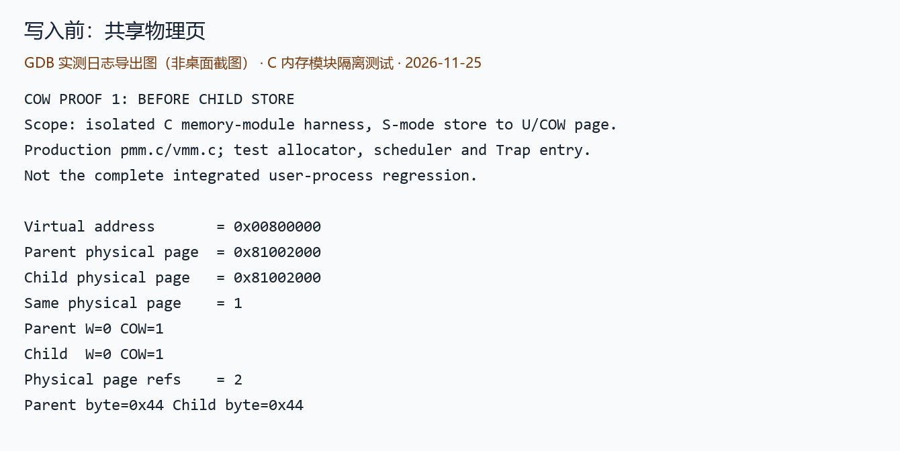

写前双方 PA=0x81002000，W=0、COW=1，引用数为 2，内容均为 0x44。

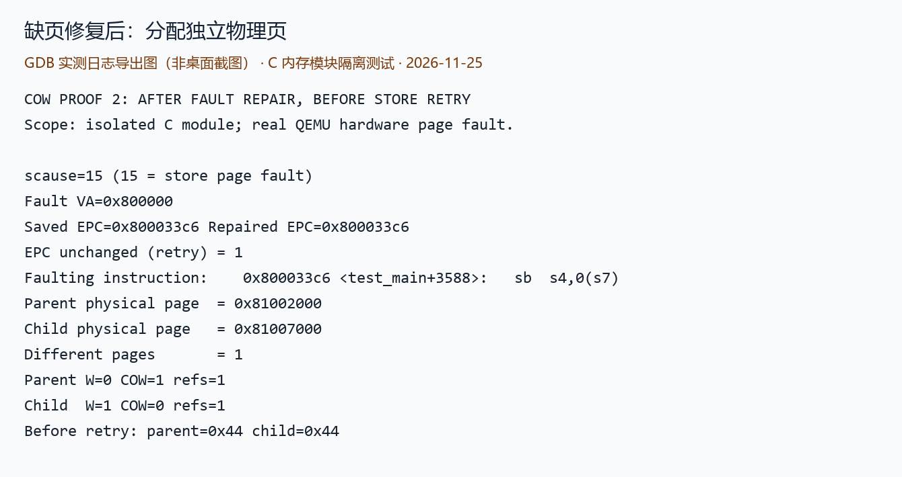

真实 store page fault 的 cause=15；子页 PA 变为 0x81007000，W=1、COW=0，各页引用为 1；EPC 不变。这一断点在原写指令重试前，因此双方数据暂时仍是 0x44。

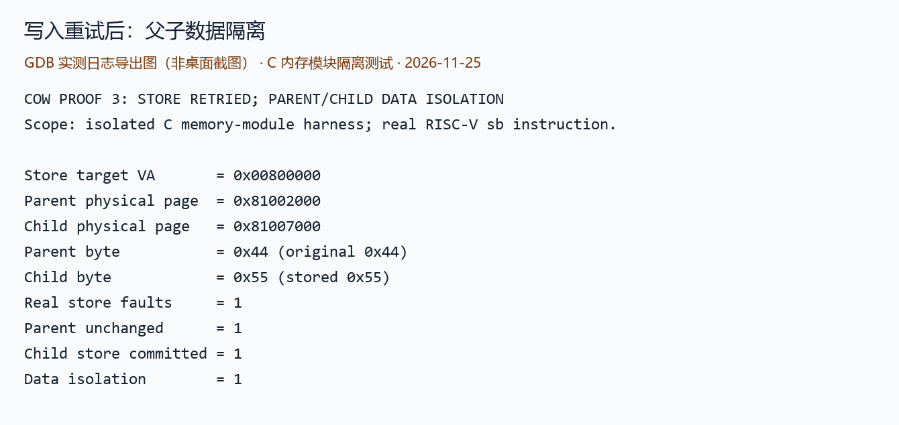

重试后父页仍为 0x44，子页为 0x55；实际写缺页次数为 1，数据隔离条件成立。

## 五、测试与调试

### 5.1 内核编译

执行 make 编译内核和用户程序，链接生成 bin/kernel，再通过 objcopy 生成 bin/ucore.img。

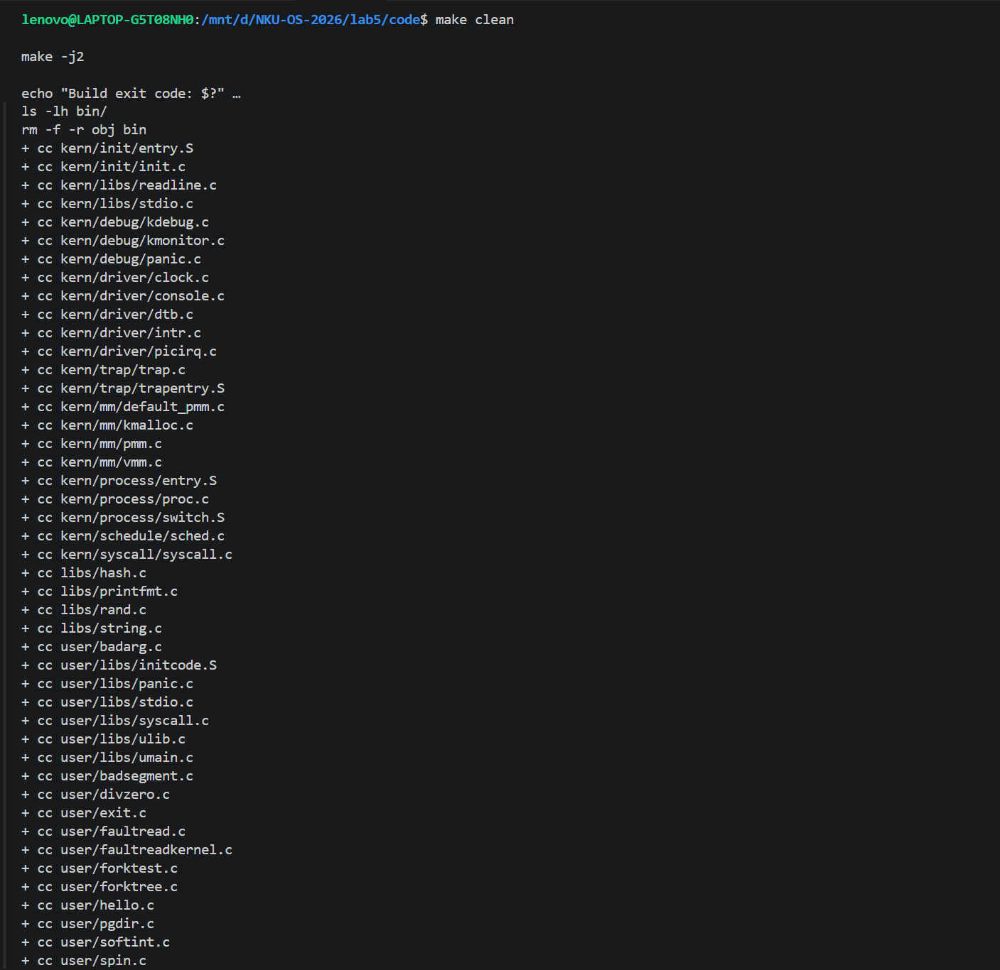

图5-1 内核及用户程序编译

编译返回状态为 0，生成 kernel 和 ucore.img。testbss 中的越界访问语句产生数组越界警告。

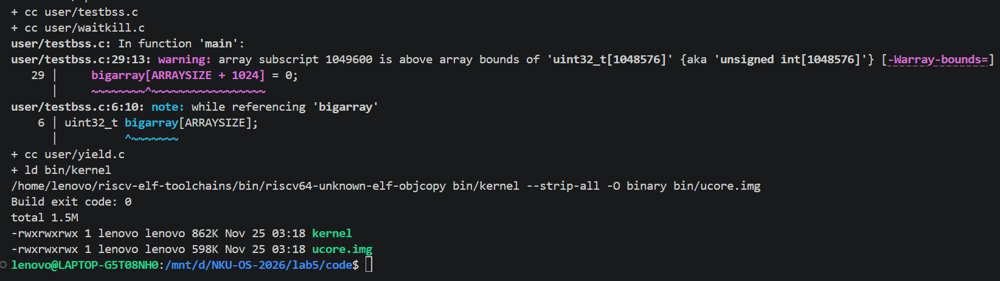

图5-2 内核编译结果

### 5.2 内核运行结果

执行 make qemu，OpenSBI 启动后从 DTB 读到 128 MiB 物理内存。物理页分配、页表映射、kmalloc、VMA 和虚拟内存检查依次输出成功信息，随后初始化时钟中断并加载 PID 为 2 的 exit 用户程序。

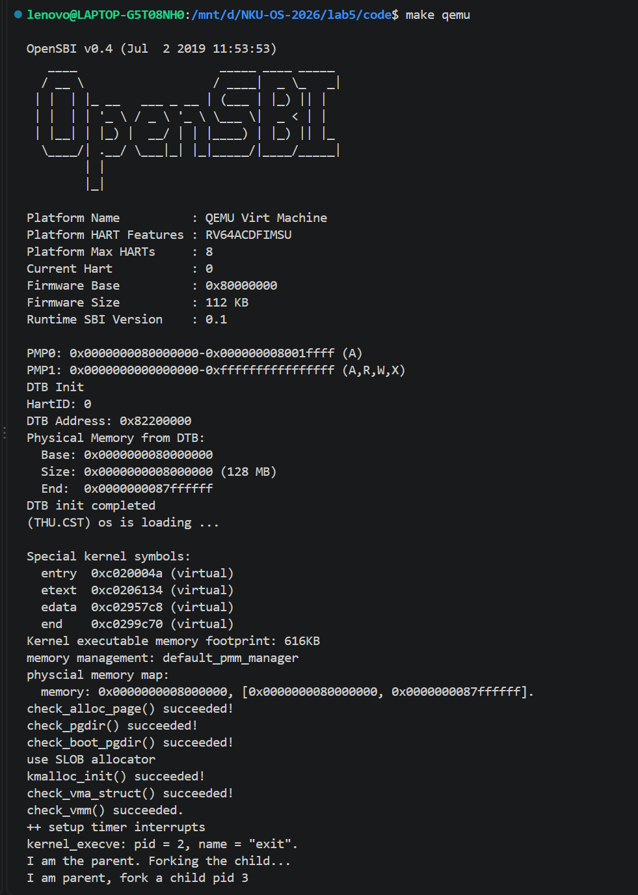

图5-3 内核初始化与用户进程创建

父进程创建 PID 为 3 的子进程，调用 wait 等待子进程退出。输出 `waitpid 3 ok.` 和 `exit pass.`，init 回收全部用户进程。运行前和回收后的空闲页数均为 31586，输出 `init check memory pass.`，最后进入 initproc 的结束路径。

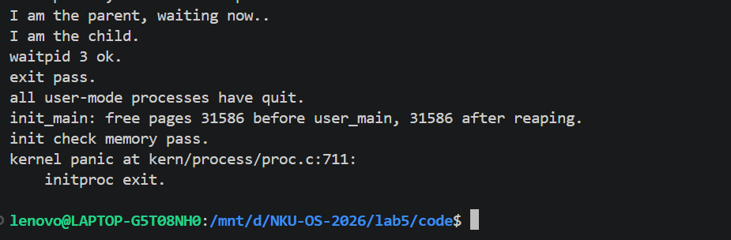

图5-4 用户进程退出及内存回收

成员 B 的 exit 运行结果也输出了 waitpid 3 ok. 和 exit pass.，回收前后的空闲页数均为 31570。


图5-5 成员 B 的用户进程运行与回收

### 5.3 评分结果

执行官方 make grade，编译评分程序并运行各项检查。

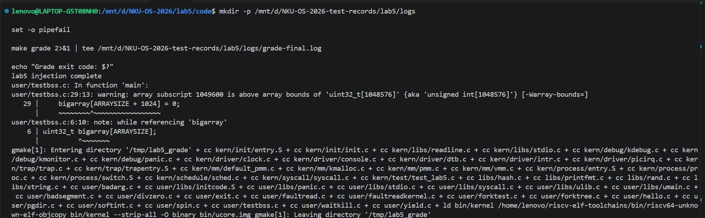

图5-6 评分编译输出

13 项测试的结果检查和输出检查均为 OK，总分为 130/130，退出码为 0。hello、yield、exit 和 forktest 分别验证了输出、调度、退出及进程复制，pgdir 验证了页表输出。

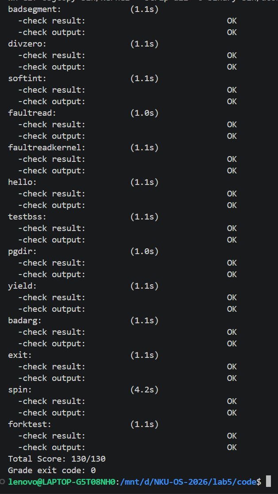

图5-7 Lab5 官方评分结果

另一组官方评分同样通过了 13 项测试，总分为 130/130。

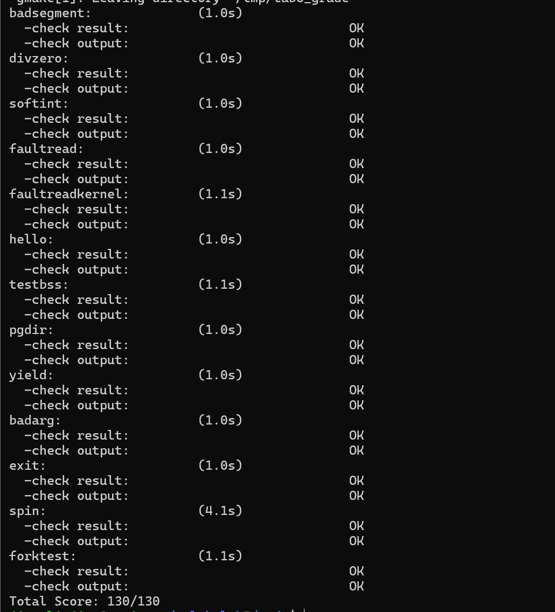

图5-8 成员 B 的官方评分结果

spin 需要时钟中断设置 need_resched，faultread 和 faultreadkernel 需要通过 do_exit 结束非法访存进程。divzero 的除法表达式被 GCC 在 -O2 下优化，在用户程序编译参数中增加 -fnon-call-exceptions 后，输出恢复为 -1。

### 5.4 首次进入用户态

在 kernel_execve 的 ebreak 处设置断点，读取系统调用参数。a0=4 对应 SYS_exec，a7=0x80 对应 T_SYSCALL，a1 指向 hello 名称，a2=5，a3 指向 ELF，a4=0x8af0。

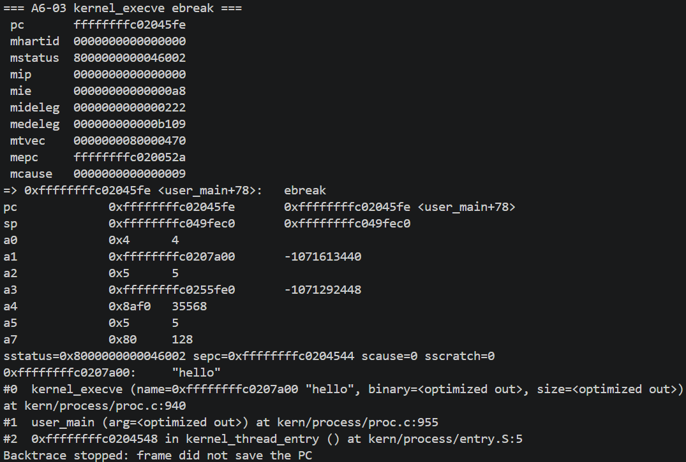

图5-9 kernel_execve 断点及寄存器

沿 syscall、do_execve 和 load_icode 继续执行，读取装载后的 trapframe：sp=0x80000000，epc=0x800020，status=0x8000000000046020，对应 SPP=0、SPIE=1、SIE=0。

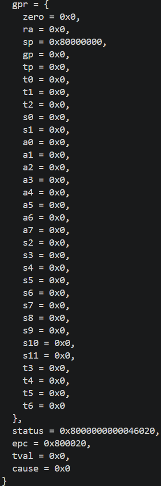

图5-10 装载后的用户进程初始现场

在 __trapret 的 sret 指令前停止，PC 为 0xffffffffc0200f8c，sepc 为 0x800020，sp 已恢复为用户栈顶 0x80000000，sscratch 保存内核栈顶 0xffffffffc049fec0。

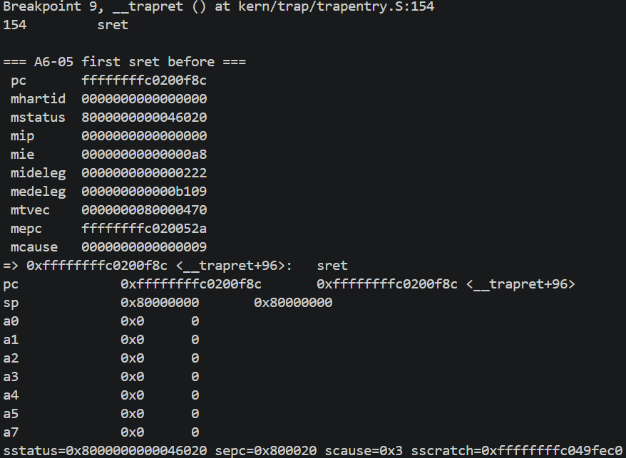

图5-11 首次 sret 执行前

单步执行 sret，PC 变为 0x800020，用户 sp 保持 0x80000000，开始执行 ELF 入口处的指令。

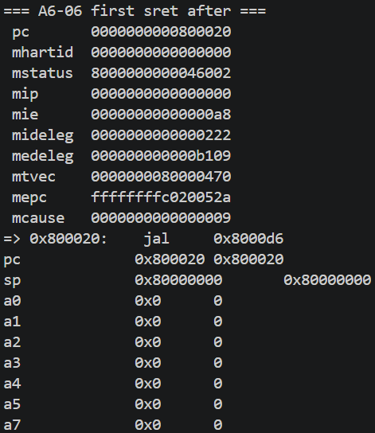

图5-12 首次 sret 执行后

### 5.5 系统调用与 Trap 返回

在用户系统调用封装的 ecall 处设置断点。PC=0x8000a0，a0=0x1e 对应 SYS_putc，a1=0x48 对应字符 H，用户 sp=0x7ffffe50。

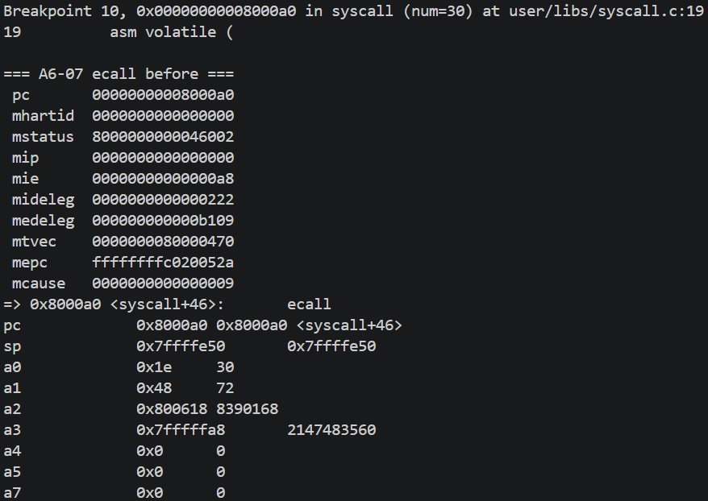

图5-13 用户 ecall 前的参数

进入 __alltraps 后执行栈交换，sp 变为内核栈顶 0xffffffffc049fec0，sscratch 保存原用户 sp=0x7ffffe50。此时 sepc=0x8000a0、scause=8，下一条指令将 sp 减去 288，为 trapframe 留出空间。

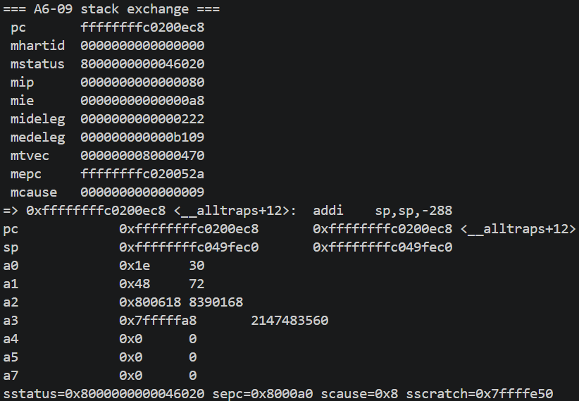

图5-14 SAVE_ALL 交换用户栈和内核栈

保存现场后进入 trap，当前帧地址为 0xffffffffc049fda0。读到保存的用户 sp=0x7ffffe50、epc=0x8000a0、cause=8，sscratch 已清零。内核栈顶与栈帧相差 0x120，即 288 字节，与 struct trapframe 的布局一致。

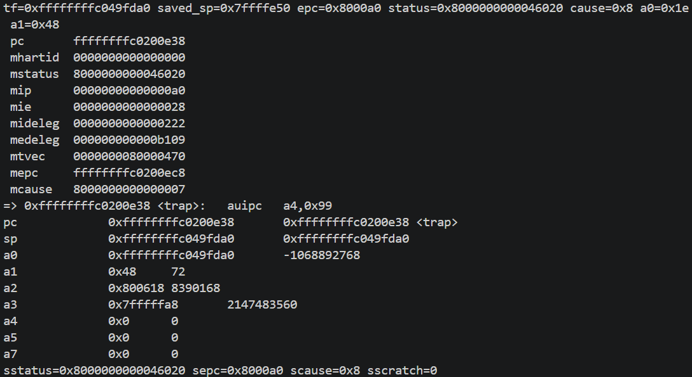

图5-15 内核栈中的 trapframe

在 syscall 中读取调用号和参数，a0=0x1e、a1=0x48，epc 已推进到 0x8000a4。调用栈经过 __alltraps、trap、trap_dispatch 和 exception_handler，再到 syscall。

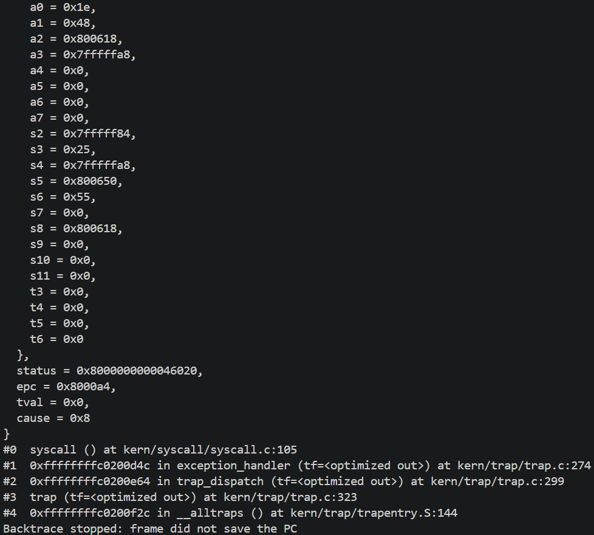

图5-16 系统调用分发及调用栈

sys_putc 输出字符后返回 0，trapframe 中的 a0 也变为 0，epc 保持 0x8000a4。

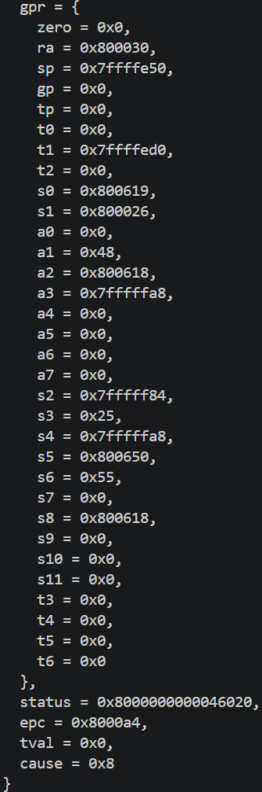

图5-17 系统调用返回值

沿 RESTORE_ALL 恢复通用寄存器和 CSR，在 sret 前读到用户 sp=0x7ffffe50、sepc=0x8000a4、sscratch=0xffffffffc049fec0。

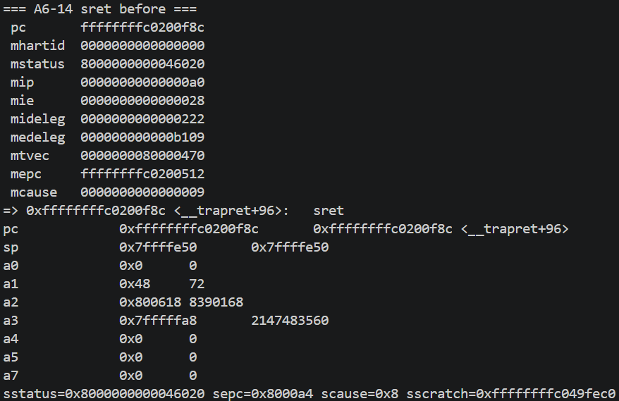

图5-18 系统调用返回前的 sret

单步后 PC=0x8000a4、a0=0，下一条指令为 `sd a0,28(sp)`。执行流从 ecall 的下一条指令继续，用户栈指针与进入内核前一致。

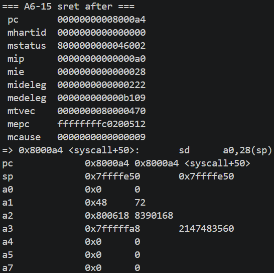

图5-19 sret 后恢复用户程序

### 5.6 双 GDB 观察异常分发

使用 RISC-V GDB 调试内核，同时使用宿主 GDB 调试带符号的 QEMU。上窗观察 QEMU 的虚拟 CPU 状态，下窗观察用户程序的寄存器和指令。

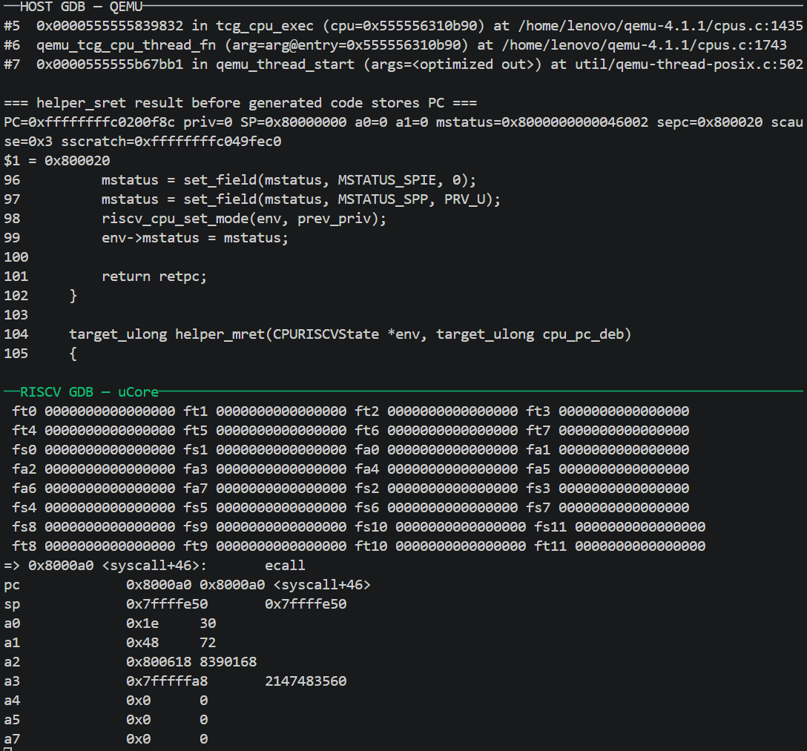

图5-20 客户机与宿主双 GDB

在 QEMU 的指令翻译路径设置断点，调用栈经过 decode_opc、riscv_tr_translate_insn、translator_loop、gen_intermediate_code 和 tb_gen_code，最后回到 cpu_exec。

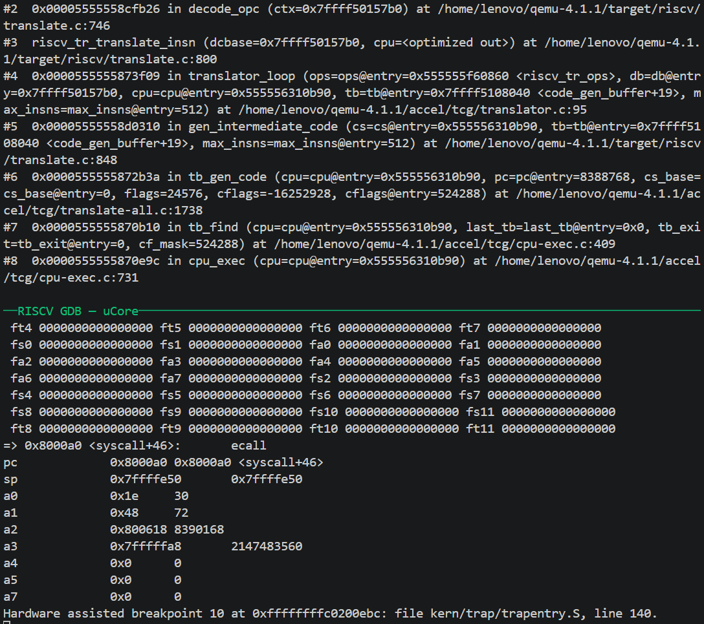

图5-21 QEMU 译码及翻译块生成调用链

异常分发入口读到异常号 8、priv=0、PC=0x8000a0。委托到 S 态后，priv=1，PC 指向 0xffffffffc0200ebc，sepc=0x8000a0，scause=8。sp 和 sscratch 保持进入异常前的值，随后由内核入口交换栈指针。

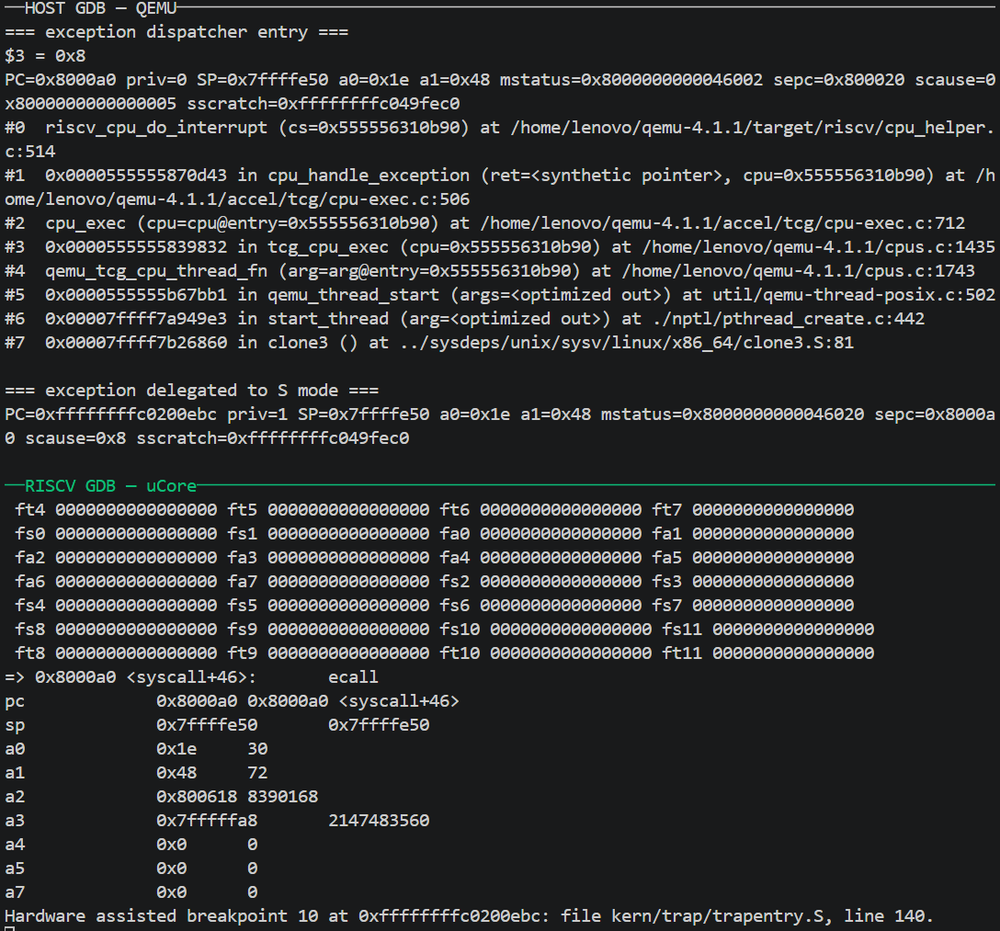

图5-22 QEMU 将 ecall 异常委托到 S 态

在 helper_sret 中继续单步，priv 从 1 变为 0，mstatus 从 0x8000000000046020 变为 0x8000000000046002。QEMU 4.1.1 的实现将 SIE 恢复为 1，并将 SPIE、SPP 清为 0。helper 返回后，生成代码把返回地址写入客户机 PC。

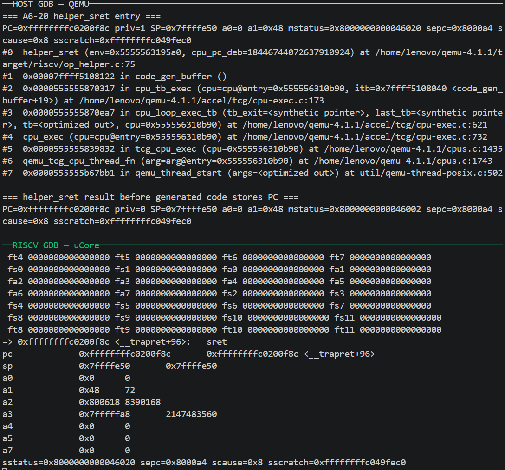

图5-23 QEMU 执行 sret

### 5.7 TCG 指令翻译

观察同一组指令的 in_asm、op 和 out_asm，分别对应 RISC-V 指令、TCG 中间操作和 x86-64 宿主指令。in_asm 中读到 ecall 的编码为 00000073，sret 的编码为 10200073。

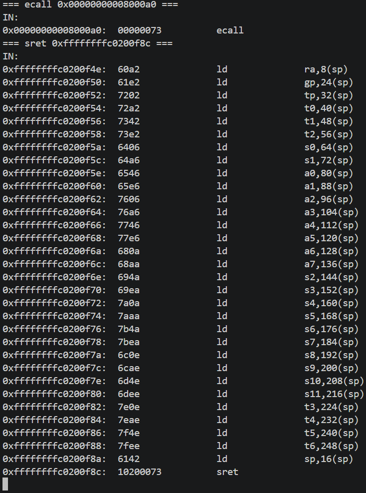

图5-24 RISC-V ecall 与 sret 指令

TCG 中间操作先把 0x8000a0 写入 PC，再装入异常号 8，调用 raise_exception。sret 路径调用对应的 helper，把返回值作为新的客户机 PC。

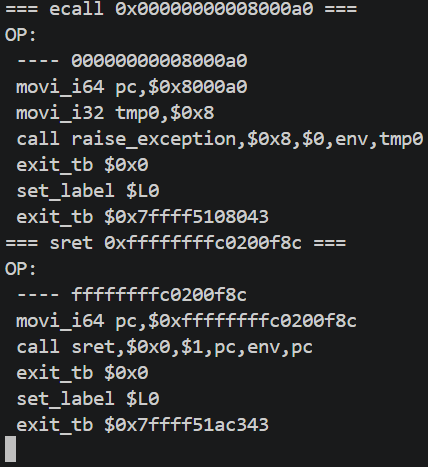

图5-25 TCG 中间操作

宿主指令把客户机 PC 写入 `0x200(%rbp)`，通过 rdi、esi 传递环境指针和异常号，再调用异常 helper。sret 返回后，使用 `movq %rax,0x200(%rbp)` 写回目标地址。沿这三个层次，可以把用户 ecall、内核异常入口和返回用户程序的过程对应起来。

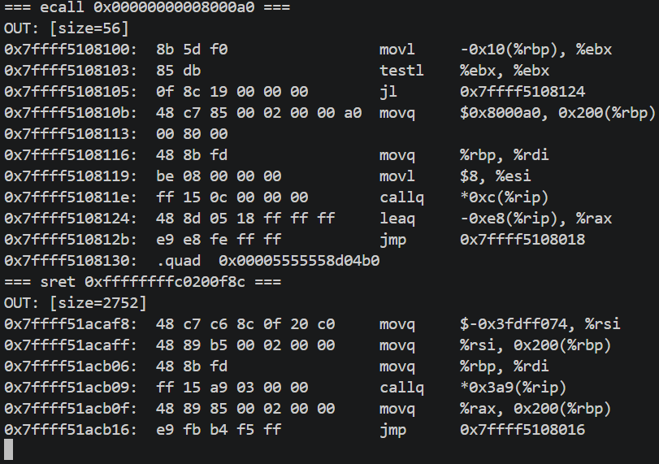

图5-26 TCG 生成的 x86-64 指令

### 5.8 hello 用户程序运行

在 GDB 中观察系统调用返回后继续运行，hello 输出问候文字和 PID，再以退出码 0 进入 do_exit。用户进程回收后，空闲页数恢复为 31586。

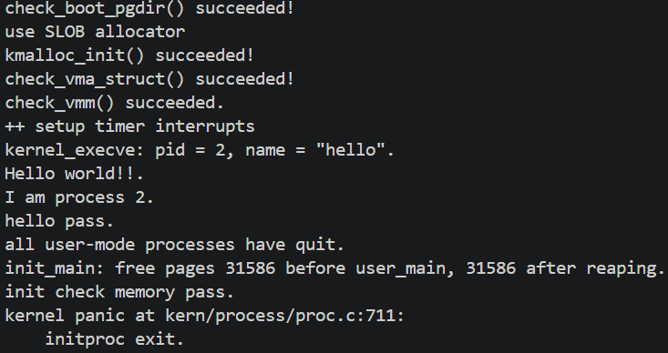

图5-27 hello 输出及内存回收

## 六、思考题

### 6.1 用户态和内核态切换

用户程序执行 ecall，处理器根据异常委托和入口配置进入 S 态，将原 PC 保存到 sepc，同时记录原特权级和中断状态。软件交换 sscratch 与 sp，转入内核栈并保存通用寄存器。执行内核服务后恢复寄存器和 CSR，通过 sret 返回。

第一个用户程序由内核构造初始现场，把用户入口、用户栈和 SPP=0 写入 trapframe，再执行 sret 完成特权级和 PC 的切换。普通跳转指令改变 PC，sret 则根据保存的状态同时恢复执行权限。

系统调用返回时，epc 指向 ecall 的下一条指令；COW 写缺页修复后，epc 仍指向原写入指令，处理器重新执行该指令。两种情况分别对应请求已经完成和访存条件已经修复。

### 6.2 Fork 写时复制

立即复制需要为每个有效数据页分配物理页并复制数据，Fork 开销与已映射数据量相关。COW 让父子进程通过各自页表共享物理页，把复制推迟到实际写入。父子中的一方写入时，通过写缺页建立独立副本；共享页的引用计数降到 1 时，直接恢复原页写权限。

COW 需要同时维护 PTE 权限、物理页引用计数和 TLB。父项清除 W 后刷新原地址翻译，撤销映射时减少物理页引用，最后一个映射撤销后释放物理页。真正的只读页按 VMA 的原访问权限处理。

内核通过物理页别名写入用户缓冲区时，也需要先处理 COW。在 copy_to_user 中逐页检查权限，解除 COW 后再复制数据，保持其他进程所见的数据。

### 6.3 用户程序预加载

负责人：B 2413507-蒋林瀞。

用户程序先作为 ELF 嵌入内核镜像，随内核进入内存，再由 exec 建立用户地址空间。几个阶段分别如下：

| 阶段 | 发生时间 | 操作 |
| --- | --- | --- |
| 编译链接 | 构建用户程序时 | 按 tools/user.ld 生成独立 ELF，入口为 0x800020 |
| 嵌入内核 | 链接内核时 | 使用 `--format=binary` 把用户 ELF 的原始字节放入内核数据段 |
| 加载到内存 | 系统启动时 | QEMU 将 ucore.img 放到物理地址 0x80200000，内嵌 ELF 一同进入内存 |
| 建立地址空间 | 执行 exec 时 | load_icode 解析 PT_LOAD，分配页面、复制段内容、清零 BSS，并建立用户栈 |

表10 用户程序的加载阶段

链接器根据文件路径生成 `_binary_obj___user_hello_out_start`、`_end` 和 `_size` 等符号。start 指向 ELF 的开头，end 指向结尾，size 是表示文件字节数的绝对符号。KERNEL_EXECVE 通过这些符号把程序地址和大小交给 kernel_execve。

用户 ELF 在内核镜像加载时就已进入物理内存，exec 则把其中的段装入新进程的用户地址空间。load_icode 写好入口和用户栈后，通过 trapframe 和 sret 开始执行用户指令。

| 项目 | Lab5 | 常用操作系统 |
| --- | --- | --- |
| 程序来源 | 构建时嵌入内核镜像 | 运行时按路径从文件系统读取 |
| 段装载 | exec 时分配页面并复制段内容 | 建立文件映射，结合缺页异常按需读入 |
| BSS | 分配物理页并清零 | 建立零初始化映射，结合写时复制和按需分配 |
| 代码页共享 | 各次装载建立自己的代码页 | 多个进程可以共享页缓存中的代码页 |

表11 用户程序加载方式对比

Lab5 通过内存中的 ELF 地址和长度完成装载，程序来源由构建配置决定。常用操作系统将程序保存在文件系统中，exec 根据文件路径读取映像，再利用虚拟内存和页缓存组织后续访问。

### 6.4 Dirty COW

负责人：C 2411788-马传志。

Dirty COW 是 Linux 写时复制机制中的竞态漏洞。私有文件映射的写访问意图、页引用和 COW 状态在并发变化中失去一致性，使写入落到原本共享的只读物理页。

写时复制的检查需要覆盖用户写缺页和内核写用户缓冲区两条路径。检查页表项后还要维护物理页引用，替换映射后刷新 TLB，使权限判断和最终写入对应同一页。

单 hart 内核通过本地中断临界区保护页表项及引用更新。扩展到多核时，需要页表锁、原子引用计数、状态复查和跨核 TLB 同步。

### 6.5 实验知识点对照

| 本实验知识点 | 对应的 OS 原理 | 含义及实验中的具体形式 |
| --- | --- | --- |
| ecall、ebreak、sret | 特权级切换 | 用户请求或内核 exec 进入 Trap，通过异常返回恢复执行 |
| 系统调用分发表 | 内核服务接口 | 以调用号选择函数，通过寄存器传递参数和返回值 |
| ELF、PT_LOAD、BSS | 可执行文件装载 | 建立段映射，复制文件数据并清零剩余内存 |
| mm、VMA、Sv39 | 进程地址空间 | 记录合法地址范围并建立独立用户映射 |
| fork、copy_thread | 进程创建 | 复制现场，父子分别返回子 PID 和 0 |
| CLONE_VM、mm_count | 地址空间共享 | 共享整个 mm，最后一个使用者释放地址空间 |
| PTE_COW、Page 引用 | 写时复制 | 延迟物理页复制，写缺页后恢复独占写权限 |
| need_resched | 抢占式调度 | 时钟中断标记重新调度，返回用户态前选择进程 |
| PROC_ZOMBIE、wait | 进程退出及回收 | 子进程记录退出码，父进程释放 PCB 和内核栈 |
| PF_EXITING | 进程终止 | 标记退出请求，唤醒可中断等待的目标进程 |
| copy_to_user | 用户地址访问 | 检查目标权限，解除 COW 再写入用户数据 |

表12 操作系统原理知识点对照

## 七、实验总结

### 实验小结

在 Lab4 的内核线程基础上加入用户进程，需要把程序装载、异常入口、系统调用和进程生命周期连接起来。加载 ELF 后先建立用户地址空间，再填写入口和用户栈，通过 sret 进入用户态。用户程序发起系统调用后，内核保存现场、执行服务，再恢复到原程序继续运行。

进程退出后，地址空间、物理页和 PCB 分别按照引用关系回收。Fork 采用 COW 共享物理页，写入时再建立独立副本。运行 exit、hello 和官方评分程序，可以观察进程创建、执行、退出和回收的完整过程。

### 对操作系统的理解

用 GDB 单步调试时，我们主要查看了程序进入内核前后的栈指针和寄存器。用户程序触发 Trap 后，入口汇编切换到内核栈，将寄存器保存在 trapframe 中。处理结束后，内核恢复现场，通过 sret 返回用户态继续运行。

系统调用和 COW 缺页的返回位置有所不同。系统调用执行完后，程序继续执行下一条指令；COW 缺页则要先修复页面映射，再重新执行刚才没有完成的写入。进程退出时，还要按引用关系释放地址空间和物理页，最后由父进程回收 PCB 和内核栈。

### AI 工具使用体会

1. 编写前先对照结构体、寄存器约定和函数声明，减少不同版本接口混用的问题。
2. 三人分工时约定清楚 Trap、进程管理和内存管理的调用关系，再分别编写对应模块。
3. 结合源码、QEMU 输出和 GDB 寄存器读数检查生成代码，再根据实际结果修改。
