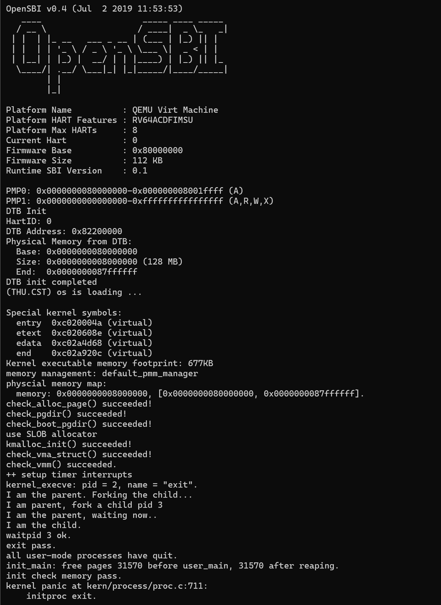

# 操作系统实验报告

Lab5：用户程序

## 实验基本信息

| 项目 | 内容 |
| --- | --- |
| 实验名称 | Lab5：用户程序 |
| 小组成员 | 2412096-王麒萱、2413507-蒋林瀞、2411788-马传志 |
| 完成日期 | 2026.11.25 |

表1 实验基本信息

### 小组分工

| 成员 | 负责的练习/模块 |
| --- | --- |
| A 2412096-王麒萱 | 功能模块一：用户态系统调用；Lab3 Trap 代码迁移；COW 写异常入口；分支任务：双 GDB 调试系统调用及返回 |
| B 2413507-蒋林瀞 | 功能模块二：创建加载第一个用户进程；功能模块四：其余系统调用功能；Lab4 进程管理代码适配；练习：用户程序预加载 |
| C 2411788-马传志 | 功能模块三：复制用户进程；Lab2/Lab4 内存管理代码迁移；Challenge：COW 机制及 Dirty COW 分析 |

表2 小组分工

各成员撰写所负责模块、练习的实现过程和测试结果，小组共同整理实验目的、整体逻辑、测试结果和总结。

---

## 一、实验目的

<!-- 待小组补充 -->

---

## 二、实验环境

在 Windows 下的 WSL Ubuntu 中编译、运行和调试内核，用 QEMU 模拟 RISC-V 64 位处理器，并通过 GDB 连接 QEMU 进行调试。

| 项目 | 配置 |
| --- | --- |
| 终端环境 | Windows 下的 WSL Ubuntu 22.04 |
| 目标架构 | RISC-V 64 位，Sv39 分页 |
| 交叉编译器 | SiFive riscv64-unknown-elf-gcc 10.1.0 |
| 调试器 | riscv64-unknown-elf-gdb |
| 运行方式 | QEMU 4.1.1 Virt Machine，OpenSBI |

表3 软件环境

| 成员 | AI 编程工具 | 底层模型 | 备注 |
| --- | --- | --- | --- |
| A 2412096-王麒萱 | | | |
| B 2413507-蒋林瀞 | Claude Code | Claude Opus 5.5 | 编写进程装载、退出与等待代码，编写专项测试，GDB 调试 |
| C 2411788-马传志 | | | |

表4 AI 工具

---

## 三、实验整体逻辑分析

### 3.1 本章节的逻辑主线

<!-- 待小组补充 -->

### 3.2 功能的逐步实现

<!-- 待小组补充 -->

---

## 四、实验内容与实现

### 4.1 功能模块一：用户态系统调用功能

**负责人：** A 2412096-王麒萱

<!-- 待成员 A 补充 -->

---

### 4.2 功能模块二：创建加载第一个用户进程功能

**负责人：** B 2413507-蒋林瀞

#### 模块功能描述

**需要实现/修改的函数：**

```c
static struct proc_struct *alloc_proc(void);
int kernel_thread(int (*fn)(void *), void *arg, uint32_t clone_flags);
static int init_main(void *arg);
static int user_main(void *arg);
static int kernel_execve(const char *name, unsigned char *binary, size_t size);
int do_execve(const char *name, size_t len, unsigned char *binary, size_t size);
static int load_icode(unsigned char *binary, size_t size);
void proc_run(struct proc_struct *proc);
```

**功能说明：**

本模块把内核从只运行内核线程推进到运行第一个用户程序。启动链如下：

```text
proc_init -> initproc(init_main) -> kernel_thread(user_main)
user_main -> kernel_execve -> ebreak -> trap -> syscall -> sys_exec -> do_execve -> load_icode
__trapret -> sret -> 用户程序入口 0x800020
init_main: do_wait 回收全部子进程 -> 检查进程表与空闲页
```

`do_wait` 同时属于本模块和功能模块四，实现说明放在 4.4.2。本模块依赖成员 A 的 Trap 返回路径和系统调用分发，依赖成员 C 的 `do_fork` 创建 `user_main`。

#### 4.2.1 适配 Lab4 进程管理代码

成员 A 已将 Lab4 的 `alloc_proc`、`kernel_thread`、`proc_init`、`schedule`、`switch_to`、`proc_run` 迁入 Lab5。审查后修改两处：

1. `alloc_proc` 在清零 PCB 后显式初始化 Lab5 新增字段：

```c
proc->exit_code = 0;
proc->wait_state = 0;
proc->cptr = proc->yptr = proc->optr = NULL;
```

`set_links` 和 `remove_links` 依赖这三个指针的初值为 `NULL`。

2. `proc_run` 改用框架提供的 `lsatp()` 写入 satp，再调用 `flush_tlb()`。`lsatp` 写入 `0x8000000000000000 | (pgdir >> 12)`，即 Sv39 模式。本实验没有分配 ASID，切换页表后刷新全部 TLB。

`kernel_thread` 沿用 Lab4 实现：内核线程以 `SPP=1` 返回 S 态，用户进程由 `load_icode` 重写 trapframe。

#### 4.2.2 解析 ELF 并建立地址空间

`load_icode` 采用先建后换的顺序：在旧地址空间仍然有效时建立完整的新地址空间，全部成功后再切换。用户进程通过 `exec` 传入的程序映像位于旧用户空间，提交前一直可以读取；装载失败时当前进程保持原状，`exec` 返回错误码。

装载分为七步：

```text
(1) 复制并检查 ELF 头           失败: -E_INVAL_ELF，未分配资源
(2) mm_create + setup_pgdir      失败: -E_NO_MEM
(3) 逐个装载 PT_LOAD 段          失败: 销毁新 mm，返回错误码
(4) 检查入口位于可执行段
(5) 建立用户栈
(6) 提交: 安装新 mm，切换 satp，释放旧 mm
(7) 重写 trapframe
```

**ELF 检查。** `--format=binary` 嵌入的程序映像不保证 8 字节对齐，因此先用 `memcpy` 把 ELF 头和程序头复制到局部变量再读取。检查项如下：

| 检查项 | 条件 |
| --- | --- |
| 魔数 | `e_magic == ELF_MAGIC` |
| 程序头 | `e_phnum > 0`，`e_phentsize == sizeof(struct proghdr)` |
| 程序头范围 | `e_phoff <= size`，且 `(size - e_phoff) / sizeof(proghdr) >= e_phnum` |
| 段大小 | `p_filesz <= p_memsz` |
| 文件范围 | `p_offset <= size`，且 `p_filesz <= size - p_offset` |
| 虚拟地址 | `p_va + p_memsz` 不回绕，且位于 `[USERBASE, USERTOP)` |
| 段重叠 | 与已建立的 VMA 不相交，包括共用同一页的情况 |
| 入口 | `e_entry` 位于带 `VM_EXEC` 的 VMA 内 |
| 段数量 | 至少有一个 `PT_LOAD` 段 |

表5 ELF 合法性检查

范围检查都写成减法形式，避免 `p_offset + p_filesz` 等加法溢出后绕过检查。

**权限设置。** 按段标志设置 VMA 和 PTE 权限：

```c
if (p_flags & ELF_PF_X) { *vm_flags |= VM_EXEC;  *perm |= PTE_X; }
if (p_flags & ELF_PF_W) { *vm_flags |= VM_WRITE; *perm |= PTE_W | PTE_R; }
if (p_flags & ELF_PF_R) { *vm_flags |= VM_READ;  *perm |= PTE_R; }
```

RISC-V 规定 W=1、R=0 的组合保留不用，因此可写页同时设置 R。代码段为 R-X，数据段和 BSS 为 RW-。

**段装载。** 用户程序的代码段从 `0x800020` 开始，没有按页对齐。对段覆盖的每一页，先分配新页并整页清零，再复制该页与文件数据区间 `[p_va, p_va + p_filesz)` 的交集：

```c
for (la = ROUNDDOWN(va, PGSIZE); la < end; la += PGSIZE) {
    page = pgdir_alloc_page(mm->pgdir, la, perm);
    memset(page2kva(page), 0, PGSIZE);
    from = max(la, va);
    to = min(la + PGSIZE, va + filesz);
    if (from < to)
        memcpy(kva + (from - la), src + (from - va), to - from);
}
```

整页清零同时处理三种情况：首页中 `p_va` 之前的部分，BSS，以及末页中文件数据之后的部分。testbss 的 BSS 段 `p_filesz=0`、`p_memsz=0x400000`，共 1024 页。专项测试按 1 KiB 间隔读取整个 BSS 及其最后 4 字节，结果均为零。

**段重叠检查。** `mm_map` 只用 `find_vma(start)` 判断新区间的起点是否落在已有 VMA 内。若新区间的起点低于已有 VMA 并覆盖它，就会进入 `insert_vma_struct` 的重叠断言，使内核 panic。`load_icode` 在调用 `mm_map` 前遍历全部 VMA，判断区间相交：

```c
if (start < vma->vm_end && vma->vm_start < end)
    return -E_INVAL_ELF;
```

**用户栈。** 映射 `[USTACKTOP - USTACKSIZE, USTACKTOP)` 为 `VM_READ | VM_WRITE | VM_STACK`，并为栈顶 4 页分配物理页。Lab5 没有缺页时按需分配页面的机制，VMA 中其余部分不建立映射，用户栈越界访问会触发缺页异常。

**提交。** 在关中断的临界区内安装新 mm：

```c
mm_count_inc(mm);
current->mm = mm;
current->pgdir = PADDR(mm->pgdir);
lsatp(current->pgdir);
flush_tlb();
```

随后执行 `fence.i`。代码段是内核通过直接映射区写入的，`fence.i` 保证之后从用户地址取到的是新写入的指令。最后调用 `release_mm(old_mm)` 释放旧地址空间的引用。

`release_mm` 将 `mm_count` 减一，减到 0 时依次调用 `exit_mmap`、`put_pgdir`、`mm_destroy`。`mm_count` 记录共享同一地址空间的进程数（`CLONE_VM`），物理页的 `Page::ref` 记录映射该页的页表项数（COW）。`exit_mmap` 撤销映射时按 `Page::ref` 决定是否释放物理页，因此 COW 共享页只在最后一个映射撤销时释放。

**trapframe。** 提交后重写 `current->tf`：

```c
uintptr_t sstatus = read_csr(sstatus);
memset(tf, 0, sizeof(struct trapframe));
tf->gpr.sp = USTACKTOP;
tf->epc = elf.e_entry;
tf->status = (sstatus & ~(SSTATUS_SPP | SSTATUS_SIE)) | SSTATUS_SPIE;
```

- `SPP=0`：`sret` 返回 U 态。
- `SPIE=1`：`sret` 将 SIE 置 1，用户程序运行时开中断。
- `SIE=0`：返回用户态前的内核路径保持关中断。
- `SUM` 等其他位沿用当前值。

**失败回收。** 第 (3)～(5) 步失败时，新 mm 尚未安装，`mm_count` 为 0，依次调用 `exit_mmap`、`put_pgdir`、`mm_destroy`，回收已分配的页面、页表和 VMA。

#### 4.2.3 替换程序映像

`do_execve` 校验参数并复制进程名，再调用 `load_icode`：

```c
if (name == NULL || binary == NULL || size == 0)
    return -E_INVAL;
if (len > PROC_NAME_LEN)
    len = PROC_NAME_LEN;
if (mm != NULL) {
    lock_mm(mm);
    if ((len != 0 && !copy_from_user(mm, local_name, name, len, 0)) ||
        !user_mem_check(mm, (uintptr_t)binary, size, 0)) {
        unlock_mm(mm);
        return -E_INVAL;
    }
    unlock_mm(mm);
} else {
    memcpy(local_name, name, len);
}
if ((ret = load_icode(binary, size)) != 0)
    return ret;
set_proc_name(current, local_name);
```

- 用户进程（`mm != NULL`）传入的指针必须位于自身可读的 VMA 中。
- 内核线程（`mm == NULL`）只能通过 `kernel_execve` 调用，参数是内核镜像中的数据，直接复制。
- 进程名截断为 `PROC_NAME_LEN`（15）个字符，复制到以零结尾的局部缓冲区。`load_icode` 提交后会释放旧地址空间，之后不再读取用户内存中的名称。
- `load_icode` 失败时直接返回错误码，PID、进程关系和原映像都不变。

内核线程不调用 `user_mem_check` 的原因见 4.2.6 第一次迭代。

#### 4.2.4 进入用户态

在 S 态不能用 `ecall` 发起系统调用，需要另外构造一次 Trap 返回。成员 A 在 `trap.c` 中实现了内核态 `ebreak` 契约：`a7 = T_SYSCALL`、`a0 = SYS_exec` 时，异常处理将 `epc` 跳过 `ebreak` 指令，再调用 `syscall()`。`kernel_execve` 按此契约发起 `exec`：

```c
size_t len = strlen(name);
register uintptr_t a0 asm("a0") = SYS_exec;
register uintptr_t a1 asm("a1") = (uintptr_t)name;
register uintptr_t a2 asm("a2") = (uintptr_t)len;
register uintptr_t a3 asm("a3") = (uintptr_t)binary;
register uintptr_t a4 asm("a4") = (uintptr_t)size;
register uintptr_t a7 asm("a7") = T_SYSCALL;
asm volatile("ebreak"
             : "+r"(a0)
             : "r"(a1), "r"(a2), "r"(a3), "r"(a4), "r"(a7)
             : "memory");
return (int)a0;
```

执行过程如下：

1. `ebreak` 进入 `__alltraps`，`SAVE_ALL` 在当前内核栈上保存 trapframe，`trap()` 将 `current->tf` 指向它。
2. `syscall()` 调用 `do_execve`，`load_icode` 把这个 trapframe 改写为用户态现场。
3. 返回 `__trapret` 后，`RESTORE_ALL` 发现 `SPP=0`，将内核栈地址写入 `sscratch`，恢复寄存器，执行 `sret` 进入用户程序。

`exec` 成功后不会回到 `kernel_execve`。返回 `kernel_execve` 说明 `exec` 失败，`a0` 中是错误码。进入 Trap 时硬件清除 SIE，`RESTORE_ALL` 再次清除 SIE，切换过程中不会被中断打断。

`user_main` 根据编译参数选择程序：

```c
#ifdef TEST
    ret = KERNEL_EXECVE2(TEST, TESTSTART, TESTSIZE);
#else
    ret = KERNEL_EXECVE(exit);
#endif
    cprintf("user_main: kernel_execve failed, error %d.\n", ret);
    return ret;
```

`make build-hello` 传入 `-DTEST=hello -DTESTSTART=_binary_obj___user_hello_out_start -DTESTSIZE=...`，评分脚本依次以各测试程序构建内核。`exec` 失败时 `user_main` 返回错误码，经 `kernel_thread_entry` 调用 `do_exit`，由 `initproc` 回收。

`init_main` 创建 `user_main`，循环调用 `do_wait(0, NULL)` 回收全部子进程，包括移交给它的孤儿进程。回收完毕后检查进程表：

```c
assert(initproc->cptr == NULL && initproc->yptr == NULL && initproc->optr == NULL);
assert(nr_process == 2);
assert(list_next(&proc_list) == &(initproc->list_link));
assert(list_prev(&proc_list) == &(initproc->list_link));
```

空闲页检查的写法见 4.2.6 第二次迭代。

#### 4.2.5 最终提示词

````markdown
[PROMPT]
在 kern/process/proc.c 中完成第一个用户进程的创建和加载：适配 Lab4 的 alloc_proc、proc_run，
实现 load_icode、do_execve、kernel_execve、user_main、init_main。使用官方 Lab5 的 ELF、
页表、VMA 和内存管理接口，不修改成员 A 的 trap.c、trapentry.S 和成员 C 的 do_fork、copy_mm、
vmm.c、pmm.c。先审查 origin/lab5 中已迁移的 Lab4 代码，只改动本人负责的函数。

[RELY]
- struct proc_struct 的 exit_code、wait_state、cptr/yptr/optr；struct elfhdr、struct proghdr、
  ELF_MAGIC、ELF_PT_LOAD、ELF_PF_R/W/X
- mm_create、setup_pgdir、put_pgdir、mm_map、find_vma、pgdir_alloc_page、page2kva、
  exit_mmap、mm_destroy、mm_count_inc/dec、user_mem_check、copy_from_user
- USERBASE、USERTOP、USTACKTOP、USTACKSIZE、PTE_U/R/W/X/V、VM_READ/WRITE/EXEC/STACK
- lsatp、flush_tlb、SSTATUS_SPP/SPIE/SIE
- 成员 A 的 ebreak 契约：a7=T_SYSCALL、a0=SYS_exec、a1..a4=name、len、binary、size；
  trap() 分发期间 current->tf 指向本次 Trap 帧
- Makefile 的 TEST、TESTSTART、TESTSIZE；KERNEL_EXECVE、KERNEL_EXECVE2 宏

[GUARANTEE]
- static int load_icode(unsigned char *binary, size_t size);
- int do_execve(const char *name, size_t len, unsigned char *binary, size_t size);
- static int kernel_execve(const char *name, unsigned char *binary, size_t size);
- static int user_main(void *arg);
- static int init_main(void *arg);
- 可以新增仅在 proc.c 内使用的 static 辅助函数，不改变公共接口。

[SPECIFICATION]
load_icode
Pre-Condition：binary 指向长度为 size 的 ELF 映像，位于内核镜像或调用者的用户空间。
Post-Condition：成功时 current 拥有新的 mm，旧 mm 的引用减一，trapframe 指向 ELF 入口、
USTACKTOP，SPP=0、SPIE=1、SIE=0；失败时 current 不变，不遗留页面、页表和 VMA。
Case 1：合法 ELF。按 PT_LOAD 段建立 VMA 和页表映射，段地址可以不按页对齐。
Case 2：p_memsz > p_filesz。首页段前部分、BSS、末页文件数据之后的部分全部清零。
Case 3：非法 ELF。检查魔数、e_phentsize、程序头范围、p_filesz <= p_memsz、文件偏移、
地址回绕、用户地址范围、段与段及段与栈的重叠、入口位于可执行段，返回 -E_INVAL_ELF。
所有范围检查用减法表达，避免加法溢出。映像可能未对齐，先复制头部再读取。
Case 4：内存不足。回收已分配的资源，返回 -E_NO_MEM。
Requirements：在旧地址空间仍有效时建立新地址空间，提交后不再读取 binary。
按段标志设置权限，可写页同时可读。提交后执行 fence.i。

do_execve
Pre-Condition：current->tf 有效。
Post-Condition：成功时保留 PID 和进程关系，进程名为截断后的 name；失败时原映像不变。
Case 1：mm == NULL。参数来自 kernel_execve 的内核数据，直接复制。
Case 2：mm != NULL。name 和 binary 必须位于调用者可读的 VMA 中，否则返回 -E_INVAL。
Requirements：name 截断为 PROC_NAME_LEN 并以零结尾。

kernel_execve
Pre-Condition：当前为 user_main 内核线程，mm == NULL。
Post-Condition：成功时经 __trapret 和 sret 进入 U 态，不返回；失败时返回错误码。
Requirements：按成员 A 的 ebreak 契约传参。绑定 register 变量之后不能再调用函数，
先求出 strlen(name) 再绑定寄存器。

user_main / init_main
Requirements：user_main 按 TEST 宏选择程序，默认运行 exit，失败时返回错误码。
init_main 循环 do_wait(0, NULL) 回收全部子进程，再检查进程链表、nr_process == 2 和空闲页数。
SLOB 分配器不归还 arena 页面，空闲页检查只要求回收后不多于回收前，并输出前后数值。
````

#### 4.2.6 实现迭代过程

本模块经过三次迭代。

---

##### 第一次迭代

按阶段提示词完成 Lab4 代码适配、`load_icode`、`do_execve`、`kernel_execve`、`user_main` 和 `init_main`，编译通过。合并成员 C 的分支后运行 `make qemu`，第一个用户进程没有启动。

**遇到的问题：**

- 问题 1：输出 `user_main: kernel_execve failed, error -3.`，即 `-E_INVAL`。在 `do_execve` 入口打印参数，得到 `name=0x0 len=4`。`mm == NULL` 时，`user_mem_check` 用 `KERN_ACCESS` 检查内核地址：

  ```c
  #define KERNBASE 0xFFFFFFFFC0200000
  #define KMEMSIZE 0x7E00000
  #define KERNTOP  (KERNBASE + KMEMSIZE)
  ```

  `KERNTOP` 的加法超出 64 位，回绕为 `0x8000000`，`KERN_ACCESS` 对任何内核地址都为假，内核线程的参数无法通过检查。
- 问题 2：修正问题 1 后错误码不变，`name` 仍为 0。最初的写法先绑定 `a1`，再调用 `strlen(name)` 给 `a2` 赋值。`strlen` 是普通函数调用，会改写调用者保存寄存器 `a1`。GCC 文档说明，局部 register 变量只在内联汇编的操作数中保证位于指定寄存器，绑定后不能再有函数调用。

**问题解决策略：**

- 针对问题 1：在 SPECIFICATION 中区分两类调用者。`mm == NULL` 的调用者只能是 `kernel_execve`，参数来自内核镜像，直接复制；`mm != NULL` 的调用者才用 `user_mem_check` 检查。`do_wait` 的 `code_store` 按同一规则处理。`memlayout.h` 属于官方公共代码，没有修改。
- 针对问题 2：在 Requirements 中补充“绑定 register 变量之后不能再调用函数”，先求出长度再绑定寄存器。

---

##### 第二次迭代

`make grade` 中 forktest 输出 `forktest pass.`，随后 `init_main` 的断言失败：

```text
assertion failed: nr_free_pages_store == nr_free_pages()
```

**遇到的问题：**

- 问题：回收全部子进程后空闲页比创建前少 3 页。需要判断是页面泄漏还是分配器缓存。

**问题解决策略：**

在临时副本中让 `init_main` 连续运行两轮同一程序，分别记录空闲页数：

| 程序 | 启动时 | 第一轮结束 | 第二轮结束 |
| --- | --- | --- | --- |
| forktest | 31569 | 31566 | 31566 |
| forktree | 31569 | 31567 | 31567 |
| exit、badarg、hello、testbss | 31569 | 31569 | 31569 |

表6 两轮运行的空闲页数

第二轮与第一轮结果相同，说明进程回收没有泄漏页面。forktest 同时存在 32 个子进程，它们的 PCB 和 VMA 由 SLOB 分配。SLOB 按页扩展 arena，释放对象时不把页面归还页分配器，所以空闲页只在第一轮减少。在 SPECIFICATION 中把空闲页检查改为“回收后不多于回收前”，并输出前后数值。

---

##### 第三次迭代

编写专项测试时，构造第二个段从第一个段之下开始并覆盖它的 ELF，内核在 `insert_vma_struct` 的 `check_vma_overlap` 断言处 panic。

**遇到的问题：**

- 问题：`mm_map` 的重叠判断只检查新区间起点是否落在已有 VMA 内。用户程序可以通过 `exec` 传入这样的映像使内核崩溃。

**问题解决策略：**

`vmm.c` 由成员 C 负责，在 `load_icode` 内新增 `map_user_range`，调用 `mm_map` 前检查与全部 VMA 的区间相交，返回 `-E_INVAL_ELF`。在 SPECIFICATION 的 Case 3 中加入段与段、段与栈的重叠检查。

**最终结果：**

经过 3 次迭代，该模块最终：

- ✅ 编译通过
- ✅ `make grade` 中依赖本模块的 13 个程序全部通过，专项测试通过
- ✅ GDB 观察到 `sret` 后从 ELF 入口开始执行用户程序

**关键改进点总结：**

1. 在 SPECIFICATION 中区分内核线程和用户进程两类 `exec` 调用者，分别规定参数检查方式。
2. 在 Requirements 中补充内联汇编传参的寄存器约束。
3. 用两轮运行区分页面泄漏和分配器缓存，按实验结果修改空闲页检查。
4. 补充段重叠检查，使非法映像返回错误码。

---

### 4.3 功能模块三：复制用户进程功能

**负责人：** C 2411788-马传志

<!-- 待成员 C 补充 -->

---

### 4.4 功能模块四：其余系统调用功能

**负责人：** B 2413507-蒋林瀞

#### 模块功能描述

**需要实现/修改的函数：**

```c
int do_exit(int error_code);
int do_wait(int pid, int *code_store);
int do_yield(void);
int do_kill(int pid);
```

**功能说明：**

本模块完成进程生命周期的收尾：退出、等待回收、让出 CPU 和终止。各函数的调用来源如下：

| 函数 | 调用来源 |
| --- | --- |
| `do_exit` | `sys_exit`；`trap()` 发现 `PF_EXITING`；内核线程函数返回后的 `kernel_thread_entry` |
| `do_wait` | `sys_wait`；`init_main` |
| `do_yield` | `sys_yield` |
| `do_kill` | `sys_kill` |

表7 调用来源

#### 4.4.1 进程退出

`do_exit` 的处理顺序如下：

1. `idleproc` 或 `initproc` 调用时 panic，与官方框架一致。
2. 若 `current->mm` 非空，先写入 `boot_pgdir_pa` 切换到内核页表，再调用 `release_mm`。正在使用的页表不能在切换之前释放。
3. 关中断，将状态设为 `PROC_ZOMBIE`，记录 `exit_code`。
4. 父进程的 `wait_state` 为 `WT_CHILD` 时唤醒父进程。
5. 将全部子进程移交给 `initproc`。
6. 开中断，调用 `schedule()`，不再返回。

移交子进程时，从 `current->cptr` 逐个取下，插入 `initproc` 子进程链表的头部，与 `set_links` 的插入方式相同：

```c
while (current->cptr != NULL) {
    proc = current->cptr;
    current->cptr = proc->optr;
    proc->yptr = NULL;
    if ((proc->optr = initproc->cptr) != NULL)
        initproc->cptr->yptr = proc;
    proc->parent = initproc;
    initproc->cptr = proc;
    if (proc->state == PROC_ZOMBIE && initproc->wait_state == WT_CHILD)
        wakeup_proc(initproc);
}
```

移交的子进程中若有僵尸进程，并且 `initproc` 正在等待，就唤醒 `initproc` 回收它。

`do_exit` 执行时仍在使用自己的内核栈，`schedule()` 和 `switch_to` 还要把寄存器保存到自己 PCB 的 `context` 中，父进程回收时也要从 PCB 读取 `exit_code`。因此内核栈和 PCB 都由 `do_wait` 释放。

#### 4.4.2 等待与回收

`do_wait` 的流程如下：

```text
检查 code_store                     用户进程: 必须可写，否则 -E_INVAL
repeat:
  关中断
  pid != 0: find_proc(pid)，且 parent == current
  pid == 0: 遍历 current->cptr 链表
  找到僵尸子进程 -> found
  有子进程但都未退出 -> SLEEPING + WT_CHILD，开中断，schedule()
                         被唤醒后若 PF_EXITING -> do_exit(-E_KILLED)
                         goto repeat
  没有子进程 -> 开中断，返回 -E_BAD_PROC
found:
  写回 exit_code                    写入失败: 返回 -E_INVAL，不回收
  关中断 { unhash_proc; remove_links }
  put_kstack; kfree
```

- **丢失唤醒。** 检查子进程状态和设置 `PROC_SLEEPING` 放在同一个关中断区间内。子进程的 `do_exit` 在检查之前执行，就会被这次检查发现；在之后执行，父进程已经处于 `WT_CHILD`，会被唤醒。
- **非法 PID。** `find_proc` 只接受 `0 < pid < MAX_PID`，`do_wait(-1, NULL)` 返回 `-E_BAD_PROC`。
- **写回退出码。** 用户进程通过 `copy_to_user` 写入。fork 后父进程的栈页处于 COW 共享状态。`copy_to_user` 先调用成员 C 的 `do_cow_fault` 解除共享：页面引用数大于 1 时为父进程复制新页，等于 1 时恢复写权限。之后再写入，子进程的页面不受影响。写入失败时子进程保留为僵尸态，之后的合法等待仍能回收它。
- **重复回收。** `unhash_proc` 和 `remove_links` 删除记录后，`find_proc` 和子进程链表都找不到该进程，第二次等待返回 `-E_BAD_PROC`。`remove_links` 中包含 `nr_process--`，不再重复计数。

#### 4.4.3 让出 CPU 与终止进程

`do_yield` 只设置 `current->need_resched = 1` 并返回 0。用户进程从系统调用返回前，`trap()` 检查该标志并调用 `schedule()`，当前进程保持 `PROC_RUNNABLE`。

`do_kill` 设置退出标志，由目标进程自己完成退出：

```c
if ((proc = find_proc(pid)) != NULL && proc != initproc) {
    if ((proc->flags & PF_EXITING) || proc->state == PROC_ZOMBIE)
        ret = -E_KILLED;
    else {
        proc->flags |= PF_EXITING;
        if (proc->wait_state & WT_INTERRUPTED)
            wakeup_proc(proc);
        ret = 0;
    }
}
```

| 目标 | 返回值 |
| --- | --- |
| 不存在或 PID 非法，包括 -1、0 | `-E_INVAL` |
| `initproc` | `-E_INVAL` |
| 已标记退出或已是僵尸态 | `-E_KILLED` |
| 其他进程 | 0 |

表8 do_kill 返回值

被终止的进程有两条退出路径：

- 运行中的进程在下一次从 Trap 返回用户态前，由 `trap()` 检查 `PF_EXITING` 并调用 `do_exit(-E_KILLED)`。
- 在 `do_wait` 中睡眠的进程，`wait_state` 为 `WT_CHILD`，含 `WT_INTERRUPTED` 位，被 `do_kill` 唤醒后检查 `PF_EXITING` 并退出。

`do_kill` 不释放目标进程的任何资源。目标进程此时仍在运行或睡眠，内核栈仍在使用。

#### 4.4.4 最终提示词

````markdown
[PROMPT]
在 kern/process/proc.c 中实现 do_exit、do_wait、do_yield、do_kill，完成进程生命周期闭环。
遵循现有进程树、PID 哈希表、等待状态和调度机制，不修改成员 C 的进程创建代码，不重复释放资源。

[RELY]
- PROC_SLEEPING、PROC_RUNNABLE、PROC_ZOMBIE；PF_EXITING、WT_CHILD、WT_INTERRUPTED
- current、idleproc、initproc；parent、cptr、yptr、optr；exit_code、wait_state、need_resched
- find_proc、set_links、remove_links（含 nr_process--）、unhash_proc、wakeup_proc、schedule
- release_mm（mm_count 减到 0 时 exit_mmap、put_pgdir、mm_destroy）、put_kstack、kfree
- user_mem_check；成员 C 的 copy_to_user，写入前解除目标页的 COW 共享
- 成员 A 的 trap()：返回用户态前检查 PF_EXITING 和 need_resched
- 错误码 -E_INVAL、-E_BAD_PROC、-E_KILLED

[GUARANTEE]
- int do_exit(int error_code);
- int do_wait(int pid, int *code_store);
- int do_yield(void);
- int do_kill(int pid);

[SPECIFICATION]
do_exit
Pre-Condition：current 不是 idleproc 或 initproc，否则 panic。
Post-Condition：用户地址空间引用已释放，进程为僵尸态并记录退出码，子进程已移交 initproc，
不再被调度。
Case 1：mm 非空。先切换到 boot_pgdir_pa，再释放 mm；mm 只在最后一个引用释放时销毁。
Case 2：有子进程。全部移交 initproc，有僵尸子进程且 initproc 在等待时唤醒 initproc。
Case 3：父进程在等待。唤醒父进程。
Requirements：不释放内核栈和 PCB；状态转换、进程树修改和唤醒在同一关中断区间内完成。

do_wait
Pre-Condition：current 请求等待 pid 指定的子进程，pid == 0 表示任意子进程。
Post-Condition：成功时回收一个僵尸子进程并写回退出码。
Case 1：目标已退出。写回退出码，删除哈希表和进程树记录，释放内核栈和 PCB，返回 0。
Case 2：有子进程但都未退出。设置 SLEEPING 和 WT_CHILD 后调度，被唤醒后重新检查。
Case 3：没有符合条件的子进程，或 pid 非法。返回 -E_BAD_PROC，包括 do_wait(-1, NULL)。
Case 4：code_store 不可写。返回 -E_INVAL，不回收子进程。
Case 5：等待期间被 kill。被唤醒后调用 do_exit(-E_KILLED)。
Requirements：检查和睡眠在同一关中断区间内完成，避免丢失唤醒；通过 copy_to_user 写回，
不绕过 COW 写保护；mm == NULL 的内核线程调用者传入的是内核指针，直接写入。

do_yield
Post-Condition：need_resched = 1，返回 0。

do_kill
Case 1：目标存在且未退出。设置 PF_EXITING，返回 0。
Case 2：目标在可中断等待中。唤醒目标。
Case 3：目标不存在、pid 非法或为 initproc，返回 -E_INVAL；已标记退出或已是僵尸态，
返回 -E_KILLED。do_kill(-1) 必须返回 -E_INVAL。
Requirements：不释放目标进程的内核栈和 PCB。
````

#### 4.4.5 实现迭代过程

本模块经过两次迭代。

---

##### 第一次迭代

按提示词完成四个函数。合并成员 C 的代码后运行 `make grade`，exit、badarg、yield、forktest 的进程输出正确，spin 测试失败：

```text
spin:
  -check result:   WRONG
   !! error: missing 'I am the parent.  Killing the child...'
```

**遇到的问题：**

- 问题 1：spin 的子进程执行 `while (1);`，父进程一直得不到 CPU。单独运行 spin，只看到持续输出的 `100 ticks`。原因是时钟中断处理没有设置 `need_resched`，`trap()` 不会在用户态返回前调度。该代码属于成员 A 的 `trap.c`。
- 问题 2：`init_main` 以内核线程身份调用 `do_wait`，与 4.2.6 问题 1 相同，`mm == NULL` 时 `user_mem_check` 不能检查内核指针。

**问题解决策略：**

- 针对问题 1：本模块的代码不需要修改，记录复现方法和建议后交给成员 A。成员 A 在时钟中断中每 `TICK_NUM` 次设置一次 `need_resched`，之后 spin 通过。
- 针对问题 2：在 SPECIFICATION 中补充内核线程调用者的规则，`code_store` 为内核指针时直接写入。

---

##### 第二次迭代

官方测试程序无法覆盖等待中被 kill、孤儿进程移交、退出码写入 COW 页面等情况。编写内核态和用户态专项测试，测试设计见 5.3，没有发现新的问题。

**最终结果：**

经过 2 次迭代，该模块最终：

- ✅ 编译通过
- ✅ yield、badarg、exit、spin、forktest，以及评分以外的 forktree、waitkill 均运行通过
- ✅ 专项测试中退出、等待、终止的全部检查通过，回收后空闲页数与创建前相同

**关键改进点总结：**

1. 在 SPECIFICATION 中写明检查与睡眠的原子性，避免丢失唤醒。
2. 写回退出码失败时不回收子进程。
3. 规定 `do_kill` 只设置标志和唤醒，资源释放由目标进程和父进程完成。

---

### 4.5 练习：用户程序预加载

**负责人：** B 2413507-蒋林瀞

> 说明该用户程序是何时被预先加载到内存中的？与我们常用操作系统的加载有何区别，原因是什么？

#### 4.5.1 加载时机

用户程序经过四个阶段才开始运行：

| 阶段 | 发生时间 | 操作 |
| --- | --- | --- |
| 编译链接 | 构建内核时 | `user/*.c` 按 `tools/user.ld` 链接为独立 ELF，如 `obj/__user_hello.out`，入口 `0x800020` |
| 嵌入内核 | 链接内核时 | `ld ... --format=binary obj/__user_*.out --format=default` 把 ELF 文件原样放入内核 `.data` 段 |
| 加载到内存 | 系统启动时 | QEMU 把 `ucore.img` 加载到物理地址 `0x80200000`，嵌入的 ELF 随内核一起进入内存 |
| 建立地址空间 | 执行 `exec` 时 | `load_icode` 解析 ELF，分配物理页，把各段从内核 `.data` 复制到用户地址空间 |

表9 用户程序的加载阶段

用户程序在系统启动、内核镜像被加载时就已进入内存，比任何进程的创建都早，这就是“预先加载”。`exec` 时只是从内存中的这份副本再复制一次。

`--format=binary` 让 `ld` 把输入文件作为原始字节处理，并按文件路径生成三个符号。路径中的非字母数字字符替换为下划线：

```text
ffffffffc025e740 D _binary_obj___user_hello_out_start
ffffffffc02684c0 D _binary_obj___user_hello_out_end
0000000000009d80 A _binary_obj___user_hello_out_size
```

`_start` 处的内容是 ELF 魔数：

```text
ffffffffc025e740 7f454c46 02010100 00000000 00000000  .ELF............
```

`_size` 是绝对符号，符号的值就是文件大小 `0x9d80`（40320 字节），因此 `KERNEL_EXECVE` 宏把它声明为数组，取地址后转换为 `size_t`。

#### 4.5.2 与常用操作系统的区别

| 项目 | Lab5 | 常用操作系统（如 Linux） |
| --- | --- | --- |
| 程序来源 | 构建时固定，嵌入内核镜像 | 运行时按路径从文件系统读取 |
| 进入内存的时间 | 系统启动时全部加载 | `exec` 时按需读取 |
| 段的装载方式 | 立即分配全部页面并复制内容 | `mmap` 映射文件，首次访问时缺页，再从页缓存读入 |
| BSS | 立即分配并清零，testbss 的 4 MiB BSS 立即占用 1024 页 | 映射匿名零页，写入时才分配 |
| 只读代码页 | 每个进程各有一份副本 | 多个进程共享页缓存中的同一份 |
| 可运行的程序 | 只有构建时嵌入的程序 | 文件系统中的任意可执行文件 |

表10 加载方式对比

原因有两点：

1. Lab5 还没有文件系统和磁盘驱动，内核无法按路径读取文件。把 ELF 嵌入内核镜像后，`load_icode` 只需要一个内存地址和长度。
2. Lab5 没有实现缺页时按需分配和读入页面的机制，只能在 `exec` 时建立全部映射。

后续实验加入文件系统后，可以从磁盘读取程序，不再需要嵌入内核镜像。

#### 4.5.3 第一次进入用户态的观察

以 hello 为例，在 `__trapret` 的 `sret` 指令处设置断点，条件为 `(sstatus & 0x100) == 0`，即 SPP=0：

```text
== at sret (SPP=0 -> return to U):
current->name = "hello"
current->pgdir = 0x804b1000
sepc     = 0x800020
sstatus  = 0x8000000000046020
sscratch = 0xffffffffc04b0ed0
satp     = 0x80000000000804b1
sp       = 0x80000000
== after sret:
pc = 0x800020   sp = 0x80000000
=> 0x800020:  jal  ra,0x8000d8
```

- `sepc=0x800020` 与 readelf 显示的入口相同。
- `sstatus` 低 12 位为 `0x020`：SPP=0、SPIE=1、SIE=0；`0x40000` 为 SUM 位。
- `satp` 的 MODE 为 8（Sv39），PPN `0x804b1` 对应 `current->pgdir = 0x804b1000`。
- `sscratch` 是 `RESTORE_ALL` 写入的内核栈地址，下一次用户态 Trap 从这里保存现场。
- 单步执行 `sret` 后，`pc` 为用户程序入口，`sp` 为 `USTACKTOP`，第一条指令跳转到 `umain`。

同一断点处 `current->tf` 的 `status` 为 `0x...46120`（SPP=1），与 `sstatus` 不同。`ebreak` 方案中，`trap()` 分发结束后把 `current->tf` 恢复为进入 Trap 前的值，即 `kernel_thread` 在内核栈顶构造的帧。`sret` 实际使用的是 `ebreak` 压在当前栈上的 trapframe，`load_icode` 改写的也是这一帧。下一次用户态 Trap 发生时，`current->tf` 指向新的 trapframe。

手动构造 trapframe 的方案直接改写内核栈顶的那一帧，再执行 `mv sp, tf; j __trapret`，不经过异常入口。两种方案都由 `__trapret` 中的 `RESTORE_ALL` 和 `sret` 完成特权级切换，区别在于 trapframe 的来源：`ebreak` 方案由硬件和 `SAVE_ALL` 生成，可以复用系统调用分发；手动方案由内核直接填写，控制流更直接。本组按分工约定使用成员 A 已实现的 `ebreak` 契约，没有再引入第二套机制。

---

### 4.6 分支任务：GDB 调试系统调用以及返回

**负责人：** A 2412096-王麒萱

<!-- 待成员 A 补充 -->

---

### 4.7 Challenge：实现 Copy on Write 机制

**负责人：** C 2411788-马传志

<!-- 待成员 C 补充 -->

---

## 五、测试与验证

### 5.1 内核运行结果

执行 `make qemu`，默认运行用户程序 exit：



图1 make qemu 运行结果

- `kernel_execve: pid = 2, name = "exit".` 表示 `user_main` 开始装载 exit。
- 父进程 fork 出 PID 3 的子进程，`waitpid 3 ok.` 和 `exit pass.` 表示等待和退出码传递正确。
- `all user-mode processes have quit.` 表示 `init_main` 回收了全部子进程；空闲页数在创建 `user_main` 前后均为 31570。
- 最后的 `initproc exit.` 是 `init_main` 返回后 `do_exit` 的 panic，与官方框架一致。

### 5.2 评分结果

执行 `make grade`，13 个测试程序全部通过，总分 130/130：


图2 make grade 评分结果

### 5.3 成员 B 专项测试

测试代码位于 `code/tools/member-b/`。`run.sh` 把源码复制到临时目录，在 `init_main` 入口注入内核态测试，把 `b_cowlife.c` 加入用户程序并作为 `TEST` 程序构建，再运行 QEMU，不修改源码树。注入位置与官方 `tools/inject.py` 相同，只在函数边界插入调用。

**内核态测试（68 项）：**

| 测试内容 | 检查数 | 结果 |
| --- | --- | --- |
| 13 种畸形 ELF：魔数、截断、`e_phentsize`、`e_phoff` 越界、程序头越界、`p_filesz > p_memsz`、`p_offset` 溢出、内核地址段、地址回绕、入口不在代码段、段与用户栈重叠、段间重叠、无 `PT_LOAD` 段。检查返回值、当前进程未改变、空闲页数不变 | 13 | 通过 |
| `name`、`binary` 为 NULL，`size` 为 0 | 3 | 通过 |
| 只剩 0、1、2、3、6、20、300 个空闲页时装载 testbss，检查返回 `-E_NO_MEM`、当前进程未改变、空闲页全部归还 | 7 | 通过 |
| 内核线程装载 testbss：mm 与 satp、进程名截断、trapframe、代码段 R-X 及内容、BSS 按 1 KiB 间隔抽查为零且 RW-、用户栈 VMA 与栈顶 4 页 | 8 × 2 | 通过 |
| 已有 mm 时 exec：拒绝内核指针、未映射的名称、超长映像；畸形映像失败后旧映像可用且不泄漏；从用户内存中的映像 exec 成功，旧 mm 释放 | 7 × 2 | 通过 |
| `do_wait` 回收及退出码、重复等待、`do_wait(0)` 与 `do_wait(-1)`、`do_kill` 非法 PID 与 `initproc`、等待中被 kill、二次 kill、孤儿进程移交与回收、整轮空闲页数 | 15 | 通过 |
| 合计 | 68 | 通过 |

表11 内核态专项测试

装载 testbss 的两组检查各运行两次：一次由测试直接创建的线程执行，一次在孤儿进程测试中由孙进程执行。

**用户态测试 `b_cowlife`（21 项）：**

| 测试内容 | 结果 |
| --- | --- |
| fork 后子进程读父进程数据，再写 `.data` 和 `.bss`，父进程数据不变 | 通过 |
| `waitpid` 把退出码写入父进程栈上的变量，该栈页此时与子进程 COW 共享 | 通过 |
| 重复等待已回收的子进程、状态指针未映射或指向内核地址时返回错误；被拒绝后子进程仍可回收 | 通过 |
| 创建 5 个子进程，`waitpid(0)` 每次回收一个不同的子进程，第 6 次返回错误 | 通过 |
| 中间进程先退出，孙进程移交 `initproc` 后仍能读写原 COW 页面 | 通过 |
| 子进程在 `wait` 中被 kill，退出码为 `-E_KILLED`（-9） | 通过 |
| 用户进程 `exec` 非 ELF 数据或内核地址时返回错误，原映像不变 | 通过 |

表12 用户态专项测试

测试结束后输出 `init_main: free pages 31553 before user_main, 31553 after reaping.`，回收全部进程后空闲页数与创建 `user_main` 前相同。

---

## 六、实验总结与收获

### 对操作系统的理解

<!-- 待小组补充 -->

### AI 协作开发的经验

<!-- 待小组补充 -->
