# 操作系统实验报告

Lab3：断，都可以断（中断和异常）

## 实验基本信息

实验名称：Lab3：断，都可以断（中断和异常）

小组成员：马传志  蒋林瀞  王麒萱

完成日期：2026.10.29

### 小组分工

A：马传志（2411788）负责继承 Lab2 的内存管理代码，补全 Trap 入口和现场恢复，检查栈指针、寄存器及返回位置。

B：蒋林瀞（2413507）负责中断分发、时钟初始化和监督态时钟中断，完成计数、定时输出及关机处理。

C：王麒萱（2412096）负责异常处理、QEMU 测试和 GDB 单步调试，并整理兜底分支、连续异常及寄存器恢复的测试记录。

## 一、实验目的

在程序发生异常或收到外部中断时，需要暂停当前执行，转入相应的处理函数，并在处理结束后继续运行。通过实现 RISC-V 的 Trap 处理，理解操作系统如何响应这些突发事件。

本次完成三项内容：了解 RISC-V 的中断机制；掌握中断前后保存和恢复上下文的方法；实现断点、非法指令和时钟中断的处理，并通过运行和单步调试检查返回结果。

## 二、实验环境

使用 Windows 下的 WSL Ubuntu 执行编译、运行和调试命令，通过 QEMU 模拟 RISC-V 64 位处理器，使用 GDB 连接 QEMU。工具配置如下。

| 项目 | 配置 |
| --- | --- |
| 终端环境 | Windows 下的 WSL Ubuntu |
| 目标架构 | RISC-V 64 位，测试包含 16 位压缩指令 |
| 交叉编译器 | riscv64-unknown-elf-gcc |
| 调试器 | riscv64-unknown-elf-gdb |
| 运行方式 | QEMU Virt Machine，OpenSBI v0.4 |

通过 GCCPREFIX 指定 riscv64-unknown-elf- 交叉编译器前缀，使用 GDB 连接 QEMU 的 1234 端口，从 bin/kernel 读取符号信息。

## 三、实验原理

### 3.1 Trap 处理流程

在内核启动时，通过 idt_init() 将 __alltraps 的地址写入 stvec，采用 Direct 模式设置统一入口。发生 Trap 后，处理器记录异常原因和执行地址，并跳转到 __alltraps；此时还没有保存全部通用寄存器，需要在汇编入口中继续完成现场保存。

在 __alltraps 中，先执行 SAVE_ALL，将寄存器保存到当前栈上的 trapframe，再按 RISC-V 调用约定把 trapframe 地址放入 a0，调用 trap()。进入 C 代码后，通过 trap_dispatch() 检查 cause 的最高位：为 1 时交给 interrupt_handler()，为 0 时交给 exception_handler()。

在处理函数返回后，通过 __trapret 执行 RESTORE_ALL，恢复通用寄存器、sstatus 和 sepc，最后执行 sret。针对断点和本次测试中的非法指令，先在处理函数中更新 tf->epc，再恢复到 sepc，防止返回后重复执行同一条异常指令。

```text
kern_init() -> idt_init() -> clock_init() -> intr_enable()
Trap -> __alltraps -> SAVE_ALL -> trap() -> trap_dispatch()
     -> interrupt_handler() / exception_handler()
     -> __trapret -> RESTORE_ALL -> sret
```

### 3.2 Trap frame 布局

在 kern/trap/trap.h 中，使用 struct trapframe 将 Trap 发生时的执行现场组织在一起。其中，gpr 按 x0 到 x31 的顺序保存通用寄存器，后四个字段分别保存 sstatus、sepc、stval 和 scause。RV64 下每个 uintptr_t 占 8 字节，整个结构共 36 个槽位，即 288 字节。

```text
struct trapframe {
    struct pushregs gpr;
    uintptr_t status;
    uintptr_t epc;
    uintptr_t badvaddr;
    uintptr_t cause;
};
```

在保存 sp 时，不能直接记录分配 Trap frame 后的栈顶地址。因此，SAVE_ALL 先把原 sp 写入 sscratch，再将 sp 减少 36 * REGBYTES，随后从 sscratch 取出原值，存入 x2 对应的槽位，恢复时使用同一布局，最后再从这个槽位恢复原 sp。

在 C 处理函数中，通过 tf->cause 判断原因，通过 tf->epc 取得异常指令地址；需要定位访存问题时，还可以查看 tf->badvaddr。对 tf->epc 的修改保存在内存中，直到 RESTORE_ALL 执行时才写回 sepc。

### 3.3 中断使能状态

在初始化时钟时，需要同时考虑中断来源和全局开关：clock_init() 设置 sie 中对应的监督态时钟中断位，intr_enable() 设置 sstatus.SIE。

在页分配和释放期间，使用 local_intr_save() 记录原来的中断状态，并临时屏蔽中断；操作完成后，再通过 local_intr_restore() 恢复。在退出临界区时，根据进入前保存的状态恢复中断，保持外层代码原有的中断设置。

## 四、实验过程

### 4.1 继承 Lab2 代码

负责人：A 马传志（2411788）。

继承 Lab2 中的 page_init() 和 Best-Fit 页分配实现，完成物理内存探测、Page 描述符初始化和空闲页管理。检查 kern_init() 的初始化顺序：清零 BSS，读取设备树，初始化控制台和 Trap 入口，执行 pmm_init()，设置时钟并开启中断。

调用 idt_init()，将 sscratch 清零，把 __alltraps 的地址写入 stvec；执行 pmm_init() 初始化物理内存；再次调用 idt_init()，接着执行 clock_init() 和 intr_enable()。通过 QEMU 启动输出和 make grade 检查初始化结果。

### 4.2 完成 Trap 入口

负责人：A 马传志（2411788）。

#### 4.2.1 确定保存和返回条件

按 SAVE_ALL 和 trapframe 的保存布局编写恢复规格：使用 sp 定位现场，恢复通用寄存器、sstatus 和 sepc，执行 sret 返回。

将 RESTORE_ALL 和 __alltraps 合并编写提示词，保留 SAVE_ALL、struct trapframe 和 trap() 接口，明确字段偏移及 Trap frame 的传参方式。

#### 4.2.2 补全 RESTORE_ALL

读取第 32、33 个槽位中的 status 和 epc，分别写回 sstatus 和 sepc。以当前 sp 为基址，按保存偏移加载 x1、x3 至 x31，再从第 2 个槽位取出原 sp，完成栈指针恢复。

```text
.macro RESTORE_ALL
    LOAD s1, 32*REGBYTES(sp)
    LOAD s2, 33*REGBYTES(sp)
    csrw sstatus, s1
    csrw sepc, s2
    # restore x registers
    LOAD x1, 1*REGBYTES(sp)
    LOAD x3, 3*REGBYTES(sp)
    LOAD x4, 4*REGBYTES(sp)
    LOAD x5, 5*REGBYTES(sp)
    LOAD x6, 6*REGBYTES(sp)
    LOAD x7, 7*REGBYTES(sp)
    LOAD x8, 8*REGBYTES(sp)
    LOAD x9, 9*REGBYTES(sp)
    LOAD x10, 10*REGBYTES(sp)
    LOAD x11, 11*REGBYTES(sp)
    LOAD x12, 12*REGBYTES(sp)
    LOAD x13, 13*REGBYTES(sp)
    LOAD x14, 14*REGBYTES(sp)
    LOAD x15, 15*REGBYTES(sp)
    LOAD x16, 16*REGBYTES(sp)
    LOAD x17, 17*REGBYTES(sp)
    LOAD x18, 18*REGBYTES(sp)
    LOAD x19, 19*REGBYTES(sp)
    LOAD x20, 20*REGBYTES(sp)
    LOAD x21, 21*REGBYTES(sp)
    LOAD x22, 22*REGBYTES(sp)
    LOAD x23, 23*REGBYTES(sp)
    LOAD x24, 24*REGBYTES(sp)
    LOAD x25, 25*REGBYTES(sp)
    LOAD x26, 26*REGBYTES(sp)
    LOAD x27, 27*REGBYTES(sp)
    LOAD x28, 28*REGBYTES(sp)
    LOAD x29, 29*REGBYTES(sp)
    LOAD x30, 30*REGBYTES(sp)
    LOAD x31, 31*REGBYTES(sp)
    # restore sp last
    LOAD x2, 2*REGBYTES(sp)
    .endm
```

执行 sret，根据 sstatus 设置返回特权级和中断使能状态，跳转到 sepc 指向的位置，继续执行内核代码。

#### 4.2.3 传递 Trap frame

执行 SAVE_ALL，将当前 sp 指向的 Trap frame 地址放入 a0，通过 jal 调用 trap()。trap() 返回到 __trapret，执行 RESTORE_ALL 恢复现场，通过 sret 继续执行。

```text
# LAB3 A 2411788
__alltraps:
    SAVE_ALL
    move a0, sp
    jal trap
__trapret:
    RESTORE_ALL
    sret
```

#### 4.2.4 设置 stvec

将 sscratch 设为 0，把四字节对齐的 __alltraps 地址写入 stvec。发生中断或异常，进入 __alltraps 保存现场，调用 C 语言处理函数进行分发。

```text
extern void __alltraps(void);
write_csr(sscratch, 0);
write_csr(stvec, &__alltraps);
```

### 4.3 处理监督态时钟中断

负责人：B 蒋林瀞（2413507）。

#### 4.3.1 确定计数和关机条件

明确时钟处理的调用条件：完成 Trap 入口初始化，使能时钟中断。每次时钟中断设置下一次事件，并增加一次 ticks；每累计 100 次中断输出一次统计信息，累计输出 10 次则调用关机接口。

按逐次计数、定期输出和定次关机编写提示词，将修改位置明确到时钟初始化和 IRQ_S_TIMER 分支。使用 ticks 的输出间隔、输出次数和关机信息核对实现。

#### 4.3.2 初始化时钟

调用 clock_init()，通过 set_csr(sie, MIP_STIP) 使能监督态时钟中断，调用 clock_set_next_event() 设置第一次事件，将 ticks 清零。调用 intr_enable()，开启全局中断。

```text
void clock_init(void) {
    set_csr(sie, MIP_STIP);
    clock_set_next_event();
    ticks = 0;
    cprintf("++ setup timer interrupts\n");
}

void clock_set_next_event(void) {
    sbi_set_timer(get_cycles() + timebase);
}
```

使用 rdtime 读取当前时间，加上 timebase=100000，通过 sbi_set_timer() 将到期时刻交给 OpenSBI。处理每次时钟中断，调用 clock_set_next_event() 设置下一次事件。

#### 4.3.3 补全 IRQ_S_TIMER 分支

取出 tf->cause 中的中断原因编号，进入 IRQ_S_TIMER 分支，设置下一次时钟事件，将 ticks 加一。ticks 达到 TICK_NUM 的整数倍，则调用 print_ticks() 输出统计信息，同时增加 print_cnt。

```text
/* LAB3 B 2413507 */
clock_set_next_event();
ticks++;
if (ticks % TICK_NUM == 0) {
    print_ticks();
    print_cnt++;
    if (print_cnt >= 10) {
        cprintf("System shutdown after 10 prints.\n");
        sbi_shutdown();
    }
}
```

累计输出 10 次统计信息，打印“System shutdown after 10 prints.”，调用 sbi_shutdown() 关机，完成时钟测试。

### 4.4 处理非法指令和断点

负责人：C 王麒萱（2412096）。

#### 4.4.1 确定异常返回条件

以有效 Trap frame 作为输入，读取 cause 判断异常原因，读取 epc 确定指令地址。处理非法指令和断点，输出异常类型及完整地址，按实际指令长度推进 epc；处理取指错误和访存错误，打印现场并保留 epc 原值。

分别描述非法指令、断点和兜底分支的处理结果，写明 16 位和 32 位指令对应的地址增量。实现 exception_handler() 及模块内部的 static 辅助函数，保留现有函数接口。完整四段式文本另存于提示词文件。

#### 4.4.2 判断指令长度

使用 uint16_t 读取异常地址处的第一个半字，检查最低两位。对于本次测试中的编码，低两位为 00、01 或 10，按 2 字节推进；低两位为 11，按 4 字节推进，分别处理压缩指令和普通指令。

```text
/* LAB3 C 2412096 */
static size_t trap_instruction_length(uintptr_t epc) {
    const volatile uint16_t *instruction =
        (const volatile uint16_t *)epc;
    return ((*instruction & 0x3) == 0x3) ? 4 : 2;
}
```

#### 4.4.3 补全 exception_handler()

读取 tf->cause，根据 0x2 和 0x3 分别进入非法指令、断点分支。输出异常类型和原始地址，调用 trap_instruction_length() 计算增量并更新 tf->epc。将 epc 转为 unsigned long long，使用 %016llx 输出完整的 64 位值。

```text
case CAUSE_ILLEGAL_INSTRUCTION:
    cprintf("Exception: Illegal instruction\n");
    cprintf("  Bad instruction address: 0x%016llx\n",
            (unsigned long long)tf->epc);
    tf->epc += trap_instruction_length(tf->epc);
    break;

case CAUSE_BREAKPOINT:
    cprintf("Exception: Breakpoint\n");
    cprintf("  Bad instruction address: 0x%016llx\n",
            (unsigned long long)tf->epc);
    tf->epc += trap_instruction_length(tf->epc);
    break;

default:
    print_trapframe(tf);
    break;
```

更新 tf->epc，通过 break 退出 switch，沿 trap() 的返回路径进入 __trapret。取指错误和访存错误使用兜底分支，调用 print_trapframe(tf) 输出现场，保留原始返回地址。

### 4.5 编译内核

执行 make，通过 GCCPREFIX 指定交叉编译器。检查链接生成的 bin/kernel 和 objcopy 导出的 bin/ucore.img。

```text
cd /mnt/d/NKU-OS-2026/lab3/code
make GCCPREFIX=/home/lenovo/riscv-elf-toolchains/bin/riscv64-unknown-elf-
```

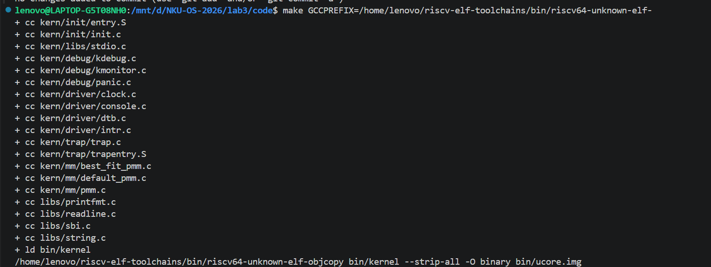

图 4-1  内核编译输出

如图 4-1，trap.c、trapentry.S、clock.c 等文件完成编译，通过链接生成 bin/kernel，再由 objcopy 导出 bin/ucore.img。

## 五、测试结果

### 5.1 运行内核并检查时钟

执行 make qemu，按启动顺序查看 OpenSBI、内核初始化和时钟统计输出，检查运行结果。

```text
make qemu GCCPREFIX=/home/lenovo/riscv-elf-toolchains/bin/riscv64-unknown-elf-
```

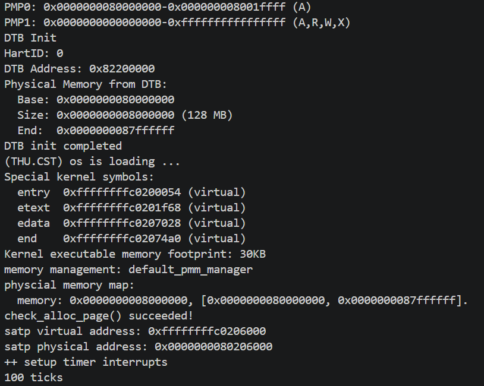

图 5-1  内核初始化输出

如图 5-1，依次输出设备树、内存管理和内核符号信息，打印“++ setup timer interrupts”，接着出现“100 ticks”，完成时钟初始化和中断处理。

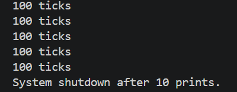

图 5-2  时钟计数及关机输出

如图 5-2，输出“System shutdown after 10 prints.”并关机，对应 print_cnt 达到 10 的处理结果。

执行 make grade，检查物理内存管理和时钟统计输出。通过异常测试及 GDB 单步记录核对四项异常的类型和返回地址。

```text
make grade GCCPREFIX=/home/lenovo/riscv-elf-toolchains/bin/riscv64-unknown-elf-
```

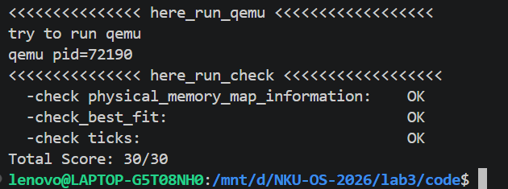

图 5-3  make grade 结果

如图 5-3，physical_memory_map_information、check_best_fit 和 ticks 三项均为 OK，总分为 30/30。

### 5.2 执行四项异常测试

通过 LAB3_EXCEPTION_TEST 启用独立测试入口。执行 idt_init()，依次运行四条测试指令，经由 __alltraps 保存现场，调用 exception_handler()，通过 sret 返回。

使用 .option norvc 生成 4 字节 ebreak，使用 .option rvc 生成 2 字节 c.ebreak。非法指令用例分别采用 .2byte 0x0000 和 .4byte 0x0200101b，其中 0x0200101b 属于 RV64 中 shamt[5] 置位的保留 SLLIW 编码。

```text
/* 32 位断点 */
".option norvc\n"  "ebreak\n"
/* 16 位断点 */
".option rvc\n"    "c.ebreak\n"
/* 16 位非法编码 */
".2byte 0x0000\n"
/* 32 位非法编码 */
".4byte 0x0200101b\n"
```

输出 Case 标记，执行异常指令，输出 PASS 标记，记录程序返回和继续执行的结果。用 epc+2、epc+4 标明预期增量，通过 GDB 读取 epc 的原值和更新值。

```text
cd /mnt/d/NKU-OS-2026/lab3-exception-test/code
make test DEFS=-DLAB3_EXCEPTION_TEST \
  GCCPREFIX=/home/lenovo/riscv-elf-toolchains/bin/riscv64-unknown-elf-
```

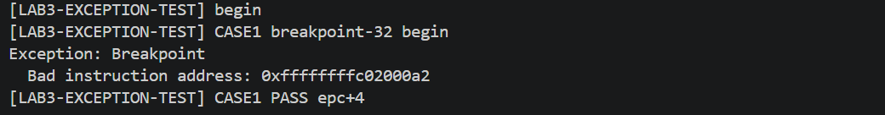

图 5-4  普通断点测试

如图 5-4，执行 Case 1，输出 Breakpoint 和异常地址，接着输出 CASE1 PASS，记录普通 ebreak 从 Trap 返回的结果。

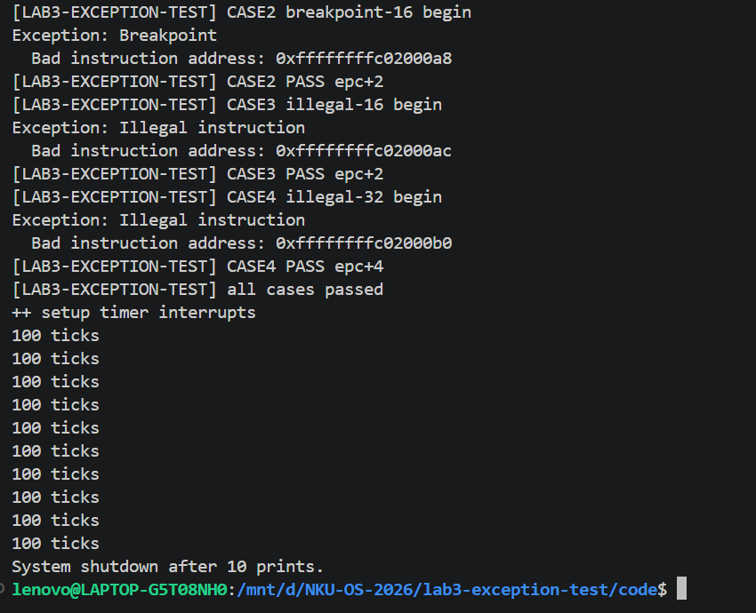

图 5-5  四项异常的运行结果

如图 5-5，其余三个用例均输出 PASS 标记，汇总输出 all cases passed；继续初始化时钟，输出 ticks。

### 5.3 使用 GDB 检查 epc

使用 VS Code 的第一个集成终端执行 make debug，以 -s -S 参数启动 QEMU 并等待连接。使用第二个终端启动 GDB，读取 bin/kernel 的符号信息，连接 localhost:1234，设置 exception_handler() 断点，执行 continue 运行到第一项异常。

```text
# 终端 1
make debug DEFS=-DLAB3_EXCEPTION_TEST \
  GCCPREFIX=/home/lenovo/riscv-elf-toolchains/bin/riscv64-unknown-elf-

# 终端 2
/home/lenovo/riscv-elf-toolchains/bin/riscv64-unknown-elf-gdb bin/kernel
(gdb) target remote localhost:1234
(gdb) break exception_handler
(gdb) continue
```

读取 scause、sepc、tf->cause 和 tf->epc，核对硬件记录和 Trap frame，查看异常地址处的指令编码。停在 tf->epc 更新语句处，将原值保存到 $before；单步执行该语句，读取 tf->epc，计算 tf->epc - $before，取得本次异常的实际增量。

```text
(gdb) p/x $scause
(gdb) p/x $sepc
(gdb) p/x tf->cause
(gdb) p/x tf->epc
(gdb) x/i $sepc
(gdb) x/1hx $sepc
# epc 更新语句处：
(gdb) set $before = tf->epc
(gdb) n
(gdb) p/x $before
(gdb) p/x tf->epc
(gdb) p/x tf->epc - $before
```

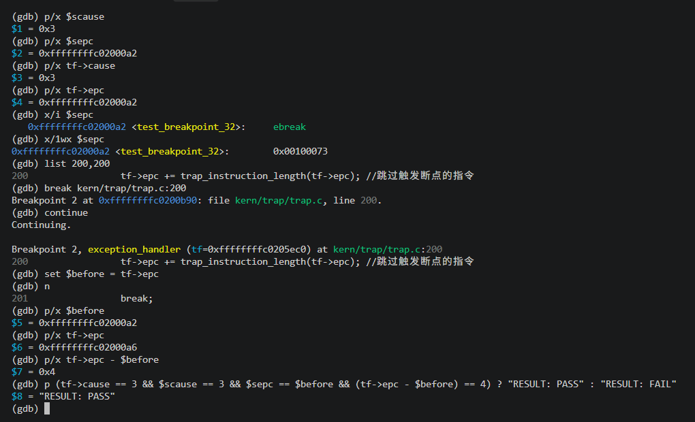

图 5-6  单步执行普通 ebreak

如图 5-6，scause=0x3，epc 从 0xffffffffc02000a2 变为 0xffffffffc02000a6，差值为 0x4，返回 RESULT: PASS。

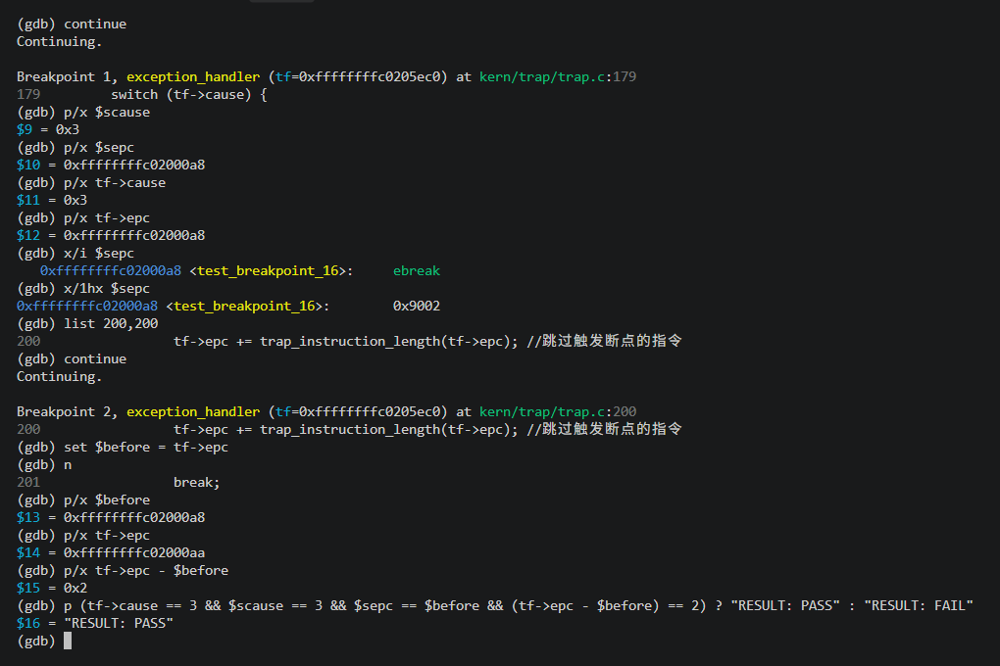

图 5-7  单步执行 c.ebreak

如图 5-7，scause=0x3，c.ebreak 的编码为 0x9002。epc 从 0xffffffffc02000a8 变为 0xffffffffc02000aa，差值为 0x2，对应压缩指令的长度。

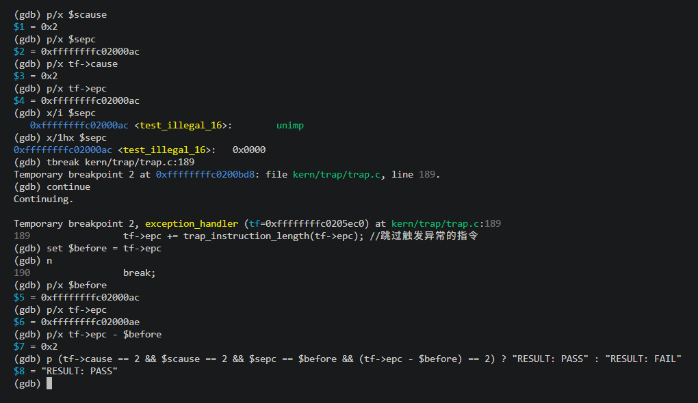

图 5-8  单步执行 16 位非法指令

如图 5-8，scause=0x2，读取到的指令编码为 0x0000。epc 从 0xffffffffc02000ac 变为 0xffffffffc02000ae，差值为 0x2。

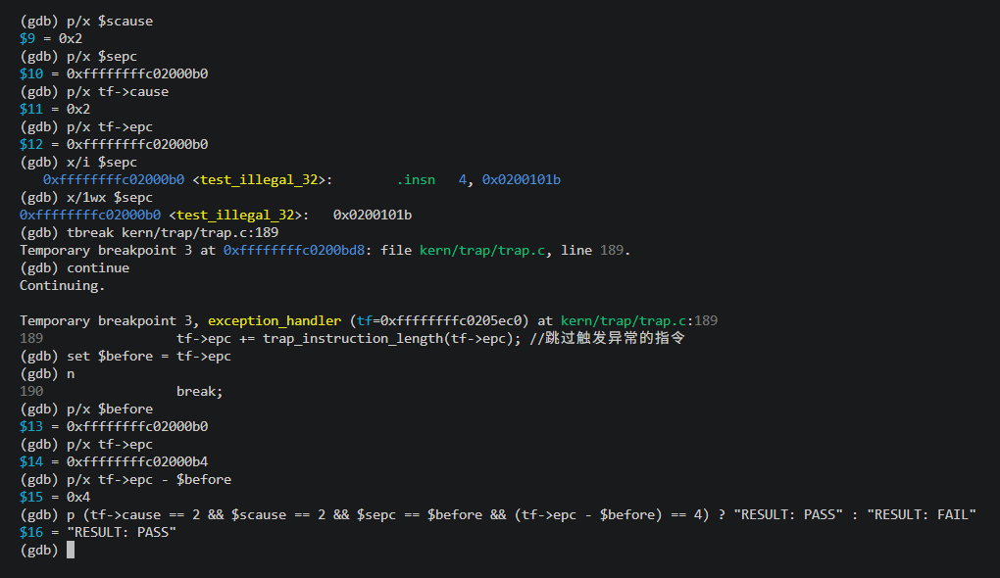

图 5-9  单步执行 32 位非法指令

如图 5-9，scause=0x2，指令编码为 0x0200101b。epc 从 0xffffffffc02000b0 变为 0xffffffffc02000b4，差值为 0x4。四项读数分别对应 4、2、2、4 字节。

### 5.4 检查其他异常分支

构造 cause 分别为 CAUSE_FAULT_FETCH 和 CAUSE_FAULT_LOAD 的 Trap frame，保存 epc 原值，调用 exception_handler()，读取 tf->epc 并与原值比较，同时查看输出的寄存器和 CSR 现场。

执行 make clean 清理已有构建结果，使用 LAB3_EXCEPTION_FALLBACK_TEST 重新编译。通过 nm 查询 bin/kernel 中的测试入口，确认链接结果，运行测试。

```text
cd /mnt/d/NKU-OS-2026/lab3-exception-test/code
make clean
make DEFS=-DLAB3_EXCEPTION_FALLBACK_TEST \
  GCCPREFIX=/home/lenovo/riscv-elf-toolchains/bin/riscv64-unknown-elf-
/home/lenovo/riscv-elf-toolchains/bin/riscv64-unknown-elf-nm \
  bin/kernel | grep lab3_exception_fallback_test
make test DEFS=-DLAB3_EXCEPTION_FALLBACK_TEST \
  GCCPREFIX=/home/lenovo/riscv-elf-toolchains/bin/riscv64-unknown-elf-
```

通过 nm 查询到 ffffffffc020012e T lab3_exception_fallback_test。运行测试，依次进入 fetch-fault 和 load-fault，分别打印 cause=0x1 和 cause=0x5 的 Trap frame。

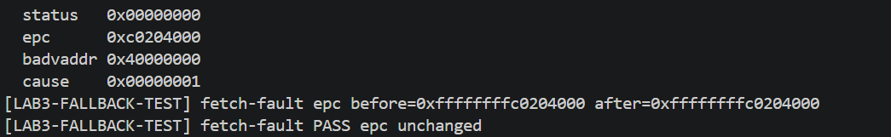

图 5-10  取指错误的兜底结果

如图 5-10，fetch-fault 分支打印现场，epc 的两次读数均为 0xffffffffc0204000，输出 PASS epc unchanged。

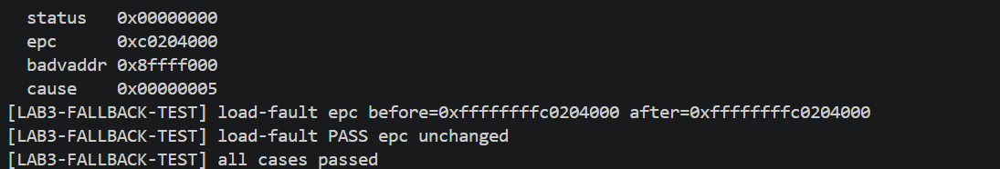

图 5-11  访存错误的兜底结果

如图 5-11，load-fault 分支打印 cause=0x5 的现场，epc 的两次读数均为 0xffffffffc0204000；汇总输出 all cases passed，继续初始化时钟。

读取测试程序输出的完整 64 位 epc，与原值比较，两次读数均为 0xffffffffc0204000。现场打印行采用 %08x 格式，显示为低 32 位的 0xc0204000；测试比较行保留完整地址。

### 5.5 检查连续异常和寄存器恢复

通过 LAB3_TRAP_SEQUENCE_TEST 启用测试入口，为 t0、t1 和 a0 设置测试值，连续执行 ebreak、c.ebreak、ebreak，触发三次断点。读取寄存器，核对测试值，继续执行测试函数。

```text
cd /mnt/d/NKU-OS-2026/lab3-exception-test/code
make clean
make DEFS=-DLAB3_TRAP_SEQUENCE_TEST \
  GCCPREFIX=/home/lenovo/riscv-elf-toolchains/bin/riscv64-unknown-elf-
/home/lenovo/riscv-elf-toolchains/bin/riscv64-unknown-elf-nm \
  bin/kernel | grep lab3_trap_sequence_test
make test DEFS=-DLAB3_TRAP_SEQUENCE_TEST \
  GCCPREFIX=/home/lenovo/riscv-elf-toolchains/bin/riscv64-unknown-elf-
```

通过 nm 查询到 ffffffffc02000fe T lab3_trap_sequence_test。运行测试，读取三次 Breakpoint 的地址，分别为 0xffffffffc02000c4、0xffffffffc02000c8 和 0xffffffffc02000ca；地址间隔依次为 4 和 2 字节，对应普通断点和压缩断点的指令长度。

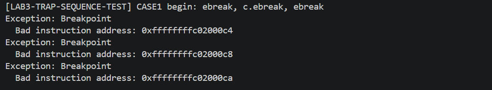

图 5-12  三次连续断点

如图 5-12，输出 CASE1 begin，依次输出三次断点信息，异常地址按 ebreak、c.ebreak、ebreak 的顺序前进。

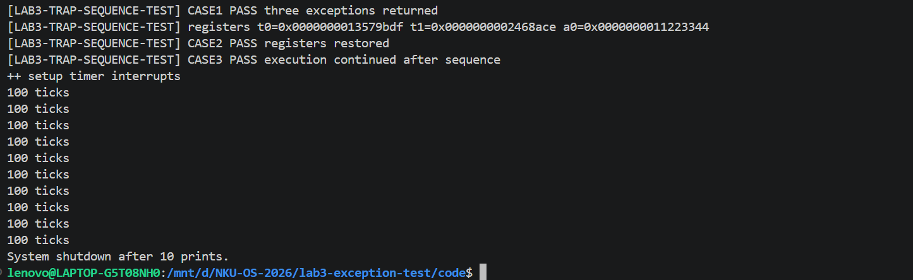

图 5-13  连续异常测试的寄存器读数

如图 5-13，读取到 t0=0x13579bdf、t1=0x02468ace、a0=0x11223344，输出 registers restored 和 execution continued after sequence，继续输出 10 行 ticks 并关机。

核对 t0、t1、a0 的预设值和 CASE3 执行标记，确认寄存器恢复和程序继续执行的结果。检查时钟统计和关机输出，完成连续异常测试。

## 六、调试记录

### 6.1 按指令长度调整 epc

结合异常原因和指令编码确定地址增量。普通 ebreak 和 c.ebreak 的 cause 均为 0x3，通过 trap_instruction_length() 分别得到 4 字节和 2 字节的长度。GDB 中测得的 epc 增量分别为 +4 和 +2，与对应编码一致。

### 6.2 单步读取 epc

停在 exception_handler() 的 epc 更新语句处，保存 $before，执行一次 n，读取 tf->epc 并计算差值。四项记录依次得到 4、2、2、4，对应各条测试指令的长度。

结合源码停点和异常地址处的反汇编确认执行位置，从当前 Trap frame 读取 cause 和 epc，逐项核对测试指令、字段修改和单步结果。

### 6.3 核对评分输出

首次评分得到 5/30，ticks 项为 OK。核对报错中的内存管理器名称和两项 satp 地址输出。再次评分得到 30/30，物理内存管理、Best-Fit 和 ticks 三项均为 OK。

分别记录评分输出和异常单步数据。通过 make grade 核对物理内存管理及 ticks，通过四条真实异常指令和 GDB 读数核对 cause、指令编码和 epc 增量；各项地址均取自对应运行记录。

## 七、思考题

### 7.1 do while 宏的作用

使用 do { ... } while (0) 将 local_intr_save(x) 的宏体组织成一条完整语句。调用宏时补上分号，按单条语句放入 if/else 分支。条件恒为 0，宏体执行一次，完成中断状态保存。

```text
#define local_intr_save(x) \
    do {                   \
        x = __intr_save(); \
    } while (0)
```

读取 sstatus.SIE，保存原有中断状态，屏蔽当前核中断。执行临界区操作，依据保存的标志恢复中断，保持外层代码原有的设置。

### 7.2 对应的操作系统知识

中断响应：使用 stvec 设置入口，通过硬件记录 CSR，由汇编保存通用寄存器，再通过 trap_dispatch() 识别原因并分发，将中断响应的基本步骤对应到具体函数和指令。

上下文保存：执行 SAVE_ALL，将寄存器和处理器状态保存到 trapframe，调用 C 函数处理 Trap。执行 RESTORE_ALL 恢复现场，通过 sret 继续执行内核代码。

时钟机制：周期性时钟可以用于统计运行时间和维护时间片。本次使用 ticks 记录中断次数，每累计 100 次输出统计信息，累计输出 10 次则关机，将时钟事件设置和软件计数联系起来。

临界区保护：调用 local_intr_save() 保存并屏蔽当前核中断，修改页分配和释放涉及的数据结构，调用 local_intr_restore() 恢复原有状态。

### 7.3 知识拓展

用户态运行涉及地址空间隔离、系统调用以及用户栈和内核栈切换。结合 sstatus.SPP 判断特权级，通过 sepc 确定返回地址，使用 trapframe 分析上下文的保存和恢复。

进程调度涉及可运行进程的选择和执行现场切换；缺页处理涉及页表维护和故障指令恢复；多核同步涉及多个处理器之间的共享数据保护。

## 八、实验总结

这次实验中，我们继承了 Lab2 的内存管理代码，梳理了 Trap 入口和现场恢复的执行过程，完成了时钟中断及异常处理。我们还编写了普通断点、压缩断点和非法指令的测试，用 QEMU 运行内核，在 GDB 中跟踪进入处理函数和返回的过程。连续异常测试和寄存器恢复测试则帮助我们把几次 Trap 连起来观察。

实验中，我们也遇到了一些问题。刚开始做异常单步调试时，我们使用 finish 执行到函数返回，再查看 Trap frame，难以分清读到的 epc 对应哪一步。我们把断点改设在 epc 的更新语句处，保存原值并单步执行，直接读取修改后的地址。处理普通指令和压缩指令时，我们结合反汇编查看编码，根据实际长度调整返回位置，把源码中的修改和单步时看到的地址变化对应起来。

做完这次实验，我们对中断发生时要保存什么、处理函数怎样读取现场、内核怎样回到原来的执行位置，有了更清楚的认识。单独阅读汇编或 C 代码时，有些细节容易略过；把寄存器、栈中的内容和正在执行的指令放在一起看，理解起来就具体得多。我们也逐渐养成了边读源码边单步调试的习惯，遇到疑问就回到对应的语句和指令上查找原因。
