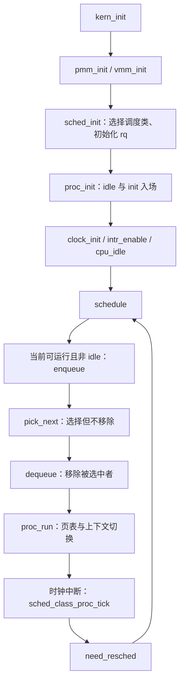
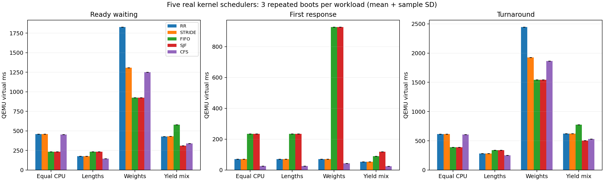
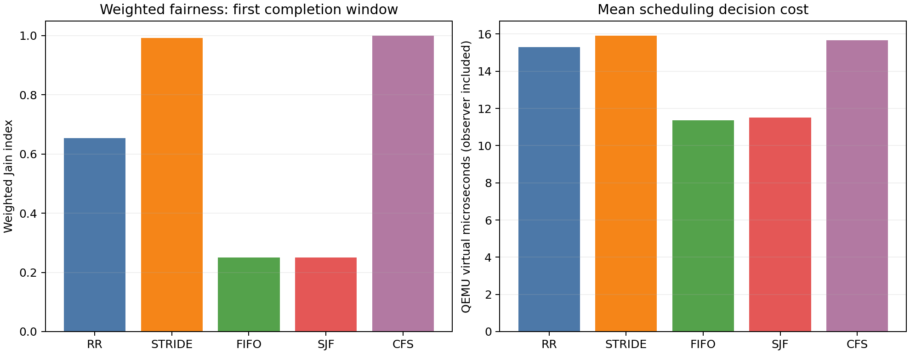

# Lab6 进程调度实验：成员 C 实现与验证

成员：2411788 马传志。日期：2026-11-28。本文记录 C 负责的 Stride、统一调度框架、五种算法接入和性能评估，可直接整合进小组最终报告。

## 1. 基线与完成范围

以本次提供的 2026 官方 Lab6 源码和手册为准。开发分支从公共 `lab6` 的 `ed876e1` 建立，合入 B 分支 `de4bd07` 的进程、中断、RR 与 CFS 前置实现；没有使用其他版本的完整 uCore 替换官方框架。A 的 FIFO/SJF、B 的 RR/CFS 实现文件保持原样。

| C 任务 | 结果 | 代码／证据 |
|---|---|---|
| C1 调度框架 | 完成 schedule，保留官方唤醒与节拍接口 | kern/schedule/sched.c |
| C2 Stride | 官方斜堆、权重、时间片、回绕处理、边界测试 | default_sched_stride.c；tests/stride |
| C3 五算法接入 | 编译时选择，默认 Stride；配置变化触发重编译 | sched_select.h；Makefile |
| C4 定量评估 | 5 算法 × 4 负载 × 3 次 = 60 次真实 QEMU 启动 | tests/results/qemu；CSV；下文图表 |
| C5 集成验证 | 6 次进程／CPU 负载测试，官方评分 60/60 | tests/results/process；grade.txt |

独立调试文件 `kern/debug/pgdir.c` 迁入我们 Lab5 的页表输出函数，补齐 A/B 整合后 sys_pgdir 缺少 print_pgdir 的链接依赖；没有覆盖 A 的 pmm.c。Lab6 此基线没有 PTE_COW 定义，所以诊断显示软件保留位 RSW，不能把任意软件位都宣称为 COW。

## 2. 总体执行线



schedule 在保存并关闭本地中断后完成清除 need_resched、当前进程入队、选取、出队、增加 runs 和 proc_run。没有候选者时选择 idleproc；idle 不进入普通运行队列。当前状态是睡眠或僵尸时不重新入队。若选中自己，仍完成队列和计数操作，但跳过不必要的上下文切换。中断状态最终恢复为调用前状态，而不是无条件开中断。

## 3. Stride 核心实现

### 3.1 接口分工

| 函数 | 本实现的行为 |
|---|---|
| proc_stride_comp_f | 比较两个斜堆节点所属 PCB 的 pass；相同 pass 按 PID 确定顺序；返回 -1/0/1，符合官方斜堆比较器约定 |
| stride_init | 初始化链表哨兵、空堆、proc_num、虚拟时间基线和预记账状态，补足默认时间片 |
| stride_enqueue | 校正运行中优先级变化的预记步长，限制陈旧虚拟信用，补充耗尽时间片，将节点插入斜堆并更新 rq、计数 |
| stride_dequeue | 验证队列归属和成员关系，使用官方 skew_heap_remove，清理脱离节点并更新计数 |
| stride_pick_next | 取堆根，记录当前虚拟时间，按权重增加 pass；框架紧接着移除该根，重新合并子堆 |
| stride_proc_tick | 减少时间片，耗尽时置 need_resched；不把时间片减为负数，不清除已有重调度请求 |

这里 lab6_stride 保存的是累计 pass（虚拟进度），真正每次增加的 stride／步长是 `max(1, BIG_STRIDE / effective_weight)`。BIG_STRIDE=2^20，优先级 0 按权重 1；很大的优先级也不会使步长降到 0。超过 BIG_STRIDE 的权重最终都对应最小步长 1，不能再承诺它们之间任意精细的比例。

### 3.2 为什么近似按权重分配

对持续可运行、消耗相同完整时间片且权重不变的进程，执行 n_i 次后的 pass 约为 `n_i × BIG_STRIDE / w_i`。调度器始终选择最小 pass，使各进程 pass 在有限步长误差内趋于相近，于是 `n_i/w_i` 近似相同，即 `n_i:n_j ≈ w_i:w_j`。这首先说明时间片次数的比例；只有时间片消耗相近时，才可进一步解释 CPU 时间比例。主动频繁 yield、不同到达时刻和动态改权都会引入瞬态偏差。

27 项宿主机专项检查包含 7000 次持续调度，权重 1:2:4 的选择次数在 1000:2000:4000 的两个时间片误差内，且每步都验证堆父指针、堆序和计数。

### 3.3 回绕、空队列与睡眠

比较器使用 uint32 无符号差的最高位判断先后，不直接用普通大小比较跨越 0 的 pass。单步不超过 2^20，活跃 pass 的有意义距离需小于 2^31；这是模序比较的前提，不是任意间隔下的全序。测试覆盖 0xfffffff0 和 0x10 的排序及步长加法回绕。新任务从队列虚拟时间基线开始；落后的唤醒任务被限制到基线，避免靠过去的空闲时间囤积 CPU 信用。极端休眠跨过半个计数空间的情形不在当前回归覆盖内。

空堆返回 NULL。非法重复入队、移除非成员会触发断言；合法移除后清空堆节点的 parent/left/right。pick_next 更新根键后，调用者必须立即 dequeue 该根，不能在更新键但未移除时再次选取。

### 3.4 实际修复：首次 setpriority 的记账偏差

首次实机 priority 测试的份额比偏低：任务第一次被选中时仍是默认权重 1，进入用户态后才设置自己的权重。若一直保留这笔按旧权重预记的步长，短测试会明显低估高权重任务。

修复是在 run_queue 保存当前运行者及已预记步长；该进程重新入队时撤销旧预记值，按最新权重补记。运行者此时不在堆里，不会通过原地改键破坏堆序。新增回归检查首个时间片改为权重 5 后 pass 为 BIG_STRIDE/5。修复后的正常 QEMU priority.c 输出 `sched result: 1 2 3 4 5`。这没有实现任意时刻重分配 tickets 的完整动态补偿协议。

## 4. 五种算法的统一选择

在 code/ 中执行：

```sh
make build-priority SCHED=rr
make build-priority SCHED=stride
make build-priority SCHED=fifo
make build-priority SCHED=sjf
make build-priority SCHED=cfs
make qemu SCHED=stride
```

SCHED 默认 stride。sched_select.h 把合法参数映射到各自 sched_class，未知参数在 Make 阶段报错。default_sched_class 仍然是 B 的 RR 类，不更名。配置戳记录 SCHED、BENCH 和 DEFS，变化时重编译 sched.o，避免同一目录切换算法仍链接旧选择。五个实现都通过同一组回调接入。

不支持在运行中热切换：RR/FIFO/CFS 的链表、Stride 的斜堆及 SJF 对 time_slice、lab6_stride 的复用语义不同。只有重新构建并启动新内核，才能保证队列和 PCB 字段一致。

## 5. 调度框架六项理解题

1. **sched_class 的函数指针是什么？** init 在 sched_init 时初始化运行队列；enqueue 在唤醒及当前任务重新排队时调用；dequeue 在选择完成后移除下一进程；pick_next 根据策略选择；proc_tick 由时钟中断经统一接口调用。函数指针使 schedule 只负责流程，不硬编码某一种排序规则。
2. **Lab5 与 Lab6 的运行队列差异？** Lab5 主要遍历全局 proc_list 查找可运行进程；Lab6 把“所有进程”与“等待 CPU 的进程”分开，run_queue 包含运行链表、计数、时间片及斜堆根。不同策略选择合适的数据结构，proc_list 仍负责全体进程管理。
3. **sched_init、wakeup_proc、schedule 如何变化？** 初始化增加策略选择和队列初始化；唤醒只在非 runnable 转为 runnable 时将非 current 的任务入队；schedule 根据状态重新排队并通过回调选取，避免重复入队以及把僵尸、睡眠、idle 当普通就绪进程。
4. **初始化顺序如何关联 default_sched_class？** kern_init 先完成内存管理，再 sched_init、proc_init，随后时钟与全局中断、cpu_idle。RR 的 default_sched_class 是一个静态函数表；本次默认编译选择 Stride，但保留 RR 表及其全部接口，官方测试仍可独立访问它。
5. **完整调度流程和 need_resched 的作用？** 定时事件续约、ticks 更新、调用 sched_class_proc_tick(current)，由所选算法设置重调度标记；Trap 返回用户态前检查标记并调用 schedule。阻塞、退出、主动 yield 和 idle 也可触发调度。标记是请求，不是已经发生切换；本框架也不等于可随时抢占的 SMP 内核。
6. **新增或切换算法需改哪里？** 新建策略实现、声明调度类、给 sched_select.h 和 Makefile 增加选择项，再独立编译和验证队列不变量。现有五类已经完成接入，不需改中断处理、进程创建或 switch.S。

## 6. 性能实验口径

- 真实执行完整内核、用户 fork/exit/wait、时钟中断和所选调度算法；不是在 Python 中重写算法得到的模拟结果。
- 五策略、四场景、每场景三轮，共 60 次完整 QEMU 启动、240 条工作进程记录；另有 5 次正常时钟模式的官方 priority.c。
- 四场景：等量 CPU 工作；长度 12/3/6/1 个固定工作单元；相同工作量但权重 1/2/4/8；长短 CPU Burst（CPU 执行片段）间主动 yield 的混合任务。最后一种没有伪装成磁盘或网络 I/O。
- 对比使用同一单 hart QEMU 4.1.1，`-icount shift=3,align=off,sleep=off`，按指令推进虚拟时间。rdtime 以 virt 的 10 MHz 为单位；报告毫秒都是虚拟毫秒，不能当作宿主机真实性能排名。
- BENCH=1 才编译 sched_bench.h 的观测器。BENCH=0 默认关闭。arrival 为首次就绪入队；response=首次选中-arrival；turnaround=结束调度时刻-arrival；waiting 为各就绪等待区间之和，不把等待子进程等阻塞时间当作就绪等待。
- CPU 占用区间从被选中到下次调度，包含部分内核服务及派发/切换记账，不宣称是精确的纯用户 CPU 时间。节拍数另行保留。
- 公平性取所有子任务创建到第一个任务结束的共同观察窗口，比较 CPU 占用区间除以权重后的 Jain 指数：`(sum(x))^2 / (N*sum(x*x))`。不能用最终各任务全部完成后的总 CPU 时间来假装体现权重公平性。
- decision_us 是调度决策区间平均耗时，含轻量探针记账，不含 switch.S、satp/TLB 切换及诊断打印，不能叫做完整上下文切换成本。
- 三轮均记录原始值和样本标准差。本次指令计时模式下各轮重复性高，多数字段标准差为 0；这不是伪造重复数据，也不能推断真实硬件没有抖动。





### 6.1 本次结果摘要

| 算法 | 等量 CPU 平均响应 ms | 加权场景 Jain | yield 混合场景平均等待 ms | 加权场景决策 us |
|---|---:|---:|---:|---:|
| RR | 71.546 | 0.654 | 429.544 | 15.291 |
| STRIDE | 71.547 | 0.991 | 430.082 | 15.917 |
| FIFO | 234.436 | 0.250 | 581.064 | 11.375 |
| SJF | 234.437 | 0.250 | 312.026 | 11.500 |
| CFS | 26.528 | 0.999 | 339.256 | 15.668 |

完整的 20 个策略/场景组合及标准差见 [summary.csv](../code/tests/results/summary.csv)，逐进程数据见 [per_process.csv](../code/tests/results/per_process.csv)，原始输出见 [qemu 记录目录](../code/tests/results/qemu)。

### 6.2 结果解释与适用场景

- RR：等权 CPU 任务的窗口公平性好，调度规则直观；权重并不参与选择，所以不同权重场景的归一化公平性较低。适合基础交互轮转，时间片过大损害响应，过小增加切换次数。
- Stride：加权场景 Jain 约 0.99，CPU 密集型权重分配符合设计；需要处理整数精度、溢出和到达/改权的瞬态。斜堆使入队、出队的摊还复杂度为 O(log n)，取根为 O(1)。
- FIFO：非抢占，决策成本低，等量有限批任务的平均周转在本次数据中可以小于 RR，但后到进程首次响应很慢，观察窗口公平性低。不能只拿一个平均值宣称总体更优。
- SJF：首次运行没有历史，所有初始预测相同，因此本次一次性不同长度任务并没有获得理想先知 SJF 的排序优势；有历史的 yield 混合任务等待时间优于 FIFO。长任务仍可能饥饿，不能把 EMA（指数移动平均）预测说成已知未来长度。
- 简化 CFS：本次首次响应较短、加权公平性较好；B 的实现扫描链表选择最小虚拟运行时间，适合小规模教学。不能把该实现的决策成本当作真实 Linux 红黑树/CFS/EEVDF 的成本。

## 7. 验证结果与真实问题记录

| 验证 | 实际结果 | 记录 |
|---|---|---|
| 官方 Lab6 make grade | 60/60 | code/tests/results/grade.txt |
| A FIFO/SJF 宿主机 ASan/UBSan | 95/95 | code/tests/fifo_sjf/results.txt |
| B RR/CFS 宿主机 ASan/UBSan | 121/121 | code/tests/rr_cfs/results/host.txt |
| C Stride 宿主机 ASan/UBSan | 27/27 | code/tests/results/stride-host.txt |
| RR/Stride/CFS 进程与 CPU 负载 | 6 个启动均通过，复用 B 的真实断言 | code/tests/results/process |
| 五算法统一 benchmark | 60/60 启动，均回收到 init | code/tests/results/qemu |
| 官方 priority.c 独立观察 | 五算法均完整结束；Stride 输出 1 2 3 4 5 | 同上，各 policy_priority.txt |

实际遇到并解决的问题：

1. **undefined reference to print_pgdir**：前置迁移留下声明而缺少定义。迁入本组已实现的诊断函数到独立 debug/pgdir.c，保留 A 的内存文件。
2. **旧版诊断引用 PTE_COW 导致编译失败**：Lab6 此框架未定义该位名；改为按实际 PTE 输出 RSW 保留位。
3. **首次 setpriority 的 Stride 预记账偏差**：见 3.4，新增专项检查后验证官方输出。
4. **临时副本打包与 make clean 并发时 tar 报目录变化**：性能测试改为显式复制 Makefile、kern、libs、user、tools，不扫描正在生成和清理的根目录、obj、bin、tests。该问题没有用忽略 tar 错误掩盖。
5. **同一目录切换策略可能复用旧 sched.o**：增加配置戳；五算法的不同启动标识和真实运行结果验证了切换有效。

本次保留真实运行日志、CSV 与独立图表，图表明确标注测量单位；没有把图表伪装成原生终端截图。答辩时可按下面命令现场运行和手动截图。

## 8. 复现与队友接入

```sh
cd code
bash tests/run_all.sh host
bash tests/run_all.sh grade
bash tests/run_all.sh qemu
# 汇总不依赖第三方 Python 包：
python3 tests/benchmark/analyze.py
# 图表生成需要已有 matplotlib，不修改系统环境：
python tests/benchmark/plot.py
```

QEMU 与交叉工具链使用当前机器已经安装的版本，路径集中在 tests/stride/env.sh，迁移到其他机器只需改环境脚本或在等价环境执行相同命令。QEMU 测试在 mktemp 目录构建，不覆盖 A/B 正式文件。

B 无需为 C 再添加 PCB 字段；C 使用其已初始化的 runs、time_slice、lab6_stride、lab6_priority 和斜堆节点。新增 Stride 基线及记账状态属于 C 维护的 run_queue。A 的 FIFO/SJF 为非抢占式，只有主动让出、阻塞或退出后才会选择别的进程。当前五种算法只能编译/启动前选择。

旧 B run_qemu.sh 使用文本替换 sched_init 选择算法，适用于它提交时的固定 RR 入口；统一选择机制合入后，应使用本次 tests/run_all.sh qemu，不依赖旧脚本中的固定文本匹配。

## 9. 与 OS 原理的联系及未实现内容

本实验体现策略与机制分离、就绪队列、抢占请求、比例份额、虚拟时间、内核临界区和测量口径。斜堆是比例调度的一种具体实现，并不是调度策略本身；同一策略可采用其他有序结构。

未包含多核负载均衡、跨 hart 调度锁与 IPI、实时截止期保证、优先级继承、真实磁盘 I/O 负载、完整 Linux CFS/EEVDF 以及任务迁移。关闭本 hart 中断不等于拥有 SMP 锁。上述限制不能通过官方 60/60 或本次小规模性能测试消除。
