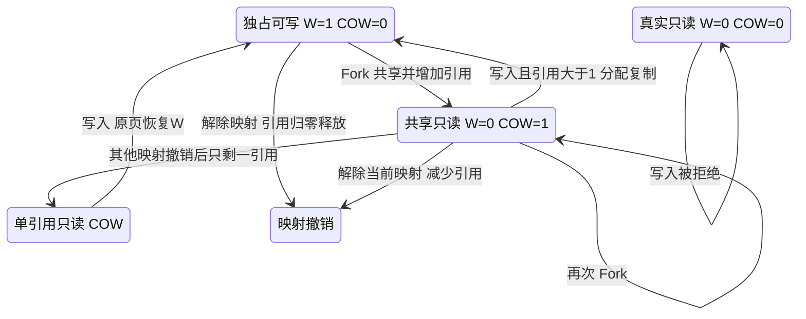

# Lab5 丙部分实现与验证

马传志 2411788。本文只记录进程复制与 COW 的工作，整组系统调用、程序加载及生命周期管理待合并后共同验收。

## 复制路径

do_fork 分配 PCB 和内核栈，再调用 copy_mm、copy_thread 准备地址空间与首次运行现场。最后在中断临界区内分配 PID、挂入哈希表、调用 set_links 维护父子兄弟关系并增加计数，再唤醒子进程。失败时按已申请资源逆序清理，不登记半完成的进程。copy_thread 给子帧 a0 清零，保留用户入口与用户栈，并设置 context.ra=forkret、context.sp=tf。

copy_mm 的三条路径分别为：内核线程不建立用户 mm；CLONE_VM 共享原 mm 并增加 mm_count；普通 Fork 新建 mm 和根页表，锁住来源 mm 后通过 dup_mmap 复制 VMA 和用户映射。部分复制失败时，exit_mmap 回收已挂接的子映射、put_pgdir 释放根页表、mm_destroy 回收 VMA 和 mm。

默认 LAB5_COW=1，普通 Fork 延迟复制数据页；编译时设置为 0，则 copy_range 分配新物理页并立即复制，提供基础功能的独立对照。这里的共享整个 mm 与共享若干 COW 物理页含义不同。

## COW 权限和引用

PTE_COW 使用软件保留位 0x100。源页面可写或已标 COW 时，父子叶项都清 W 并置 COW；本来只读的页保持只读，不授予写能力。新映射通过 page_insert 增加页引用，父项更新后失效对应翻译。修改父子共享关系的关键区关闭本地中断。

do_cow_fault 先检查地址和 VMA 写权限，再验证 PTE 的 V/U/R/COW 状态，拒绝非 COW 和原本只读页面。引用为 1 时直接清 COW 并恢复 W；引用大于 1 时先分配并复制新页，再替换当前映射，旧引用随撤销减少。分配失败保持当前映射和数据有效。异常成功返回后 EPC 不变，原写指令重试。

copy_to_user 在实际复制载荷前逐页检查并解除 COW，再按物理页别名分段写入。否则内核从直接映射写入共享物理页，可能绕过用户页写保护，破坏父子隔离。长度加法溢出也在 user_mem_check 中拒绝。

## COW 状态转换

图中描述单个映射；多引用写入创建的新独占页不会使其他进程的原映射自动变为可写。Fork 失败后父项允许保留单引用 COW，下一次写入再恢复权限；所有失败路径不以恢复父 PTE 的完全相同位模式为要求。

## 实际测试

QEMU 4.1.1 下 COW/复制配置通过 52 项检查，普通 Fork 配置通过 8 项。它们检查立即复制、父子物理页共享、写保护、单引用优化、多次 Fork、内核 copyout、只读写入拒绝、跨 VMA 回收、父子登记和多种资源不足回滚。真实 S 态 store page fault 经测试入口处理后继续执行同一写指令，父数据不变。

GDB 在该 fault 的 trap 入口读到 cause=15、tval=0x800000；修复前 COW/W 掩码为 0x100，修复后为 0x4。EPC 不变、目标物理页改变两次比较均为 1，见 code/tools/member-c/evidence/cow-gdb.log。原始运行结果见 cow-runtime.log、eager-runtime.log。

测试使用独立页分配器和 B 的 alloc_proc 替代件，验证生产内存代码和 do_fork，但没有接入生产 U/S 双向栈、系统调用、ELF 与退出/等待实现。完整编译当前首先报 A 的 sys_* 未定义，尚未进行官方 13 项验收。不能把隔离测试结果写成整组用户程序全部通过。

## 继承与修复记录

从小组 Lab4 迁移 Best-Fit 物理页分配、page_init 和映射建立/删除逻辑，保留 Lab5 框架及检查。适配 Lab5 公开的 free_area 和新的 Trap 字段 tval。

get_pte 原实现第一级建表成功、第二级失败时会遗留资源，现记录新建状态并回滚。非叶项 U/A/D 按 Sv39 约束清零，对应启动检查同步检查非叶项保留位，而不是沿用旧的 U=1 断言；官方评分程序未改动。

exit_range 原实现可能只检查当前 VMA 对应的一部分上级表，就释放仍含其他有效兄弟表的目录页。现释放上级页表前扫描全部目录项，保留其他映射仍用的表。多 VMA 回收测试检查父子空间和总资源恢复。

测试脚本最初假定失败 finisher 必然令 QEMU 返回非零，但 4.1.1 在本环境也可能返回 0；改为检查精确 FAIL 断言和成功标志，而非根据退出码猜测。编译产物改到忽略目录 build，避免独立 WSL 调用间临时目录不可用。

## Dirty COW 分析和受控模拟

Dirty COW（CVE-2016-5195）是 Linux mm/gup.c 中与写时复制处理有关的竞态，可使只读私有映射被越权写入。其风险涉及页的身份、写访问意图、COW 处理结果在重试及并发变化中失去一致性，而不只是漏掉某一条 memcpy。[NVD](https://nvd.nist.gov/vuln/detail/CVE-2016-5195)

当前 ucore 没有对应 Linux 的文件映射、GUP、madvise 等完整接口，不声称复现原漏洞。tests/mutation.sh 在临时源码副本中移除 copy_to_user 的 COW 解除与 PTE 写权限检查，让内核直接写共享物理页；三方共享测试在父子隔离断言处失败。正式实现拒绝真实只读 VMA，并在写入前解除 COW，因此相同正常测试通过。

该模拟确定性验证“内核写路径绕过 COW”的同类隔离错误，未模拟原 Linux 竞态时序。多核或可抢占内核还需要页表锁、页引用保护、状态重新验证和跨核 TLB 同步；仅关闭当前 hart 中断不能解决所有竞态。

## 对接与剩余工作

给 A 的接口为 cow_handle_store_fault(mm, fault_addr)，在 vmm.h 声明（内部 do_cow_fault 名称保留兼容），仅对 store page fault 调用，参数使用 tf->tval，成功不推进 EPC；OOM 和非法访问按进程异常策略处理。给 B 的约定是分别维护 mm_count 与 Page 引用，最后一个 mm 使用者才销毁地址空间，用户结果写入走 copy_to_user。详细约定见 code/tools/member-c/README.md。

下一步在 A/B 合并后执行官方 13 项，验证用户态父子写、wait/exit/exec 回收及错误路径，再补生产环境截图。目前没有桌面截图或原 Linux Dirty COW 竞态复现记录。

## 2026-11-25：补齐 print_pgdir

在 pmm.c 实现 print_pgdir()，从当前 satp 提取 Sv39 根页表，不固定打印启动页表。递归最多三级，区分非叶项与 4 KiB、2 MiB、1 GiB 叶项，输出规范化虚拟地址、物理地址、大小、RWX/U/G/A/D 权限和 COW 位。不分配物理页，不修改页表或引用计数；异常表指针只输出诊断，不继续解引用。

新增 5 项实际 QEMU 断言：当前用户根及 COW、2 MiB 叶项、高位规范地址及 1 GiB 叶项、无状态修改、测试资源回收。现在 COW 隔离配置共 57 项、普通 Fork 配置共 13 项通过；GDB 和 copyout 变异检测也再次通过。

另外，在隔离的构建目录导出公共 lab5 的 c11f317，只插入本次打印函数（保留公共分支已有的 A/B/C 整合修改），完整 make 链接成功。使用 build-pgdir、DEBUG_GRADE 和 QEMU 4.1.1 实际运行，出现 pgdir pass.、all user-mode processes have quit. 和 init check memory pass.，最后到框架的 initproc exit 终止路径。见 evidence/integration-print-pgdir-build.log 与 integration-print-pgdir-runtime.log。本次没有运行全部 13 个官方程序，不能据此宣称满分。截图中 A 的定时调度、用户读缺页终止问题仍由 A 检查。
