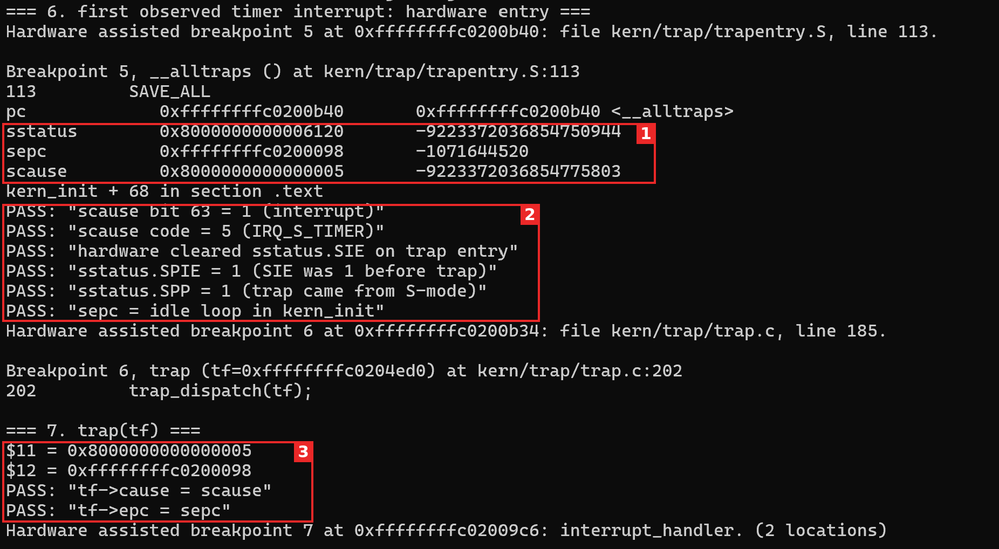
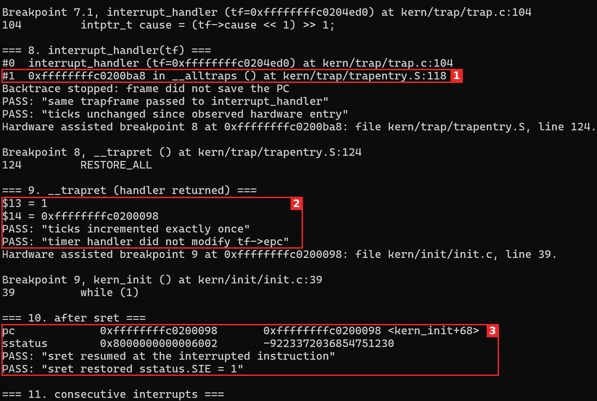
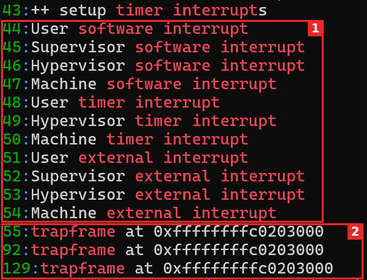

# 操作系统实验报告

Lab3：断，都可以断（中断和异常）

## 实验基本信息

| 项目 | 内容 |
| --- | --- |
| 实验名称 | Lab3：断，都可以断（中断和异常） |
| 小组成员 | 2411788-马传志、2413507-蒋林瀞、2412096-王麒萱 |
| 完成日期 | 2026.10.29 |

### 小组分工

练习分工：

| 成员 | 负责的练习/模块 |
| --- | --- |
| A 2411788-马传志 | 继承 Lab2 内存管理代码；功能模块一：Trap 上下文恢复与 Trap 入口（`RESTORE_ALL`、`__alltraps`）；检查栈指针、寄存器及返回位置 |
| B 2413507-蒋林瀞 | 功能模块二中的 `interrupt_handler()`：中断分类、监督态时钟中断、计数、定时输出及关机；`clock.c`、`intr.c`、`init.c` 中的初始化与中断使能 |
| C 2412096-王麒萱 | 功能模块二中的 `exception_handler()` 与 Challenge 3：非法指令、断点及兜底分支；异常测试、GDB 单步调试；三人代码集成 |

实验报告分工：每位成员撰写自己负责模块的实现、提示词、测试与调试记录，提示词汇总在 `report/prompt.md`；C 负责统稿和汇总测试截图，三人共同核对实验逻辑、知识点和总结部分。

## 一、实验目的

在程序发生异常或收到外部中断时，需要暂停当前执行，转入相应的处理函数，并在处理结束后继续运行。通过实现 RISC-V 的 Trap 处理，理解操作系统如何响应这些突发事件。

本次完成三项内容：了解 RISC-V 的中断机制；掌握中断前后保存和恢复上下文的方法；实现断点、非法指令和时钟中断的处理，并通过运行和单步调试检查返回结果。

## 二、实验环境

使用 Windows 下的 WSL Ubuntu 执行编译、运行和调试命令，通过 QEMU 模拟 RISC-V 64 位处理器，使用 GDB 连接 QEMU。工具配置如下。

| 项目 | 配置 |
| --- | --- |
| 终端环境 | Windows 下的 WSL Ubuntu |
| 目标架构 | RISC-V 64 位，测试包含 16 位压缩指令 |
| 交叉编译器 | riscv64-unknown-elf-gcc |
| 调试器 | riscv64-unknown-elf-gdb |
| 运行方式 | QEMU 4.1.1 Virt Machine，OpenSBI v0.4 |

通过 GCCPREFIX 指定 riscv64-unknown-elf- 交叉编译器前缀，使用 GDB 连接 QEMU 的 1234 端口，从 bin/kernel 读取符号信息。

三人使用的 AI 工具如下。

| 成员 | AI 编程工具 | 底层模型 | 备注 |
| --- | --- | --- | --- |
| A 2411788-马传志 | Codex | gpt-6.1-sol | 用于 Lab2 继承、Trap 入口核对及独立验证脚本 |
| B 2413507-蒋林瀞 | Claude Code（桌面应用 Code 标签页） | Claude Opus 5.5 | 用于基线审查、中断与时钟代码修改、GDB 测试脚本及 B 部分报告 |
| C 2412096-王麒萱 | Codex | gpt-6.1-sol | 用于异常处理、异常测试与 GDB 调试 |

## 三、实验整体逻辑与原理

### 3.1 本章的逻辑主线

本章围绕 Trap 展开：让内核在执行任意指令时都可能被中断或异常打断，并能在处理后回到原执行流。Lab2 完成了内存管理，内核已能稳定运行；但没有 Trap 机制时，内核既无法响应时钟和外设，也无法处理非法指令等错误。本章要建立的是“进入 Trap → 保存现场 → 按原因处理 → 恢复现场 → 返回”这条完整闭环，并用时钟中断和断点、非法指令异常验证它。

### 3.2 功能的逐步实现

1. 首先继承 Lab2 的内存管理。Trap frame 保存在内核栈上，页分配的临界区也要依赖关中断保护，内存管理必须先可用。
2. 接着完成 Trap 入口与现场恢复（功能模块一）。设置 `stvec`、`SAVE_ALL`/`RESTORE_ALL`、把 Trap frame 传给 C 函数，这是所有中断和异常共用的通路，处理函数只有在通路正确时才能被调用并安全返回。
3. 然后实现中断处理与时钟机制。时钟中断是唯一能在内核空转时持续、自动产生的 Trap，最适合检验入口和返回能否被反复使用；初始化时还要按“入口 → 时钟源 → 全局使能”的顺序打开中断。
4. 最后实现异常处理与 Challenge 3。异常由当前指令同步触发，处理后必须按指令长度推进 `epc`，比中断多一层返回位置的处理，因此放在通路和中断都验证之后。

### 3.3 Trap 处理流程

在内核启动时，通过 idt_init() 将 __alltraps 的地址写入 stvec，采用 Direct 模式设置统一入口。发生 Trap 后，处理器记录异常原因和执行地址，并跳转到 __alltraps；此时还没有保存全部通用寄存器，需要在汇编入口中继续完成现场保存。

在 __alltraps 中，先执行 SAVE_ALL，将寄存器保存到当前栈上的 trapframe，再按 RISC-V 调用约定把 trapframe 地址放入 a0，调用 trap()。进入 C 代码后，通过 trap_dispatch() 检查 cause 的最高位：为 1 时交给 interrupt_handler()，为 0 时交给 exception_handler()。

在处理函数返回后，通过 __trapret 执行 RESTORE_ALL，恢复通用寄存器、sstatus 和 sepc，最后执行 sret。针对断点和本次测试中的非法指令，先在处理函数中更新 tf->epc，再恢复到 sepc，防止返回后重复执行同一条异常指令。

```text
kern_init() -> idt_init() -> pmm_init() -> clock_init() -> intr_enable()
Trap -> __alltraps -> SAVE_ALL -> trap() -> trap_dispatch()
     -> interrupt_handler() / exception_handler()
     -> __trapret -> RESTORE_ALL -> sret
```

### 3.4 Trap frame 布局

在 kern/trap/trap.h 中，使用 struct trapframe 将 Trap 发生时的执行现场组织在一起。其中，gpr 按 x0 到 x31 的顺序保存通用寄存器，后四个字段分别保存 sstatus、sepc、stval 和 scause。RV64 下每个 uintptr_t 占 8 字节，整个结构共 36 个槽位，即 288 字节。

```text
struct trapframe {
    struct pushregs gpr;
    uintptr_t status;
    uintptr_t epc;
    uintptr_t badvaddr;
    uintptr_t cause;
};
```

在保存 sp 时，不能直接记录分配 Trap frame 后的栈顶地址。因此，SAVE_ALL 先把原 sp 写入 sscratch，再将 sp 减少 36 * REGBYTES，随后从 sscratch 取出原值，存入 x2 对应的槽位，恢复时使用同一布局，最后再从这个槽位恢复原 sp。

在 C 处理函数中，通过 tf->cause 判断原因，通过 tf->epc 取得异常指令地址；需要定位访存问题时，还可以查看 tf->badvaddr。对 tf->epc 的修改保存在内存中，直到 RESTORE_ALL 执行时才写回 sepc。

### 3.5 中断使能状态

在初始化时钟时，需要同时考虑中断来源和全局开关：clock_init() 设置 sie 中对应的监督态时钟中断位，intr_enable() 设置 sstatus.SIE。一次 S 态时钟中断要真正打断 CPU，需要同时满足三个条件：OpenSBI 在定时器到期后置位 sip.STIP；sie.STIE 为 1；sstatus.SIE 为 1。进入 Trap 时，硬件把 SIE 保存到 SPIE 并清零 SIE，因此处理函数执行期间不会被新的中断打断；sret 再把 SIE 恢复为 SPIE。

在页分配和释放期间，使用 local_intr_save() 记录原来的中断状态，并临时屏蔽中断；操作完成后，再通过 local_intr_restore() 恢复。在退出临界区时，根据进入前保存的状态恢复中断，保持外层代码原有的中断设置。

## 四、实验过程

### 4.1 继承 Lab2 代码

负责人：A 马传志（2411788）。

继承 Lab2 中的 page_init() 和 Best-Fit 页分配实现，完成物理内存探测、Page 描述符初始化和空闲页管理。检查 kern_init() 的初始化顺序：清零 BSS，读取设备树，初始化控制台和 Trap 入口，执行 pmm_init()，设置时钟并开启中断。

调用 idt_init()，将 sscratch 清零，把 __alltraps 的地址写入 stvec；执行 pmm_init() 初始化物理内存；接着执行 clock_init() 和 intr_enable()。基线代码在 pmm_init() 前后各调用一次 idt_init()，pmm_init() 不修改 stvec，第二次调用没有作用，B 已将其删除（见 4.3.5）。通过 QEMU 启动输出和 make grade 检查初始化结果。

### 4.2 完成 Trap 入口

负责人：A 马传志（2411788）。

#### 4.2.1 确定保存和返回条件

按 SAVE_ALL 和 trapframe 的保存布局编写恢复规格：使用 sp 定位现场，恢复通用寄存器、sstatus 和 sepc，执行 sret 返回。

将 RESTORE_ALL 和 __alltraps 合并编写提示词，保留 SAVE_ALL、struct trapframe 和 trap() 接口，明确字段偏移及 Trap frame 的传参方式。

#### 4.2.2 补全 RESTORE_ALL

读取第 32、33 个槽位中的 status 和 epc，分别写回 sstatus 和 sepc。以当前 sp 为基址，按保存偏移加载 x1、x3 至 x31，再从第 2 个槽位取出原 sp，完成栈指针恢复。

```text
.macro RESTORE_ALL
    LOAD s1, 32*REGBYTES(sp)
    LOAD s2, 33*REGBYTES(sp)
    csrw sstatus, s1
    csrw sepc, s2
    # restore x registers
    LOAD x1, 1*REGBYTES(sp)
    LOAD x3, 3*REGBYTES(sp)
    LOAD x4, 4*REGBYTES(sp)
    LOAD x5, 5*REGBYTES(sp)
    LOAD x6, 6*REGBYTES(sp)
    LOAD x7, 7*REGBYTES(sp)
    LOAD x8, 8*REGBYTES(sp)
    LOAD x9, 9*REGBYTES(sp)
    LOAD x10, 10*REGBYTES(sp)
    LOAD x11, 11*REGBYTES(sp)
    LOAD x12, 12*REGBYTES(sp)
    LOAD x13, 13*REGBYTES(sp)
    LOAD x14, 14*REGBYTES(sp)
    LOAD x15, 15*REGBYTES(sp)
    LOAD x16, 16*REGBYTES(sp)
    LOAD x17, 17*REGBYTES(sp)
    LOAD x18, 18*REGBYTES(sp)
    LOAD x19, 19*REGBYTES(sp)
    LOAD x20, 20*REGBYTES(sp)
    LOAD x21, 21*REGBYTES(sp)
    LOAD x22, 22*REGBYTES(sp)
    LOAD x23, 23*REGBYTES(sp)
    LOAD x24, 24*REGBYTES(sp)
    LOAD x25, 25*REGBYTES(sp)
    LOAD x26, 26*REGBYTES(sp)
    LOAD x27, 27*REGBYTES(sp)
    LOAD x28, 28*REGBYTES(sp)
    LOAD x29, 29*REGBYTES(sp)
    LOAD x30, 30*REGBYTES(sp)
    LOAD x31, 31*REGBYTES(sp)
    # restore sp last
    LOAD x2, 2*REGBYTES(sp)
    .endm
```

执行 sret，根据 sstatus 设置返回特权级和中断使能状态，跳转到 sepc 指向的位置，继续执行内核代码。

#### 4.2.3 传递 Trap frame

执行 SAVE_ALL，将当前 sp 指向的 Trap frame 地址放入 a0，通过 jal 调用 trap()。trap() 返回到 __trapret，执行 RESTORE_ALL 恢复现场，通过 sret 继续执行。

```text
# LAB3 A 2411788
__alltraps:
    SAVE_ALL
    move a0, sp
    jal trap
__trapret:
    RESTORE_ALL
    sret
```

#### 4.2.4 设置 stvec

将 sscratch 设为 0，把四字节对齐的 __alltraps 地址写入 stvec。发生中断或异常，进入 __alltraps 保存现场，调用 C 语言处理函数进行分发。

```text
extern void __alltraps(void);
write_csr(sscratch, 0);
write_csr(stvec, &__alltraps);
```

#### 4.2.5 最终提示词

以下为功能模块一最终使用的提示词（A2）；Lab2 继承（A1）和 GDB 独立测试（A3）的提示词见 `prompt.md`。

`````markdown
[PROMPT]

任务：

对照 SAVE_ALL 和 struct trapframe，核对 kern/trap/trapentry.S 中的 RESTORE_ALL、__alltraps、__trapret，完成必要的完善和布局检查。

建立“保存现场 → C 处理 → 恢复现场 → sret 返回”的完整衔接关系。 输入包中已有的正确实现应保留并验证，不因重写而引入无关变化。

操作要求：

保持 SAVE_ALL、struct trapframe 字段和 trap() 函数签名不变。

逐项核对保存区偏移，不能自行假定另一种结构布局。

原 SP 必须从对应保存槽恢复，并安排在最后。

不在底层统一返回代码中给 epc 添加固定偏移。

不修改B、C负责的 interrupt_handler()/exception_handler()。

本阶段针对当前 S 态内核栈，不扩展用户态栈切换和浮点/向量现场。

输出要求：对照反汇编核对入口调用、恢复顺序和最终 sret。

[RELY]

请阅读并核实：

kern/trap/trapentry.S、trap.h、trap.c

libs/riscv.h 中 REGBYTES、LOAD、STORE 的定义

RISC-V 的 a0 参数传递约定和栈对齐要求

sstatus、sepc、sscratch、scause 及 sret 的含义

RV64 下共有 36 个寄存器宽度的槽位，每槽 8 字节，总大小为 288 字节。 槽 0～31 对应整数通用寄存器，槽 32～35 对应 status、epc、badvaddr、cause。 SAVE_ALL 通过 sscratch 保存原 SP，并将其写入槽 2。

[GUARANTEE]

对外保持：

__alltraps：统一 Trap 入口。

trap(struct trapframe *tf)：接收当前保存区地址。

__trapret：恢复现场并执行 sret。

C 层返回后，按 Trap frame 中的值恢复通用寄存器、原 SP、返回 PC 和相应状态。 使用编译期检查约束 C 结构布局与汇编保存区的对应关系。

[SPECIFICATION]

Pre-Condition：

stvec 已指向统一入口。

进入 Trap 前内核栈有效且满足 ABI 对齐要求。

C 处理函数遵守调用约定，并负责必要的 tf->epc 调整。

Post-Condition：

保存后 a0 指向当前 Trap frame，作为 trap() 的第一个参数。

C 函数返回后进入 __trapret，保存区仍可正确访问。

sstatus、sepc 从对应槽位写回，通用寄存器恢复为保存值。

原 SP 最后恢复，sret 返回到处理后的 epc。

Case 1：CSR 与临时寄存器恢复

先完成 sstatus/sepc 的写回，再恢复临时使用的 s1、s2 原值。 避免 CSR 临时值最终残留在通用寄存器中。

Case 2：SP 恢复顺序

所有依赖当前保存区地址的加载完成后，再恢复 x2；不能提前失去保存区基址。

Case 3：时钟中断与同步异常

统一入口沿用 C 层处理后的 epc。 时钟中断保留原返回位置，异常指令的长度处理由异常处理函数负责。

Case 4：诊断字段与硬件状态

x0 恒为零，无需回写；scause/stval 是诊断快照，不作为本实验常规恢复目标。 sret 会更新部分状态位，不能要求整个 sstatus 与 Trap 前逐位相同。

Requirements：

保持保存区大小和关键偏移一致，保证 C 调用时的栈对齐。

检查实际 QEMU 版本对 SPIE 的行为，不为迎合错误预期而改写内核。

不把当前验证范围扩展为已经支持用户态切换或完整嵌套中断。

#### 本阶段验证

1. 编译检查保存区大小和关键字段偏移。

2. 对照反汇编核对入口调用、恢复顺序和最终 sret。

3. 用 GDB 观察入口、C 参数、保存区、__trapret 和实际返回位置。

4. 比较原 SP、通用寄存器和应恢复的中断状态。
`````

#### 4.2.6 实现迭代过程

本模块经历了 2 次迭代。

##### 第一次迭代

**遇到的问题：**

- 第一次运行 `make grade` 出现 shell 语法错误。原因是压缩包中的 `grade.sh` 使用 CRLF 换行。只把换行改为 LF，判分逻辑不变，随后得到 30/30。
- GDB 验证脚本直接对 `$sp` 取模，GDB 将其视为指针，报算术参数类型错误。这是验证脚本的问题，改为先转成无符号整数。

**问题解决策略：** 两个问题都出在工具和脚本上：把 `grade.sh` 的换行改为 LF，修正 GDB 表达式的类型。输入源码包中的 `RESTORE_ALL`、`__alltraps` 已有实现，因此 [PROMPT] 写明“输入包中已有的正确实现应保留并验证，不因重写而引入无关变化”，并在 [GUARANTEE] 中加入编译期布局检查。

##### 第二次迭代

**遇到的问题：** 初版验证假定 `sret` 后 `SPIE` 必为 1，与 QEMU 4.1.1 的实测结果不符。查看该版本 `helper_sret()` 后确认模拟器会把 SPIE 清零。

**问题解决策略：** 在 Requirements 中加入“检查实际 QEMU 版本对 SPIE 的行为，不为迎合错误预期而改写内核”，验证改为重点检查 SIE、SPP、返回 PC 和通用寄存器。

**最终结果：** 编译期断言通过；GDB 核对保存区、`a0` 传参、恢复顺序和 `sret` 后状态均通过；`make grade` 30/30。

### 4.3 处理监督态时钟中断

负责人：B 蒋林瀞（2413507）。

#### 4.3.1 确定计数和关机条件

明确时钟处理的调用条件：完成 Trap 入口初始化，使能时钟中断。每次时钟中断设置下一次事件，并增加一次 ticks；每累计 100 次中断输出一次统计信息，累计输出 10 次则调用关机接口。

按逐次计数、定期输出和定次关机编写提示词，将修改位置明确到时钟初始化和 IRQ_S_TIMER 分支。使用 ticks 的输出间隔、输出次数和关机信息核对实现。

#### 4.3.2 初始化时钟

调用 clock_init()，通过 set_csr(sie, MIP_STIP) 使能监督态时钟中断，调用 clock_set_next_event() 设置第一次事件，将 ticks 清零。调用 intr_enable()，开启全局中断。

```text
void clock_init(void) {
    set_csr(sie, MIP_STIP);
    clock_set_next_event();
    ticks = 0;
    cprintf("++ setup timer interrupts\n");
}

void clock_set_next_event(void) {
    sbi_set_timer(get_cycles() + timebase);
}
```

使用 rdtime 读取当前时间，加上 timebase=100000，通过 sbi_set_timer() 将到期时刻交给 OpenSBI。处理每次时钟中断，调用 clock_set_next_event() 设置下一次事件。

#### 4.3.3 补全 IRQ_S_TIMER 分支

取出 tf->cause 中的中断原因编号，进入 IRQ_S_TIMER 分支，设置下一次时钟事件，将 ticks 加一。ticks 达到 TICK_NUM 的整数倍，则调用 print_ticks() 输出统计信息，同时增加 print_cnt。

```text
/* LAB3 EXERCISE1 B 2413507: 时钟事件、计数和关机。 */
clock_set_next_event();          // (1) 经 SBI 预约下一次时钟事件，并清除 STIP
ticks++;                         // (2) 每次时钟中断计数一次
if (ticks % TICK_NUM == 0) {     // (3) 每 100 次打印一次
    print_ticks();
    print_cnt++;
    if (print_cnt >= SHUTDOWN_AFTER) {  // (4) 打印 10 行后关机
        cprintf("System shutdown after %d prints.\n", SHUTDOWN_AFTER);
        sbi_shutdown();
    }
}
// 中断的 sepc 指向被打断的指令，不修改 tf->epc
```

累计输出 10 次统计信息，打印“System shutdown after 10 prints.”，调用 sbi_shutdown() 关机，完成时钟测试。指导书把关机阈值写作 `SHUTDOWN_AFTER`，但基线源码中没有这个宏，因此在 `trap.c` 中与 `TICK_NUM` 一起定义为 10。

时钟中断是异步事件，`sepc` 记录的是被打断、尚未执行的指令，所以处理函数不修改 `tf->epc`，返回后从原位置继续执行。这一点与 4.4 中异常处理推进 `epc` 的做法相反。

#### 4.3.4 区分其他中断和未知中断

RV64 的 `scause` 最高位为 1 表示中断，低位是原因码。trap_dispatch() 已按最高位把中断交给 interrupt_handler()，函数内用 `(tf->cause << 1) >> 1` 清除最高位得到原因码。`tf->cause` 是无符号数，右移为逻辑右移。

基线代码中 11 个其他中断分支有 5 个提示类型错误：原因码 6、7 是时钟中断，8、10、11 是外部中断，却都输出为 software interrupt。框架的 `IRQ_*` 编号满足“原因码 = 4 × 类型 + 特权级”（类型 0/1/2 为软件/时钟/外部，特权级 0～3 为 U/S/H/M），据此用两张短表生成提示，未知原因码仍调用 `print_trapframe(tf)` 输出现场。

```text
/* LAB3 B 2413507: 按中断原因输出特权级和类型。 */
static const char *const irq_level[] = {"User", "Supervisor", "Hypervisor", "Machine"};
static const char *const irq_type[] = {"software", "timer", "external"};

case IRQ_U_SOFT: case IRQ_S_SOFT: case IRQ_H_SOFT: case IRQ_M_SOFT:
case IRQ_U_TIMER:                 case IRQ_H_TIMER: case IRQ_M_TIMER:
case IRQ_U_EXT:  case IRQ_S_EXT:  case IRQ_H_EXT:  case IRQ_M_EXT:
    cprintf("%s %s interrupt\n", irq_level[cause & 3], irq_type[cause >> 2]);
    break;
...
default:
    print_trapframe(tf);
    break;
```

`case` 标签仍逐个列出 `IRQ_*` 宏，表下标只在这 11 个值上使用。没有为每个分支各写一条字符串，原因见 4.3.7 第二次迭代。

#### 4.3.5 核对初始化顺序

`kern_init()` 的顺序为：`idt_init()` 设置 `stvec`，`pmm_init()` 初始化内存，`clock_init()` 置位 `sie.STIE` 并预约第一次事件，最后 `intr_enable()` 置位 `sstatus.SIE`。`stvec` 最先就绪，内存初始化期间发生的任何 Trap 都能进入本内核入口；全局中断最后打开，前面的准备步骤不会被提前打断。基线在 `pmm_init()` 之后重复调用了一次 `idt_init()`，已删除。`intr_enable()`/`intr_disable()` 只置位或清除 `sstatus.SIE`，GDB 核对其他状态位不受影响。

函数名 `idt_init` 和原注释中的 IDT、`lidt`、`iret`、8253 时钟都继承自 x86 版 ucore。RISC-V 没有 IDT，本次把这些注释改为 `stvec`、`sret` 和 SBI 定时器的实际机制。

#### 4.3.6 最终提示词

以下为中断识别与分发的最终提示词（B2）；基线审查（B1）、时钟初始化（B3）、测试与 GDB（B4）、Git 交付（B5）的提示词见 `prompt.md`。

`````markdown
[PROMPT]

任务：检查并完善 code/kern/trap/trap.c 中的中断处理功能，使内核能够正确识别各类中断，持续处理 Supervisor Timer Interrupt，并在达到指定计数后关闭系统。

操作要求：

在上一阶段审查结果的基础上，直接修改工程中的实际代码。保留已有正确实现，仅修改 B 负责的中断处理逻辑和必要的辅助代码。

trap.c 由 B、C 共同负责。不得修改 C 的 exception_handler() 和 Challenge 3，不修改 A 的 Trap 汇编与内存管理。

输出要求：汇报改动、验证结果及仍需后续测试的项目。本阶段不编写完整实验报告。

[RELY]

使用工程实际定义的以下资源：

struct trapframe、tf->cause、tf->epc

IRQ_* 中断原因常量

clock_set_next_event()

volatile size_t ticks

TICK_NUM、现有打印计数器和关机阈值

print_ticks()、print_trapframe()

cprintf()、sbi_shutdown()

libs/riscv.h、libs/sbi.h

指导书使用 SHUTDOWN_AFTER 表示关机阈值，但当前工程不一定定义该宏。应先核实已有状态，不引入重复或冲突的定义。

[GUARANTEE]

必须保持接口：

```text
void interrupt_handler(struct trapframe *tf);
```

可以按需要调整该模块内部的静态变量、宏或辅助函数，但不得改变公开接口和其他成员负责的处理函数。

[SPECIFICATION]

#### interrupt_handler()

Pre-Condition：

Trap 入口已经保存处理器上下文。

tf 指向有效的 Trap frame。

tf->cause 表示本次中断的原因。

Post-Condition：

能正确提取 RV64 scause 的中断原因码。

Supervisor Timer Interrupt 能被持续处理。

其他已知中断具有准确的分类输出。

未知中断输出完整 Trap frame。

正常返回时不破坏原执行上下文。

Case 1：Supervisor Timer Interrupt

每次收到中断均安排下一次时钟事件。

ticks 每次准确增加 1。

每累计 TICK_NUM = 100 次时钟中断，输出一行 100 ticks。

正常运行模式累计输出 10 次后，调用 sbi_shutdown()。

保证不存在重复计数、错误打印频率、重复关机或仅响应一次的问题。

时钟中断是异步事件，不应像异常指令一样给 tf->epc 增加固定偏移。

Case 2：其他已知中断

按照工程现有 IRQ_* 类型正确区分软件中断、时钟中断和外部中断，输出准确的类型名称。不将外部中断误输出为软件中断，不将 Hypervisor Timer 误标为软件中断。

本实验未要求的设备处理中断，不添加不存在的设备驱动。只在框架允许的范围内实现类型识别和提示。

Case 3：未知中断

使用 print_trapframe(tf) 输出诊断信息，不臆造恢复方式。

Case 4：DEBUG_GRADE

保留原评分模式的预期输出和终止机制，确保评分模式与正常运行模式不相互影响。不能为了获得连续十次输出而破坏评分脚本的 End of Test. 检查。

Requirements：

正确区分 scause 中断标志位与具体原因码，保持 RV64 类型和位宽语义。

不随意修改标准输出内容。

不改动 trap_dispatch()、trap() 或异常处理函数的行为。

保留本任务所需的 LAB3 注释，按指导书要求处理 B 负责部分的学号标记，不修改其他成员标记；不知道学号时先标明待确认，不得猜测。

完成后检查 Diff、编译及基本运行行为；通过后创建一次有意义的 Git commit。
`````

#### 4.3.7 实现迭代过程

本模块经历了 3 次迭代。

##### 第一次迭代

**遇到的问题：** 基线审查（B1）发现时钟分支逻辑已经正确，但其他中断有 5 个分支类型错误；指导书列出的 `SHUTDOWN_AFTER` 在源码中不存在；`idt_init()` 重复调用；负责代码中的学号标记 `2313508` 不属于本组成员。

**问题解决策略：** 在 B2 的 Case 2 中写明“不将外部中断误输出为软件中断，不将 Hypervisor Timer 误标为软件中断”；在 [RELY] 中提示 `SHUTDOWN_AFTER` 可能未定义，要求先核实再定义；在 Requirements 中要求保留已有正确实现、只改 B 负责的部分。

##### 第二次迭代

**遇到的问题：** AI 第一次修正标签时为每个分支写一条正确字符串，`make qemu` 正常，但 `satp` 地址从 0x80205000 变为 0x80206000，`make grade` 降到 10/30。评分脚本写死了 `boot_page_table_sv39` 的地址；本机工具链下基线只读数据结束于 0x…2fd8，距页边界仅 40 字节，新增字符串使其越过 0x3000，`.data` 段和页表整体后移一页。

**问题解决策略：** 要求每次修改后都执行 `make grade` 回归，并让 AI 利用原因码编码规则压缩输出实现。最终只读数据结束于 0x…2f78，余量 136 字节，评分恢复 30/30。

##### 第三次迭代

**遇到的问题：** 本机 binutils 2.45 不接受 `trapentry.S` 中旧 CSR 名 `sbadaddr`，构建直接失败。该文件属于 A，B 只在构建命令中用 `DEFS=-Dsbadaddr=stval` 临时替换并记录问题；集成时 C 将其改为 CSR 编号 `0x143`，新旧工具链均可构建。

**最终结果：**

- ✅ 编译通过，`make qemu` 输出 10 行 `100 ticks` 后自行关机
- ✅ `make grade` 30/30
- ✅ GDB 真实时钟中断 35 项断言、隔离分发 17 项断言全部通过（见 5.3.1、5.4.1）

### 4.4 处理非法指令和断点

负责人：C 王麒萱（2412096）。

#### 4.4.1 确定异常返回条件

以有效 Trap frame 作为输入，读取 cause 判断异常原因，读取 epc 确定指令地址。处理非法指令和断点，输出异常类型及完整地址，按实际指令长度推进 epc；处理取指错误和访存错误，打印现场并保留 epc 原值。

分别描述非法指令、断点和兜底分支的处理结果，写明 16 位和 32 位指令对应的地址增量。实现 exception_handler() 及模块内部的 static 辅助函数，保留现有函数接口。完整四段式文本另存于提示词文件。

#### 4.4.2 判断指令长度

使用 uint16_t 读取异常地址处的第一个半字，检查最低两位。对于本次测试中的编码，低两位为 00、01 或 10，按 2 字节推进；低两位为 11，按 4 字节推进，分别处理压缩指令和普通指令。

```text
/* LAB3 C 2412096 */
static size_t trap_instruction_length(uintptr_t epc) {
    const volatile uint16_t *instruction =
        (const volatile uint16_t *)epc;
    return ((*instruction & 0x3) == 0x3) ? 4 : 2;
}
```

#### 4.4.3 补全 exception_handler()

读取 tf->cause，根据 0x2 和 0x3 分别进入非法指令、断点分支。输出异常类型和原始地址，调用 trap_instruction_length() 计算增量并更新 tf->epc。将 epc 转为 unsigned long long，使用 %016llx 输出完整的 64 位值。

```text
case CAUSE_ILLEGAL_INSTRUCTION:
    cprintf("Exception: Illegal instruction\n");
    cprintf("  Bad instruction address: 0x%016llx\n",
            (unsigned long long)tf->epc);
    tf->epc += trap_instruction_length(tf->epc);
    break;

case CAUSE_BREAKPOINT:
    cprintf("Exception: Breakpoint\n");
    cprintf("  Bad instruction address: 0x%016llx\n",
            (unsigned long long)tf->epc);
    tf->epc += trap_instruction_length(tf->epc);
    break;

default:
    print_trapframe(tf);
    break;
```

更新 tf->epc，通过 break 退出 switch，沿 trap() 的返回路径进入 __trapret。取指错误和访存错误使用兜底分支，调用 print_trapframe(tf) 输出现场，保留原始返回地址。

#### 4.4.4 最终提示词

以下为异常处理的最终提示词（C1）；四项异常测试、GDB 调试、兜底测试和连续异常测试（C2～C5）的提示词见 `prompt.md`。

`````markdown
[PROMPT]

任务：修改 kern/trap/trap.c 中的 exception_handler()，完成 Lab3 的异常处理和 Challenge 3。

操作要求：直接修改项目中的实际代码，保留原有结构和 LAB3 注释，不修改其他组员负责的部分。

输出要求：完成修改后执行 make 编译，展示修改内容和编译结果。

[RELY]

1. struct trapframe 定义在 kern/trap/trap.h 中，cause 表示异常原因，epc 表示异常指令地址。

2. CAUSE_ILLEGAL_INSTRUCTION = 0x2

3. CAUSE_BREAKPOINT = 0x3

4. print_trapframe(tf) 用于输出异常现场。

5. Trap 返回时会将 tf->epc 恢复到 sepc，再通过 sret 返回。

[GUARANTEE]

需要修改的函数：

```text
void exception_handler(struct trapframe *tf);
```

允许添加必要的 static 辅助函数，不改变原有函数接口。

[SPECIFICATION]

函数：exception_handler()

Pre-Condition： Trap 上下文已经保存，tf 包含当前异常信息。

Post-Condition： 正确识别并处理异常，更新需要跳过的指令地址，保证能够正常返回。

Case 1：非法指令异常 输出异常类型和地址，根据实际指令长度将 epc 增加 2 或 4 字节。

Case 2：断点异常 输出断点信息，普通 ebreak 跳过 4 字节，压缩 c.ebreak 跳过 2 字节。

Case 3：其他异常 调用 print_trapframe(tf) 输出异常现场，不随意修改 epc。

Requirements： 1. 根据实际指令编码判断长度。

2. 异常地址输出需要支持完整的 64 位地址。

3. 不修改 interrupt_handler()、trapentry.S 等其他模块。

4. 保留原有 LAB3 标记。

5. 修改后执行 make，检查编译是否成功，并展示 Git Diff。
`````

#### 4.4.5 实现迭代过程

**遇到的问题：** 基线 `exception_handler()` 对非法指令和断点统一执行 `tf->epc += 4`，遇到 2 字节的 `c.ebreak` 或压缩编码会跳到指令中间；地址用 `%08x` 输出，只显示 64 位地址的低 32 位。

**问题解决策略：** 在 C1 的 Requirements 中明确“根据实际指令编码判断长度”和“异常地址输出需要支持完整的 64 位地址”，并允许添加 static 辅助函数。生成的 `trap_instruction_length()` 读取异常地址处的半字，按低两位区分 2 字节和 4 字节指令。

调试时最初使用 `finish` 运行到函数返回再看 Trap frame，难以分清读到的 `epc` 对应哪一步；之后把断点设在 `epc` 更新语句处，单步前后各读一次（见 5.3.2 和 6.2）。

**最终结果：** 四项异常的 `epc` 增量分别为 4、2、2、4 字节；兜底分支保持 `epc` 不变；连续断点后寄存器恢复正确。

### 4.5 编译内核

执行 make，通过 GCCPREFIX 指定交叉编译器。检查链接生成的 bin/kernel 和 objcopy 导出的 bin/ucore.img。

```text
cd /mnt/d/NKU-OS-2026/lab3/code
make GCCPREFIX=/home/lenovo/riscv-elf-toolchains/bin/riscv64-unknown-elf-
```


图 4-1  内核编译输出

如图 4-1，trap.c、trapentry.S、clock.c 等文件完成编译，通过链接生成 bin/kernel，再由 objcopy 导出 bin/ucore.img。

## 五、测试结果

### 5.1 运行内核并检查时钟

执行 make qemu，按启动顺序查看 OpenSBI、内核初始化和时钟统计输出，检查运行结果。

```text
make qemu GCCPREFIX=/home/lenovo/riscv-elf-toolchains/bin/riscv64-unknown-elf-
```


图 5-1  内核初始化输出

如图 5-1，依次输出设备树、内存管理和内核符号信息，打印“++ setup timer interrupts”，接着出现“100 ticks”，完成时钟初始化和中断处理。


图 5-2  时钟计数及关机输出

如图 5-2，输出“System shutdown after 10 prints.”并关机，对应 print_cnt 达到 10 的处理结果。

执行 make grade，检查物理内存管理和时钟统计输出。通过异常测试及 GDB 单步记录核对四项异常的类型和返回地址。

```text
make grade GCCPREFIX=/home/lenovo/riscv-elf-toolchains/bin/riscv64-unknown-elf-
```


图 5-3  make grade 结果

如图 5-3，physical_memory_map_information、check_best_fit 和 ticks 三项均为 OK，总分为 30/30。

当前 `grade.sh` 的顶层直接执行 `make`，没有定义 `DEBUG_GRADE`；会附加 `-DDEBUG_GRADE` 的 `build_run()` 只被已注释掉的 `run_test()`/`quick_run()` 调用。手动以 `DEFS+=-DDEBUG_GRADE` 构建时，第一行 `100 ticks` 后输出 `End of Test.` 并 panic 进入内核监视器，不会关机（记录见 `code/tools/member_b/evidence/qemu-debug-grade.log`）。

### 5.2 执行四项异常测试

通过 LAB3_EXCEPTION_TEST 启用独立测试入口。执行 idt_init()，依次运行四条测试指令，经由 __alltraps 保存现场，调用 exception_handler()，通过 sret 返回。

使用 .option norvc 生成 4 字节 ebreak，使用 .option rvc 生成 2 字节 c.ebreak。非法指令用例分别采用 .2byte 0x0000 和 .4byte 0x0200101b，其中 0x0200101b 属于 RV64 中 shamt[5] 置位的保留 SLLIW 编码。

```text
/* 32 位断点 */
".option norvc\n"  "ebreak\n"
/* 16 位断点 */
".option rvc\n"    "c.ebreak\n"
/* 16 位非法编码 */
".2byte 0x0000\n"
/* 32 位非法编码 */
".4byte 0x0200101b\n"
```

输出 Case 标记，执行异常指令，输出 PASS 标记，记录程序返回和继续执行的结果。用 epc+2、epc+4 标明预期增量，通过 GDB 读取 epc 的原值和更新值。

```text
cd /mnt/d/NKU-OS-2026/lab3-exception-test/code
make test DEFS=-DLAB3_EXCEPTION_TEST \
  GCCPREFIX=/home/lenovo/riscv-elf-toolchains/bin/riscv64-unknown-elf-
```


图 5-4  普通断点测试

如图 5-4，执行 Case 1，输出 Breakpoint 和异常地址，接着输出 CASE1 PASS，记录普通 ebreak 从 Trap 返回的结果。


图 5-5  四项异常的运行结果

如图 5-5，其余三个用例均输出 PASS 标记，汇总输出 all cases passed；继续初始化时钟，输出 ticks。

### 5.3 使用 GDB 检查中断与异常的返回位置

中断和异常都经由 `__alltraps` 进入、`__trapret` 返回，区别在于返回位置：时钟中断返回被打断的指令，异常要跳过触发异常的指令。下面先用 GDB 跟踪一次真实时钟中断，再单步检查四项异常的 `epc` 更新。

#### 5.3.1 跟踪时钟中断

运行 `code/tools/member_b/run_checks.sh`，QEMU 以 `-S -gdb` 启动，GDB 只使用硬件断点，依次停在 `kern_init`、`pmm_init`、`clock_init`、`intr_enable`，再沿 `__alltraps → trap → interrupt_handler → __trapret → sret` 跟踪第一次真实时钟中断，每一步读取 CSR 和 Trap frame 并断言。

```text
cd code
sh tools/member_b/run_checks.sh
sed -n '/=== 6/,/=== 11/p' tools/member_b/evidence/timer-flow-gdb.log
```

初始化阶段的读数如下。

| 断点位置 | stvec | sie | sstatus | 结论 |
| --- | --- | --- | --- | --- |
| `kern_init` 入口 | 0x80200000 | 0x0 | 0x8000000000006000 | 入口未指向本内核，中断全关 |
| `pmm_init`（idt_init 后） | `__alltraps` | — | — | MODE = 0（Direct），sscratch = 0 |
| `intr_enable`（clock_init 后） | — | 0x20 | 0x8000000000006000 | STIE 已置位，SIE 仍为 0 |
| `intr_enable` 返回后 | — | — | 0x8000000000006002 | 只多了 SIE 位 |



图 5-6  时钟中断进入 Trap

如图 5-6，框 1 中 scause=0x8000000000000005，最高位为 1 表示中断，原因码 5 为监督态时钟中断；sstatus=0x…6120，SIE 被硬件清零，SPIE=1 记录了进入前的使能状态，SPP=1 表示来自 S 态；sepc=0xffffffffc0200098，即 `kern_init` 中 `while (1)` 的空转指令。框 2 为对应断言。框 3 中 trap() 收到的 `tf->cause`、`tf->epc` 与硬件 CSR 一致。



图 5-7  时钟中断处理与返回

如图 5-7，框 1 的回溯显示 interrupt_handler() 的上一帧直接是 `__alltraps`：trap() 编译后以尾跳转进入 interrupt_handler()，处理函数返回时直接回到 `jal trap` 的下一条，也就是 `__trapret`。框 2 中 ticks 恰好加 1，`tf->epc` 仍为 0xffffffffc0200098，时钟中断没有推进返回位置。框 3 中 sret 后 PC 回到同一条空转指令，sstatus=0x…6002，SIE 恢复为 1，可以接收下一次中断。

随后连续 5 次在 `__trapret` 停下，ticks 每次加 1，scause 均为 0x8000000000000005；最后在 print_ticks() 停下时 ticks=100。时钟事件每次都被重新预约，计数与中断次数一致。sret 后 SPIE 为 0，这是 QEMU 4.1.1 的实现行为（见 4.2.6）。

#### 5.3.2 单步检查异常的 epc

使用 VS Code 的第一个集成终端执行 make debug，以 -s -S 参数启动 QEMU 并等待连接。使用第二个终端启动 GDB，读取 bin/kernel 的符号信息，连接 localhost:1234，设置 exception_handler() 断点，执行 continue 运行到第一项异常。

```text
# 终端 1
make debug DEFS=-DLAB3_EXCEPTION_TEST \
  GCCPREFIX=/home/lenovo/riscv-elf-toolchains/bin/riscv64-unknown-elf-

# 终端 2
/home/lenovo/riscv-elf-toolchains/bin/riscv64-unknown-elf-gdb bin/kernel
(gdb) target remote localhost:1234
(gdb) break exception_handler
(gdb) continue
```

读取 scause、sepc、tf->cause 和 tf->epc，核对硬件记录和 Trap frame，查看异常地址处的指令编码。停在 tf->epc 更新语句处，将原值保存到 $before；单步执行该语句，读取 tf->epc，计算 tf->epc - $before，取得本次异常的实际增量。

```text
(gdb) p/x $scause
(gdb) p/x $sepc
(gdb) p/x tf->cause
(gdb) p/x tf->epc
(gdb) x/i $sepc
(gdb) x/1hx $sepc
# epc 更新语句处：
(gdb) set $before = tf->epc
(gdb) n
(gdb) p/x $before
(gdb) p/x tf->epc
(gdb) p/x tf->epc - $before
```


图 5-8  单步执行普通 ebreak

如图 5-8，scause=0x3，epc 从 0xffffffffc02000a2 变为 0xffffffffc02000a6，差值为 0x4，返回 RESULT: PASS。


图 5-9  单步执行 c.ebreak

如图 5-9，scause=0x3，c.ebreak 的编码为 0x9002。epc 从 0xffffffffc02000a8 变为 0xffffffffc02000aa，差值为 0x2，对应压缩指令的长度。


图 5-10  单步执行 16 位非法指令

如图 5-10，scause=0x2，读取到的指令编码为 0x0000。epc 从 0xffffffffc02000ac 变为 0xffffffffc02000ae，差值为 0x2。


图 5-11  单步执行 32 位非法指令

如图 5-11，scause=0x2，指令编码为 0x0200101b。epc 从 0xffffffffc02000b0 变为 0xffffffffc02000b4，差值为 0x4。四项读数分别对应 4、2、2、4 字节。

对比 5.3.1 和 5.3.2：两类 Trap 中 sepc 都记录“发生时的那条指令”。时钟中断打断的指令尚未执行，返回原位置继续执行即可；断点和非法指令就是触发异常的指令本身，若不推进 epc，返回后会再次触发同一异常。因此 epc 的调整放在各处理函数中，`__trapret` 不做统一偏移。

### 5.4 检查其他中断和异常分支

#### 5.4.1 中断原因码分发

本实验只使能了 `sie.STIE`，也没有外设或核间中断源，其他中断原因码无法由真实事件触发。因此在 GDB 中停在 intr_enable()（此时 SIE=0，不会混入真实中断），在启动栈底部构造 Trap frame，以函数调用方式直接执行 trap(tf)，依次传入原因码 0～11（跳过 5）、12、16，以及最高位为 0 的原因码 1。

```text
grep -n 'interrupt$\|^trapframe' tools/member_b/evidence/dispatch-serial.log
```



图 5-12  中断原因码的分发结果

如图 5-12，框 1 的 11 行提示与 `IRQ_*` 定义一一对应。框 2 的三次 Trap frame 输出依次对应：未知中断原因码 0xc 和 0x10，以及最高位为 0 的原因码 1。后者是取指访问错误，经 trap_dispatch() 进入 exception_handler() 的兜底分支，说明最高位的区分正确。每次调用后 `tf->epc` 保持不变，ticks 也没有变化（17 项断言，见 `dispatch-gdb.log`）。

#### 5.4.2 异常兜底分支

构造 cause 分别为 CAUSE_FAULT_FETCH 和 CAUSE_FAULT_LOAD 的 Trap frame，保存 epc 原值，调用 exception_handler()，读取 tf->epc 并与原值比较，同时查看输出的寄存器和 CSR 现场。

执行 make clean 清理已有构建结果，使用 LAB3_EXCEPTION_FALLBACK_TEST 重新编译。通过 nm 查询 bin/kernel 中的测试入口，确认链接结果，运行测试。

```text
cd /mnt/d/NKU-OS-2026/lab3-exception-test/code
make clean
make DEFS=-DLAB3_EXCEPTION_FALLBACK_TEST \
  GCCPREFIX=/home/lenovo/riscv-elf-toolchains/bin/riscv64-unknown-elf-
/home/lenovo/riscv-elf-toolchains/bin/riscv64-unknown-elf-nm \
  bin/kernel | grep lab3_exception_fallback_test
make test DEFS=-DLAB3_EXCEPTION_FALLBACK_TEST \
  GCCPREFIX=/home/lenovo/riscv-elf-toolchains/bin/riscv64-unknown-elf-
```

通过 nm 查询到 ffffffffc020012e T lab3_exception_fallback_test。运行测试，依次进入 fetch-fault 和 load-fault，分别打印 cause=0x1 和 cause=0x5 的 Trap frame。


图 5-13  取指错误的兜底结果

如图 5-13，fetch-fault 分支打印现场，epc 的两次读数均为 0xffffffffc0204000，输出 PASS epc unchanged。


图 5-14  访存错误的兜底结果

如图 5-14，load-fault 分支打印 cause=0x5 的现场，epc 的两次读数均为 0xffffffffc0204000；汇总输出 all cases passed，继续初始化时钟。

读取测试程序输出的完整 64 位 epc，与原值比较，两次读数均为 0xffffffffc0204000。现场打印行采用 %08x 格式，显示为低 32 位的 0xc0204000；测试比较行保留完整地址。

### 5.5 检查连续异常和寄存器恢复

通过 LAB3_TRAP_SEQUENCE_TEST 启用测试入口，为 t0、t1 和 a0 设置测试值，连续执行 ebreak、c.ebreak、ebreak，触发三次断点。读取寄存器，核对测试值，继续执行测试函数。

```text
cd /mnt/d/NKU-OS-2026/lab3-exception-test/code
make clean
make DEFS=-DLAB3_TRAP_SEQUENCE_TEST \
  GCCPREFIX=/home/lenovo/riscv-elf-toolchains/bin/riscv64-unknown-elf-
/home/lenovo/riscv-elf-toolchains/bin/riscv64-unknown-elf-nm \
  bin/kernel | grep lab3_trap_sequence_test
make test DEFS=-DLAB3_TRAP_SEQUENCE_TEST \
  GCCPREFIX=/home/lenovo/riscv-elf-toolchains/bin/riscv64-unknown-elf-
```

通过 nm 查询到 ffffffffc02000fe T lab3_trap_sequence_test。运行测试，读取三次 Breakpoint 的地址，分别为 0xffffffffc02000c4、0xffffffffc02000c8 和 0xffffffffc02000ca；地址间隔依次为 4 和 2 字节，对应普通断点和压缩断点的指令长度。


图 5-15  三次连续断点

如图 5-15，输出 CASE1 begin，依次输出三次断点信息，异常地址按 ebreak、c.ebreak、ebreak 的顺序前进。


图 5-16  连续异常测试的寄存器读数

如图 5-16，读取到 t0=0x13579bdf、t1=0x02468ace、a0=0x11223344，输出 registers restored 和 execution continued after sequence，继续输出 10 行 ticks 并关机。

核对 t0、t1、a0 的预设值和 CASE3 执行标记，确认寄存器恢复和程序继续执行的结果。检查时钟统计和关机输出，完成连续异常测试。

## 六、调试记录

### 6.1 按指令长度调整 epc

结合异常原因和指令编码确定地址增量。普通 ebreak 和 c.ebreak 的 cause 均为 0x3，通过 trap_instruction_length() 分别得到 4 字节和 2 字节的长度。GDB 中测得的 epc 增量分别为 +4 和 +2，与对应编码一致。

### 6.2 单步读取 epc

停在 exception_handler() 的 epc 更新语句处，保存 $before，执行一次 n，读取 tf->epc 并计算差值。四项记录依次得到 4、2、2、4，对应各条测试指令的长度。

结合源码停点和异常地址处的反汇编确认执行位置，从当前 Trap frame 读取 cause 和 epc，逐项核对测试指令、字段修改和单步结果。

### 6.3 核对评分输出

首次评分得到 5/30，ticks 项为 OK。核对报错中的内存管理器名称和两项 satp 地址输出。再次评分得到 30/30，物理内存管理、Best-Fit 和 ticks 三项均为 OK。

分别记录评分输出和异常单步数据。通过 make grade 核对物理内存管理及 ticks，通过四条真实异常指令和 GDB 读数核对 cause、指令编码和 epc 增量；各项地址均取自对应运行记录。

### 6.4 修正中断提示后评分下降

B 修正 5 个中断分支的提示后，`make qemu` 正常，但 `satp` 地址由 0x80205000 变为 0x80206000，`make grade` 中 check_best_fit 失败，总分 10/30。`satp` 指向 `boot_page_table_sv39`，它位于按页对齐的 `.data` 段；新增字符串使只读数据越过 0x3000 页边界，`.data` 和页表整体后移一页。

| 版本 | .text | .rodata | 只读数据结束 | 页表地址 |
| --- | --- | --- | --- | --- |
| 基线 | 0x1f30 | 0x10a0 | 0x…2fd8 | 0x…205000 |
| 每个分支一条字符串 | 0x1f6c | 0x1140 | 0x…30b8 | 0x…206000 |
| 最终版本 | 0x1f10 | 0x1060 | 0x…2f78 | 0x…205000 |

改用原因码编码规则生成提示后，只读数据比基线还少 64 字节，评分恢复 30/30（`layout.log`、`bug-layout-shift.log`）。这项评分检查依赖内核体积和编译器版本，集成后若 check_best_fit 失败，可先检查段边界。

### 6.5 新工具链无法汇编 sbadaddr

在 GCC 15.1 / binutils 2.45 下，基线代码直接构建失败：`trapentry.S:47: Error: unknown CSR 'sbadaddr'`。`sbadaddr` 是特权级规范 1.9 的旧名，1.10 起改称 `stval`，新版 binutils 不再接受旧名，A 使用的 GCC 10.2 工具链仍接受。B 开发时用 `DEFS=-Dsbadaddr=stval` 在预处理阶段替换，没有修改 A 的文件；集成时 C 改为直接写 CSR 编号 `0x143`，新旧工具链都能构建。

### 6.6 不重设时钟事件的对照实验

指导书说明“不设置下一次时钟事件，系统只能收到一次时钟中断”。在临时副本中删去 `clock_set_next_event()` 后运行，仍然输出 10 行 `100 ticks` 并关机，但从启动到退出只用约 0.09 秒，正常版本约 10.2 秒（`experiment-no-rearm.log`）。

OpenSBI 在 M 态定时器到期时置位 `sip.STIP`，该位只在下一次 `sbi_set_timer()` 时清除；S 态不能直接写 STIP。不重设事件时 STIP 一直挂起，sret 恢复 SIE 后立即再次进入 Trap，形成中断风暴。因此在本实验环境中，`clock_set_next_event()` 同时承担“预约下一次”和“清除本次挂起”两项职责。

## 七、思考题

### 7.1 do while 宏的作用

使用 do { ... } while (0) 将 local_intr_save(x) 的宏体组织成一条完整语句。调用宏时补上分号，按单条语句放入 if/else 分支。条件恒为 0，宏体执行一次，完成中断状态保存。

```text
#define local_intr_save(x) \
    do {                   \
        x = __intr_save(); \
    } while (0)
```

读取 sstatus.SIE，保存原有中断状态，屏蔽当前核中断。执行临界区操作，依据保存的标志恢复中断，保持外层代码原有的设置。

### 7.2 stvec 的模式位如何保证后向兼容

1.9.1 版规范要求 `stvec` 四字节对齐，因此旧软件写入的地址低两位总是 0。1.10 版把低两位定义为 MODE，并规定 00 为 Direct 模式，行为与旧版完全相同：所有 Trap 跳到同一地址。旧软件不需修改即可在新硬件上运行，只有写入 01 时才启用新的向量模式。本实验写入 4 字节对齐的 `__alltraps`，MODE 为 0。

### 7.3 本实验知识点与 OS 原理的对应

| 本实验知识点 | 对应的 OS 原理 | 含义与关系 | 差异 |
| --- | --- | --- | --- |
| `scause` 最高位区分中断与异常 | 中断（异步）与异常（同步） | 中断来自时钟、外设等外部事件，异常由当前指令触发；内核据此选择不同处理函数 | x86 按向量号范围区分；RISC-V 统一入口后用一位标志区分 |
| `stvec` Direct 模式统一入口 | 中断向量表 | 硬件在 Trap 发生时跳到内核预设的入口，保证提权后执行的一定是内核代码 | x86 由 IDT 为每个向量提供入口，ucore 的各入口再统一跳到 `__alltraps`；RISC-V 只有一个入口，由软件读 `scause` 分发。`idt_init` 是从 x86 继承的名字 |
| `sepc` 与 `tf->epc` 调整 | 中断/异常的返回地址 | 返回地址决定处理后从哪里继续执行 | x86 对中断压入下一条指令地址、对故障类异常压入出错指令地址；RISC-V 一律记录当前指令，异常需由软件按指令长度推进，中断不推进 |
| `SAVE_ALL`/`RESTORE_ALL` | 现场保存与恢复 | 处理程序可能改写任意寄存器，必须完整保存被打断程序的状态 | x86 硬件自动压入 EFLAGS、CS、EIP 等；RISC-V 硬件只更新几个 CSR，通用寄存器全部由软件保存 |
| `sret` 与 `SPP`/`SPIE` | 中断返回与特权级恢复 | 返回时恢复 PC、特权级和中断使能状态 | x86 的 `iret` 根据栈上 CS 的特权级决定弹出 3 个还是 5 个值，栈被破坏会造成安全问题；RISC-V 按当前特权级使用 `sret`/`mret`，返回特权级由 `SPP` 决定 |
| OpenSBI 委托与 `sbi_set_timer()` | 特权级与受控的权限提升 | 中断经 `mideleg` 委托给 S 态处理；S 态通过 `ecall` 请 M 态固件代设定时器 | 原理课一般只讲用户态/内核态两级；RISC-V 有 M/S/U 三级，内核本身也要通过调用更高特权级获取服务 |
| `sie` 与 `sstatus.SIE` | 中断屏蔽 | 进入 Trap 时自动关中断，保证处理过程不被打断 | RISC-V 分为分类型使能和全局使能两级；本实验内核不允许中断嵌套 |
| 时钟中断与 `ticks` | 时钟中断与时间片 | 周期性中断为内核提供时间基准 | 本实验只计数和输出，不做调度；每次必须重新预约事件，否则挂起位不清除会形成中断风暴（6.6） |
| `local_intr_save()`/`local_intr_restore()` | 临界区与原子性 | 修改共享数据结构时关中断，结束后恢复原状态 | 只对单个 hart 有效，不等价于多核互斥锁 |

### 7.4 OS 原理中重要但本实验未对应的知识点

- 抢占式调度：完整系统在时钟中断中检查时间片，到期后切换进程；本实验没有进程，时钟中断只计数。
- 用户态与内核态切换：本实验所有 Trap 都发生在 S 态，`sscratch` 恒为 0，没有切换到内核栈的过程，也没有系统调用的参数传递与检查。
- 设备中断：外部中断分支只打印提示，没有 PLIC 识别中断源、调用驱动和完成确认的流程。
- 中断嵌套与优先级：处理期间 SIE=0，所有中断都被推迟；实际内核可能重新开中断，或把耗时工作放到下半部执行。课上也提到，ucore 和 Linux 为简化设计，内核态的中断处理不嵌套，内核代码不做时间片轮转。
- 内核态缺页等异常的恢复：本实验对访存类异常只打印现场，不做页表修复后重试。
- 多核中断与同步：每个核需要独立的时钟事件，共享数据要用原子操作或锁保护。
- 用户态中断：RISC-V 和新的 x86 处理器都支持在用户态直接响应中断，无需切换特权级，本实验未涉及。

## 八、实验总结

### 实验过程

这次实验中，我们继承了 Lab2 的内存管理代码，梳理了 Trap 入口和现场恢复的执行过程，完成了时钟中断及异常处理。我们还编写了普通断点、压缩断点和非法指令的测试，用 QEMU 运行内核，在 GDB 中跟踪进入处理函数和返回的过程。连续异常测试和寄存器恢复测试则帮助我们把几次 Trap 连起来观察。

实验中，我们也遇到了一些问题。刚开始做异常单步调试时，我们使用 finish 执行到函数返回，再查看 Trap frame，难以分清读到的 epc 对应哪一步。我们把断点改设在 epc 的更新语句处，保存原值并单步执行，直接读取修改后的地址。处理普通指令和压缩指令时，我们结合反汇编查看编码，根据实际长度调整返回位置，把源码中的修改和单步时看到的地址变化对应起来。

### 对操作系统的理解

做完这次实验，我们对中断发生时要保存什么、处理函数怎样读取现场、内核怎样回到原来的执行位置，有了更清楚的认识。单独阅读汇编或 C 代码时，有些细节容易略过；把寄存器、栈中的内容和正在执行的指令放在一起看，理解起来就具体得多。我们也逐渐养成了边读源码边单步调试的习惯，遇到疑问就回到对应的语句和指令上查找原因。

### AI 协作开发的经验

1. 先让 AI 核实再修改。指导书列出的 `SHUTDOWN_AFTER` 在源码中并不存在，输入包里的 `RESTORE_ALL`、`__alltraps` 也已有实现。在提示词中要求“所有宏和接口先在源码中核实”“已有正确实现应保留”，避免了重复定义和无意义的重写。
2. 功能正确不等于全部测试通过。修正中断提示的第一版代码运行正常，却因内核体积变化使评分从 30/30 降到 10/30。之后每次修改都完整执行 `make qemu` 和 `make grade`，不只看改动处的输出。
3. 把环境差异写进提示词。QEMU 4.1.1 的 SPIE 行为、新版 binutils 不认 `sbadaddr`，都是代码之外的差异；在 Requirements 中写明实际版本，AI 才会按真实环境验证。
4. 区分内核问题和测试工具问题。GDB 脚本中指针取模、带引号参数、有符号 CSR 比较等错误都出在 AI 写的测试脚本上，修正脚本即可。每个失败都先定位到具体来源。
5. 用实测结果检验结论。指导书说不重设时钟只会收到一次中断，实测却是中断风暴。让 AI 设计对照实验，比直接采用文档描述更能理解机制。
6. 在提示词中写清分工边界。`trap.c` 由 B、C 共同修改，提示词明确“不修改其他成员负责的函数”，并按成员标记学号，集成时没有出现覆盖对方代码的冲突。
